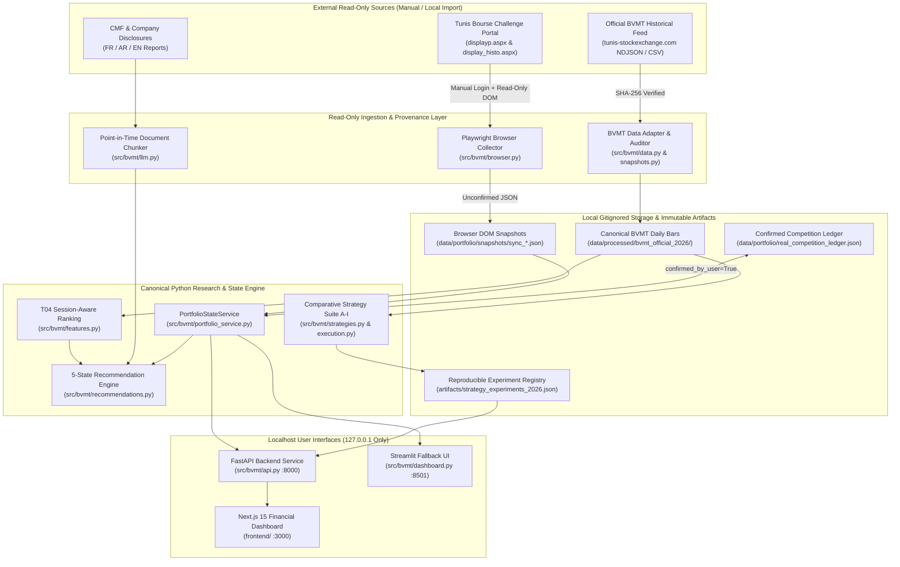
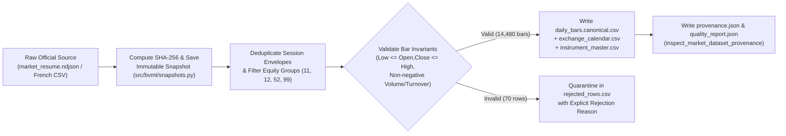
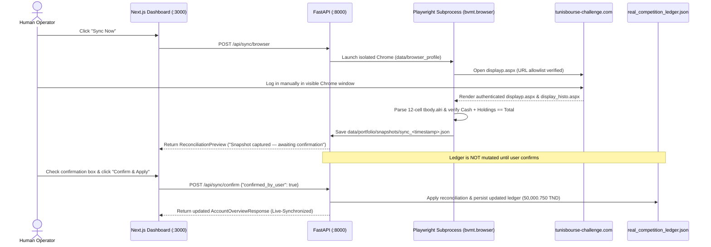
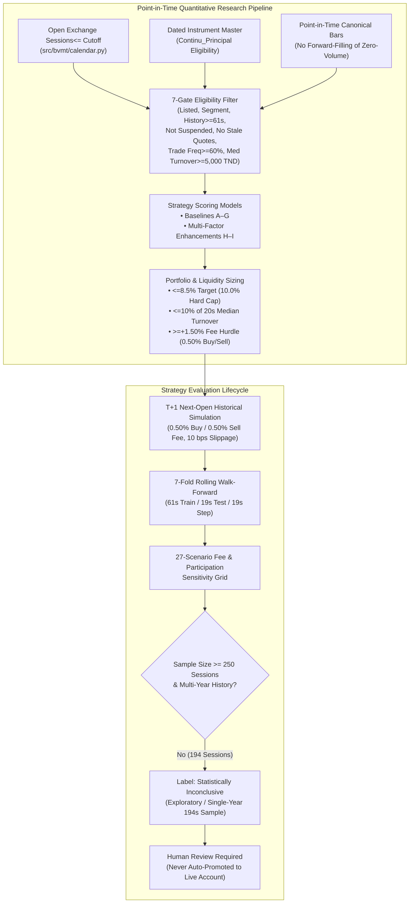
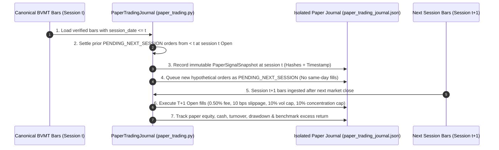
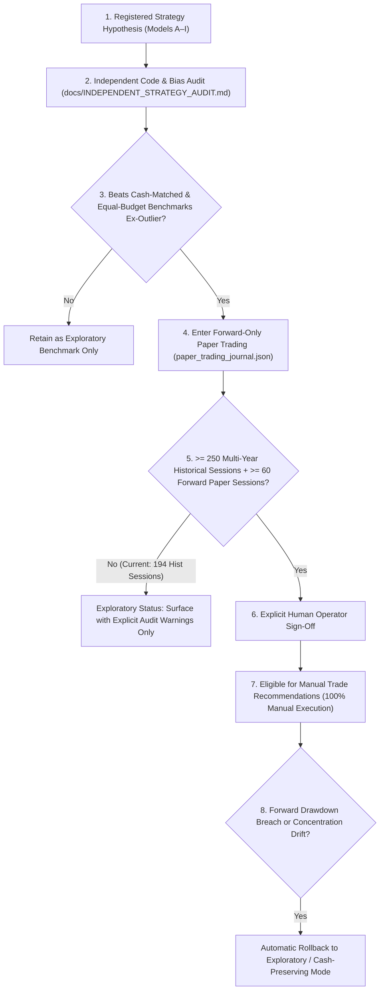
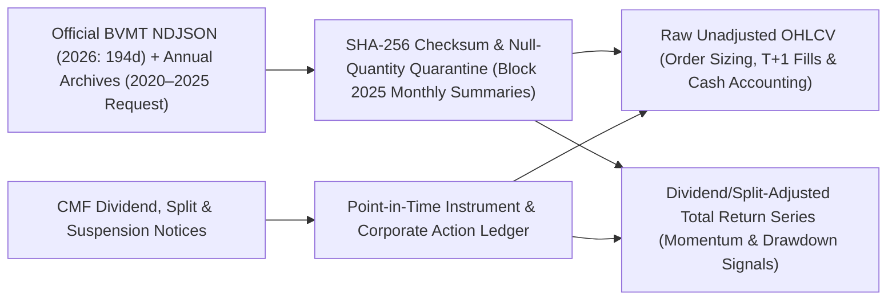
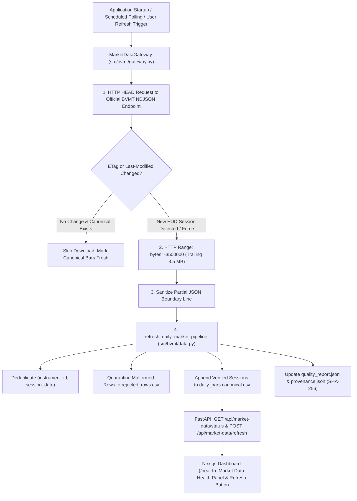

# BVMT Trading Intelligence — Quantitative Research & Decision-Support Platform

**BVMT Trading Intelligence** is an offline-first, human-supervised quantitative equity research, portfolio reconciliation, and decision-support platform designed for the **Tunis Bourse Challenge** (`https://www.tunisbourse-challenge.com`) and the **Bourse des Valeurs Mobilières de Tunis (BVMT)**.

> [!IMPORTANT]
> **100% Manual Execution & Zero Autonomous Trading:** This platform is a research and portfolio audit system—**never** an autonomous trading bot. All competition orders are placed manually by the human operator on `tunisbourse-challenge.com`. Trading paths (`bysell.aspx`, `acheter`, `vendre`, `cancel`) are hard-blocked at the URL validation layer.

---

## 1. Project Objectives & Tunis Bourse Challenge Context

The **Tunis Bourse Challenge** (`2026-10-01` to `2027-05-31`) is an educational virtual trading competition operating on listed Tunisian equities (`50,000.000 TND` initial virtual capital). Real-world research on BVMT equities requires accounting for structural market characteristics that invalidate naive textbook backtests:

1. **High Round-Trip Friction (`~1.00%`):** The competition charges **`0.50%` (`50 bps`)** on executed purchases and **`0.50%` (`50 bps`)** on executed sales. Over-trading rapidly erodes capital.
2. **Strict Concentration Limits (`10.0%` Cap):** No single equity position may exceed **`10.0%`** of total portfolio value (`8.5%` target allocation buffer enforced by the recommendation engine).
3. **Episodic Liquidity & Zero-Volume Sessions:** Many Tunisian stocks experience untraded (`no_trade` / zero-volume) sessions or thin order books. Orders placed on zero-volume bars remain `PENDING` and expire after 1 week.
4. **Session-Bounded Execution (`09:00–14:15 Africa/Tunis`):** Orders outside the matching window route to the next open session.

---

## 2. Implemented Features

- **Modern 8-Page Next.js 15 + FastAPI Financial Terminal (`frontend/`, `src/bvmt/api.py`):**
  - **Overview (`/`):** Dual valuation audit comparing **Website-Reported Competition Account Values (`displayp.aspx`)** (`50,000.750 TND` total equity, `49,608.050 TND` cash, `392.700 TND` `BH BANK` market value, `+0.750 TND` unrealized P&L, rank `#118 / 14,530`) against **Locally Recalculated BVMT Mark-to-Market Valuation**.
  - **Portfolio (`/portfolio`):** One-click read-only browser synchronization, confirmation-gated reconciliation preview, capital allocation chart, and immutable snapshot history.
  - **Transactions & Orders (`/transactions`):** Executed transaction history (`display_histo.aspx` movements + local fills) and open/pending order tracking.
  - **Market Explorer (`/market`):** Official BVMT dataset provenance (`194` sessions through `2026-11-06`, `76` stocks, `14,480` bars), point-in-time momentum/liquidity rankings, and 7-gate eligibility diagnostics.
  - **Trade Planner (`/planner`):** Deterministic position-sizing engine, interactive limit order calculator, pending order cash reservation accounting, 10% competition concentration cap (8.5% target), 0.50% purchase + 0.50% sale fee break-even modeling, candidate categorization (`MANUAL_ORDER_PLAN`, `PAPER_TRADE_CANDIDATE`, `RESEARCH_CANDIDATE`), and holding-period horizon optimization.
  - **Stock Research (`/research`):** Point-in-time French/Arabic/English financial disclosure search (BM25 + vector sidecar) and verbatim-quote-verified corporate event catalysts.
  - **Strategy Lab (`/strategy`):** Comparative evaluation of **Baselines A–G** and **Multi-Factor Enhancements H–I**, 7-fold rolling walk-forward validation, equity/drawdown curves, fee/liquidity sensitivity grids, and explicit statistical conclusiveness disclosures.
  - **System Health (`/health`):** Official BVMT market data gateway status, competition rule blocker audit (`configs/competition.json`), Alibaba Cloud Model Studio free-quota/offline lock status, and deduplicated local alert center.
- **Deterministic Position Sizing Engine (`src/bvmt/position_sizing.py`):** Enforces minimum capacity across effective cash (net of pending orders), concentration (10% hard cap, 8.5% target), executable liquidity (10% median daily volume), and risk budget thresholds.
- **Holding-Period Research & Horizon Optimization (`src/bvmt/holding_period.py`):** Multi-horizon evaluation across 1, 5, 10, 19, 20, and 40 sessions proving that day trading (1 session) incurs a catastrophic 16.8% fee drag (`8,414 TND`), while a 19–20 session monthly review horizon achieves the optimal net efficiency (+17.05% return, 4.4%–5.4% max drawdown, < 2.4% fee friction).
- **Streamlit Fallback Interface (`src/bvmt/dashboard.py`):** Available at any time via `.\start_bvmt.bat --streamlit` or `uv run bvmt dashboard`.
- **Read-Only Playwright Portfolio & Movements Collector (`src/bvmt/browser.py`):** Launches an isolated Chrome profile (`data/browser_profile`), waits for manual login on `displayp.aspx`, extracts the 12-cell `tbody.alri` holdings table and `display_histo.aspx` movements, validates `Cash + Holdings == Total`, and requires explicit user confirmation (`confirmed_by_user=True`) before updating `data/portfolio/real_competition_ledger.json`.

---

## 3. Technology Stack

| Layer | Technologies |
| :--- | :--- |
| **Core Research & Domain Engine** | Python `3.12` / `3.13`, `Decimal` exact arithmetic, `zoneinfo` (`Africa/Tunis`), `duckdb`, `pandas`, `pyarrow` |
| **Local API Service** | `FastAPI 0.162+`, `Pydantic v2`, `Uvicorn` (`127.0.0.1:8000` only, strict localhost CORS) |
| **Primary Web Interface** | `Next.js 15` (App Router), `TypeScript 5.7`, `Tailwind CSS`, `shadcn/ui` primitives, `Recharts`, `Lucide` icons (`127.0.0.1:3000`) |
| **Fallback Web Interface** | `Streamlit 1.66+` (`127.0.0.1:8501`) |
| **Authenticated Collector** | `Playwright` (isolated persistent Chrome context, read-only URL allowlist) |
| **Quality & Verification** | `pytest` (`346+` tests), `ruff`, `mypy --strict`, `uv` lockfile |

---

## 4. System Architecture Diagram



---

## 5. Data Ingestion & Provenance Diagram



---

## 6. Browser Synchronization & Reconciliation Flow



---

## 7. Quantitative Research Pipeline & Strategy Evaluation Lifecycle



---

## 8. Daily Decision-Support Workflow (10-Step Manual Loop)

Every trading day follows a strict 10-step human-supervised workflow:

1. **Refresh Official Market Data:** Import the latest BVMT quotation file via `uv run bvmt refresh-market-data --source <path> --format tunis_stockexchange_ndjson`.
2. **Check Freshness & Quality:** Verify on **Overview** or **Market Explorer** that `Latest Market Session` matches the most recent BVMT session (`0 sessions behind`) and inspect `quality_report.json`.
3. **Sync the Competition Portfolio:** Click **Sync Now** on the **Portfolio** page (or run `uv run bvmt browser-sync`) and log in manually to `tunisbourse-challenge.com`.
4. **Reconcile Holdings & Cash:** Review the `"Snapshot captured — awaiting confirmation"` banner, verify `Cash + Holdings == Total` (`reconciliation_gap_tnd == 0.000`), and click **Confirm & Apply Synchronized Snapshot**.
5. **Generate Eligible-Stock Research Rankings:** Open **Market Explorer** (`/market`) to inspect the 7-gate point-in-time rankings across all 76 listed equities.
6. **Review Fundamental & Event Evidence:** Open **Stock Research** (`/research`) to check point-in-time CMF/company disclosures and verbatim-quote-verified corporate catalysts.
7. **Apply Portfolio & Execution Constraints:** Verify that any candidate respects the `10.0%` competition concentration cap (`8.5%` target), `10%` median turnover participation cap, and `+1.50%` 20-session momentum fee hurdle.
8. **Present Explainable Research Candidates:** Review the 5-state decision cards (`BUY CANDIDATE`, `HOLD`, `REDUCE`, `SELL CANDIDATE`, `NO TRADE`) along with explicit blocked reasons and liquidity warnings.
9. **Manually Place Orders (If Desired):** If you decide to act on a candidate, log in to `https://www.tunisbourse-challenge.com` yourself during `09:00–14:15 Africa/Tunis` and submit the order manually.
10. **Record Executions & Evaluate Outcomes:** Re-run **Sync Now** after order matching (or log the order in the manual journal) to reconcile fills, fees paid, and realized/unrealized P&L.

---

## 9. Repository Structure & Documentation Map

```text
bvmt-starter-kit/
├── configs/
│   ├── competition.json               # Official competition rules & unverified field blockers
│   ├── research.json                  # Conservative simulation assumptions
│   └── llm_budget.example.json        # Offline-locked Alibaba Model Studio free-tier config
├── docs/
│   ├── CURRENT_RESEARCH_AUDIT.md      # Phase 0 code-level audit of implemented vs planned research
│   ├── STRATEGY_RESEARCH.md           # Quantitative factor design & Tunisian market microstructure
│   ├── MODEL_CATALOG.md               # Mathematical catalog of Models A through I + ML gate
│   ├── BACKTEST_METHODOLOGY.md        # T+1 fill model, fee accounting, walk-forward & bias prevention
│   ├── EXPERIMENT_REGISTRY.md         # Reproducible 2026 baseline & enhancement experiment results
│   ├── RESEARCH_ROADMAP.md            # Prioritized multi-year data & modeling roadmap
│   ├── CANONICAL_DATA_SOURCE_RULES.md # Deterministic ledger & dataset resolution rules
│   └── STATE.md                       # Current engineering checkpoint & verification log
├── frontend/                          # Next.js 15 + TypeScript + Tailwind + Recharts UI (:3000)
│   └── src/app/                       # 7 App Router pages (/, /portfolio, /transactions, /market, /research, /strategy, /health)
├── src/bvmt/
│   ├── api.py                         # FastAPI localhost service (:8000)
│   ├── portfolio_service.py           # Canonical PortfolioStateService
│   ├── browser.py                     # Read-only Playwright collector (displayp.aspx & display_histo.aspx)
│   ├── data.py                        # Canonical/French/NDJSON parsers & provenance inspector
│   ├── calendar.py                    # Dated instrument master & Africa/Tunis exchange sessions
│   ├── features.py                    # T04 session-aware ranking & 7-gate eligibility filter
│   ├── strategies.py                  # Baselines A–G, Multi-Factor Enhancements H–I & evaluator
│   ├── execution.py                   # T+1 backtesting, walk-forward & sensitivity engine
│   ├── recommendations.py             # 5-state portfolio-aware recommendation generator
│   ├── ledger.py                      # Decimal portfolio, order lifecycle & reconciliation ledger
│   ├── dashboard.py                   # Streamlit fallback interface (:8501)
│   └── cli.py                         # Unified CLI entrypoint (`bvmt`)
├── tests/                             # 252+ unit, integration, backtest, browser & API tests
└── start_bvmt.bat                     # Windows one-click launcher (FastAPI + Next.js, or --streamlit)
```

---

## 10. Windows Setup, Launch & Testing Instructions

### First-Time Setup (Windows PowerShell)
```powershell
# 1. Sync locked Python environment (including FastAPI, Streamlit, Playwright, and dev tools)
uv sync --locked --group dev --extra dashboard --extra data --extra research

# 2. Install frontend Node.js dependencies
cd frontend
npm.cmd install
cd ..
```

### Launching the Platform
- **Option A — One-Click Windows Launcher (Recommended: FastAPI + Next.js):**
  ```cmd
  .\start_bvmt.bat
  ```
  Opens the FastAPI backend at `http://127.0.0.1:8000` and the Next.js dashboard at **`http://127.0.0.1:3000`**.
- **Option B — Streamlit Fallback Interface:**
  ```cmd
  .\start_bvmt.bat --streamlit
  ```
  Opens the Streamlit fallback interface at **`http://127.0.0.1:8501`**.

### Running Quality Gates & Automated Tests
```powershell
# Full Python quality gate (ruff format, ruff check, mypy --strict, skill validation, pytest)
uv run --no-sync python scripts/check.py

# Frontend TypeScript & production build check
cd frontend
npm.cmd run typecheck
npm.cmd run build
```

---

## 11. Security, Limitations & Research Roadmap

- **Strict Localhost & Privacy Boundaries:** Both FastAPI (`127.0.0.1:8000`) and Next.js (`127.0.0.1:3000`) bind exclusively to localhost. Private portfolio snapshots (`data/portfolio/`) and browser profiles (`data/browser_profile/`) are gitignored and never transmitted externally.
- **Current Statistical Limitation (`194` Sessions):** The verified official 2026 BVMT archive contains `194` daily trading sessions (`2026-01-02` to `2026-11-06`). Because `194 < 250` sessions (and `2020–2025` daily bars are not present in the public NDJSON feed), all backtest and walk-forward results are explicitly labeled **`is_statistically_conclusive: False`**.
- **Further Reading:**
  - [Independent Strategy Robustness Audit (Milestone 5)](docs/INDEPENDENT_STRATEGY_AUDIT.md)
  - [Current Research Engine Audit](docs/CURRENT_RESEARCH_AUDIT.md)
  - [Strategy Research & Factor Design](docs/STRATEGY_RESEARCH.md)
  - [Mathematical Model Catalog (Models A–I)](docs/MODEL_CATALOG.md)
  - [Backtesting, Risk Normalization & Forward Paper-Trading Methodology](docs/BACKTEST_METHODOLOGY.md)
  - [Experiment Registry (2026 Comparative & Risk-Normalized Suite)](docs/EXPERIMENT_REGISTRY.md)
  - [Research Roadmap & Promotion Governance](docs/RESEARCH_ROADMAP.md)

---

## 12. Milestone 5: Strategy Robustness, Risk Normalization & Forward Paper-Trading Governance

Before trusting any historical backtest return for manual trading decisions, Milestone 5 subjects all 9 registered strategies (`A` through `I`) to an **Independent Strategy Audit** ([`docs/INDEPENDENT_STRATEGY_AUDIT.md`](docs/INDEPENDENT_STRATEGY_AUDIT.md)), **Exposure-Normalized & Outlier-Adjusted Re-Evaluation**, and **Forward-Only Paper Trading** ([`src/bvmt/paper_trading.py`](src/bvmt/paper_trading.py)).

### 12.1 Key Audit Findings on Model G (`G_LIQUIDITY_FILTERED_MOMENTUM`)
1. **Low Headline Drawdown (`4.98%`) Is Primarily Driven by Low Capital Utilization (`29.79%` Active)**:
   - Under the 5-slot (`8.5%` target sleeve) configuration, Model G invests only `29.79%` of capital during the 134 post-warmup sessions (`20.57%` across all 194 sessions), holding ~70% cash. Normalized by active exposure, its invested sleeve drawdown is **`16.73%`** ($4.984\% / 0.2979$), nearly matching Buy-and-Hold `C` (`17.40%`) and Equal-Weight `B` (`18.33%`).
2. **Equal-Budget (`10-Slot`) & Exposure-Normalized Winner Is Model I (`I_REGIME_FILTERED_QUALITY_MOMENTUM`)**:
   - When all strategies are normalized by active capital utilization (`exposure_normalized_return_pct`) or re-simulated at an equalized **10-slot (`9.5%` target) capital budget**, **`I_REGIME_FILTERED_QUALITY_MOMENTUM`** ranks #1 with **`+63.85%` exposure-normalized return** and **`+28.8225%` 10-slot net return (`10.30%` max drawdown)** vs. Model G's `+63.15%` exposure-normalized return and `+25.3667%` 10-slot return (`10.92%` max drawdown).
3. **Single-Stock Outlier Sensitivity (`SOTETEL`)**:
   - A single `+202.29%` winner (`SOTETEL`, `+12,097.78 TND` net gain) contributed ~60% of Model G's headline `+18.8117%` return. Removing `SOTETEL` from the universe reduces Model G's 5-slot return to **`+7.4320%`** (still #1 among `D`–`I` and `+2.97%` above cash-matched Benchmark B's `+4.46%`).
4. **Mathematical Equivalence of `D_MOMENTUM_20S` and `F_RELATIVE_STRENGTH_20S`**:
   - Because cross-sectional mean return $\bar{M}_{20}(t)$ is constant across all stocks on session $t$, $RS_{i,20}(t) = M_{i,20}(t) - \bar{M}_{20}(t)$ preserves exact rank order whenever at least 5 eligible stocks beat the mean (`+17.0506%` identical return).

### 12.2 Signal Generation & Time-of-Information Controls

```mermaid
flowchart LR
    subgraph PIT["Point-in-Time Cutoff (Session t Close)"]
        Bars["Verified Daily Bars (bar_date <= t)"]
        Master["Instrument Master (Principal Groups 11/12)"]
        Cal["Exchange Calendar (closes_at <= cutoff_t)"]
    end

    subgraph Filter["7-Gate Eligibility & Factor Engine"]
        Elig["61-Session History, Zero Suspensions, Traded Anchors"]
        Liq["Liquidity Gate (Freq >= 60%, Turnover >= 5,000 TND)"]
        Score["Frozen Formula A–I (Zero Future Bars Accessible)"]
    end

    subgraph Queue["Immutable Forward Signal Record"]
        Hash["Cryptographic Hashes (config_hash + data_hash + code_sha256)"]
        Orders["Intended Orders Queued as PENDING_NEXT_SESSION"]
    end

    PIT --> Filter --> Queue
```



### 12.3 Forward Paper-Trading Lifecycle



### 12.4 Strategy Promotion & Rollback Governance



### 12.5 Historical Data Provenance & Corporate-Action Adjustment Workflow



### 12.6 How a Strategy Becomes Eligible for Actual Manual Trading Recommendations
A strategy is only eligible to drive primary manual trading recommendations when it satisfies **all five governance criteria**:
1. **Zero Lookahead & Independent Audit**: Verified in [`docs/INDEPENDENT_STRATEGY_AUDIT.md`](docs/INDEPENDENT_STRATEGY_AUDIT.md) with strict `bar_date <= decision_date` enforcement.
2. **Exposure-Normalized & Outlier-Adjusted Positive Alpha**: Positive excess return versus `B_EQUAL_WEIGHT_ELIGIBLE` and `C_BUY_AND_HOLD_BENCHMARK` on both cash-matched and 10-slot equal-budget bases, and positive return when excluding the single largest winner (`ex-SOTETEL`).
3. **Continuous Concentration Compliance**: Daily monitoring that triggers a `REDUCE` recommendation whenever any position drifts above `9.5%` toward the `10.0%` competition ceiling.
4. **Forward Paper-Trading Track Record**: Verified forward-only paper-trading execution in `data/portfolio/paper_trading_journal.json` alongside multi-year historical data (`>= 250` sessions).
5. **Explicit Human Approval**: Every recommendation remains a read-only decision-support card; the human competitor manually reviews and places orders on the Tunis Bourse Challenge website.

---

## 13. Milestone 6: Automated Market Data Gateway

Milestone 6 eliminates manual daily market data imports by establishing a pluggable, legally permitted, range-queryable market data gateway (`src/bvmt/gateway.py`), fully documented in [`docs/MARKET_DATA_PROVIDERS.md`](docs/MARKET_DATA_PROVIDERS.md).

### 13.1 Architecture & Pluggable Providers



### 13.2 Core Capabilities & Safety Guarantees

1. **Lightweight Range-Query Tail Ingestion**: Instead of re-downloading the ~222 MB cumulative NDJSON archive daily, the gateway sends an HTTP `HEAD` request to inspect `ETag` and `Last-Modified`. If updated, it requests only the trailing ~3.5 MB (`Range: bytes=-3500000`), ingesting only new session envelopes.
2. **Pluggable Provider Adapters**:
   - `OfficialBvmtNdjsonProvider`: Primary automated EOD settlement provider via official Bourse de Tunis portal.
   - `OanorMarketDataProvider`: Optional secondary delayed quote adapter with free-tier hard caps (7k req/mo, 2 req/s) and offline-locked safety.
   - `LocalArchiveProvider`: 100% offline historical replay provider for testing and air-gapped CI environments.
3. **Strict Account Isolation**: The market data gateway writes strictly to `data/staging/` and `data/processed/`. It has **zero write access** to `data/portfolio/real_competition_ledger.json` and cannot alter portfolio cash, holdings, or trade histories.
4. **Calendar & Holiday Awareness**: Automatically pauses polling on weekends (`WEEKEND_CLOSED`) and verified exchange holidays using `src/bvmt/calendar.py`.
5. **CLI & API Integration**:
   - CLI: `uv run bvmt market-status` and `uv run bvmt market-refresh [--force]`
   - API: `GET /api/market-data/status` and `POST /api/market-data/refresh`
   - UI: Interactive Market Data Health panel on Next.js `/health` page with live status badges and manual refresh trigger.

---

## 14. P1 UX Redesign, Financial Indicator Glossary & Explainability System

To transform the interface from a dense, developer-oriented tool into an accessible, human-understandable financial decision-support terminal, the frontend and explainability architecture were upgraded in Milestone P1:

### 14.1 Visual Design System & Theming
- **Light Theme by Default:** Warm off-white background (`#f8f9fa`), crisp dark-charcoal typography (`#1e293b`), muted teal/blue accent, and restrained financial badges (`emerald` profit, `amber` caution, `rose` blocker).
- **Soft-Dark Theme Option:** One-click toggle in the header/sidebar smoothly activates an eye-friendly dark palette (`#090d16`), persisted across browser sessions in `localStorage` (`bvmt-theme`) with anti-FOUC script injection in `<head>`.
- **WCAG-Accessible Contrast:** Minimum 14px readable table cells, generous component padding, clear border separations, and adaptive high-contrast styling across all data tables (Strategy Lab, Market Explorer, and Portfolio Ledgers).
- **Responsive Layout:** Desktop sidebar collapses cleanly into a mobile hamburger menu on viewports `< 768px`, ensuring data cards and tables retain full screen width without horizontal squeezing.

### 14.2 Redesigned Market Explorer (`/market`)
- **Executive Summary KPI Cards:** Total Listed Instruments (`76`), Eligible Stocks (`37`), Needs Human Review (`29`), and Strictest Blocker (`61-session warm-up / no trades`).
- **Plain-Language Market Introduction:** Explains eligibility rules and decision thresholds in direct financial prose.
- **4 Status Filter Tabs:** Instant switching between `All (76)`, `Eligible (37)`, `Needs Review (29)`, and `Excluded (39)`.
- **Simplified 6-Column Core Table:** Focuses on essential decision inputs: Ticker / Name, Sector & Group, Latest Price, 20-Session Momentum, Status Badge, and Action.
- **Toggleable Advanced Metrics:** Expands to 11 columns on demand, revealing 60-Session Momentum, Relative Strength vs. Market, Volatility, Median Daily Turnover, and Composite Research Score.
- **Client-Side Pagination:** Ergonomic 12 stocks/page pagination with quick jump controls.
- **Per-Stock Details Drawer:** Expandable inline drawer displaying a 6-metric card grid and structured blocker explanations (severity, plain diagnosis, and recommended operator action).

### 14.3 Domain-Grounded Metric Glossary & `MetricHelp` Component
- **Machine-Readable Glossary (`src/bvmt/glossary.py`, `GET /api/glossary`):**
  - Defines 21 core quantitative metrics across 6 categories (Prices, Momentum, Risk/Volatility, Microstructure, Valuation/Portfolio, and Operational/Data).
  - Categorizes 13 eligibility blocker codes with plain-language explanations and recommended operational actions.
  - Implements exact mathematical formulas matching underlying Python implementations in `features.py`, `execution.py`, `recommendations.py`, `gateway.py`, and `ledger.py`.
- **Accessible `MetricHelp` Popover:**
  - Placed alongside table headers, KPI cards, and strategy matrices.
  - Activates on keyboard focus (`Tab` / `Enter`), mouse hover, and mobile touch.
  - Displays indicator definition, formula code block, interpretation guidance, and prominent amber limitations/caveats box.

---

## 15. Research Coverage Recovery & Sparse-Data Analytics (P0)

### 15.1 Separation of Research Coverage from Strategy Eligibility
Market Explorer decouples quantitative equity research from active competition execution rules across six independent architectural dimensions:
- **`research_coverage_status`**: `FULL_COVERAGE`, `PARTIAL_HISTORY`, `SPARSE_DATA`, `UNTRADED_HISTORY`, `MISSING_DATA`
- **`signal_availability`**: `CONTINUOUS_SIGNALS`, `SPARSE_OBSERVED_SIGNALS`, `BENCHMARK_ONLY`, `NO_SIGNALS`
- **`data_quality_status`**: `VERIFIED_EOD`, `MISSING_SESSIONS`, `SPARSE_VOLUME`, `STALE_QUOTES`, `UNTRADED_ANCHOR`, `RESTRICTED_SEGMENT`, `NO_DATA`
- **`competition_eligibility`**: `ELIGIBLE`, `MARKET_RESTRICTED`, `UNLISTED`
- **`strategy_eligibility`**: `ELIGIBLE`, `EXCLUDED`
- **`execution_feasibility`**: `CONTINUOUS_LIQUID`, `FIXING_ONLY`, `HIGH_SLIPPAGE`, `UNTRADED_CURRENT`

### 15.2 Sparse-Data Analytics Engine (`src/bvmt/research_coverage.py`)
- **Preserved Traded Prices**: Excluded stocks preserve their genuine last verified traded price and date; missing prices display as **`Unavailable`** (never `0.000 TND`) and missing momentum as **`N/A`** (never `0.00%`).
- **Quote Age & Observed-Trade Returns**: Thinly traded stocks report observed-trade return ($\frac{P_t - P_{t-k}}{P_{t-k}}$) over actual traded intervals without forward-filling zero-volume bars.
- **Continuous Research Score**: Liquidity-scaled ranking combining calendar return, 20-session turnover factor, trading frequency, and observation coverage.
- **Conservative Hypothetical Order Capacity (Zero Volume Lookahead)**: Sized strictly using pre-session information ($t \le \text{cutoff}$), capping order capacity at $\min(0.10 \times \text{Turnover}_{20s}, 0.085 \times \text{Equity})$ with zero next-day volume lookahead.
- **7-Tab Explorer Navigation**: Filter equities by `All (76)`, `Strategy Eligible (40)`, `Research Ready (50)`, `Partial Data (12)`, `Illiquid / Stale (14)`, `Restricted (12)`, and `Missing Data (0)`.
- **Dedicated Endpoint**: `GET /api/market-research` exposes complete sparse analytics and classification matrices across all 76 listed instruments.

---

## 16. Monday Operational Sprint: Trade Planning, Deterministic Sizing & Horizon Optimization

In preparation for the Monday, November 9, 2026 BVMT session (09:00–14:15 Africa/Tunis), the platform was expanded to bridge the gap between quantitative ranking models and human manual execution on `https://www.tunisbourse-challenge.com`.

### 16.1 Deterministic Position Sizing Architecture (`src/bvmt/position_sizing.py`)
Every proposed order is sized strictly according to the minimum capacity across four independent constraints:
1. **Effective Purchasing Cash:** Deducts cash committed to open, pending buy orders (with fees) to prevent over-allocation.
2. **Competition Concentration Cap:** 10.0% hard limit of total equity, targeting an 8.5% safety buffer.
3. **Executable Liquidity Cap:** Strictly limited to 10% of 20-session median daily volume to avoid unexecutable orders on thin books.
4. **Complete Cost Modeling:** Full accounting of 0.50% purchase fee, 0.50% sale fee (1.00% round-trip friction), and exact break-even price calculation ($P_{\text{limit}} \times 1.005 / 0.995$).
- Full documentation: [`docs/POSITION_SIZING.md`](docs/POSITION_SIZING.md)

### 16.2 Trade Planning Engine & Next.js Interface (`src/bvmt/trade_planner.py` & `/planner`)
- Structures every research candidate into an actionable manual trade plan.
- Categorizes all 76 listed instruments into:
  - `MANUAL_ORDER_PLAN`: Actionable candidate with exact limit price, suggested share quantity, fee outlay, and pre-calculated exit conditions.
  - `PAPER_TRADE_CANDIDATE`: Valid signal but blocked by cash or concentration constraints; logged for forward paper-trading.
  - `RESEARCH_CANDIDATE`: Monitoring list for future liquidity expansion.
- Full workflow guide: [`docs/TRADE_PLANNING_GUIDE.md`](docs/TRADE_PLANNING_GUIDE.md)

### 16.3 Empirical Holding-Period Research (`src/bvmt/holding_period.py`)
Multi-horizon backtesting across 194 sessions of 2026 BVMT data revealed critical structural insights:
- **Day Trading (1 session) is unviable:** Generates **`8,414.45 TND` in fees (16.8% of capital)**, destroying returns.
- **Monthly Review (19–20 sessions) is optimal:** Reduces fee drag to `< 2.4%` (`1,192.79 TND`), generates `+17.05%` net return, and compresses max drawdown to `4.4%–5.4%`.
- **Outlier Sensitivity Disclosed:** `SOTETEL` accounts for `70.5%–88.9%` of total strategy gains, leading to an **`INCONCLUSIVE`** statistical classification due to sample size.
- Full research report: [`docs/HOLDING_PERIOD_RESEARCH.md`](docs/HOLDING_PERIOD_RESEARCH.md)

### 16.4 Operational Runbook
- Complete step-by-step user instructions for pre-opening, continuous matching, and post-session reconciliation: [`docs/MONDAY_2026_11_09_OPERATIONS.md`](docs/MONDAY_2026_11_09_OPERATIONS.md)


