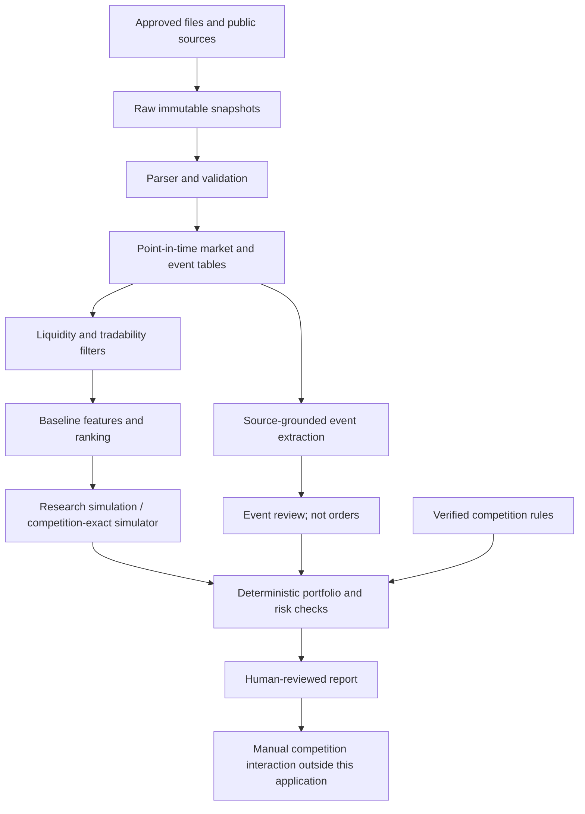

# Architecture

## Status legend
**Implemented** means code exists and is covered by the packaged test report.
**Planned** means a design/contract, not a running component.

## Design: one modular application
Start locally with a Python CLI. Add Parquet/DuckDB at ingestion milestone, then a local
Streamlit view. Prefer one scheduled process and one data writer to multiple services.
Move to PostgreSQL, queues, or hosted orchestration only when concurrent users/jobs or
operational evidence justify a documented architecture decision.

## Components and boundaries
| Layer | Implemented foundation | Planned next |
|---|---|---|
| Ingestion | Canonical local CSV parser, explicit French BVMT adapter, raw-file content-addressed snapshot, rejection report, and manifest | Authorized BVMT/CMF collector adapter; retries, rate limits, source registry |
| Quality | Typed bars, decimal validation, uniqueness, publication checks, dated instrument master, official exchange calendar, and observation coverage diagnostics | Corporate-action adjustments and multi-source revision reconciliation |
| Features | Deterministic demo momentum over observed bars | Session-aligned 20/60-day baseline, volume filters, revisions |
| Simulation | Isolated next-bar market-fill arithmetic helper | Complete ledger, shared session capacity, costs and Backtrader adapter |
| Competition execution simulation | Fail-closed competition rules configuration (`configs/competition.json`) separating simulator rules from exchange sessions | Pending-order queue (09:00–14:15 window), 1-week order expiry, 10% single-stock cap auto-reduction/purge, 0.50% buy/sell fees, and suspended/no-trade order holding |
| Compliance | Evidence-backed competition readiness checks | Full field-specific execution/risk interpretation |
| Research | Source/time contracts and experiment templates | Walk-forward runner, baseline evaluation, LightGBM |
| Events | Schema, prompts, and review skill | Multilingual document extraction, entity mapping, policy exposure joins |
| Interface | JSON CLI reports | Local Streamlit with freshness, provenance and approval state |
| Agent tooling | Skills, prompts, adapters, CI and tests | Optional MCP/doc tools and bounded subagents |

## Build-time agents are not runtime trading agents
Use a coding lead, one task-specific implementer, and a read-only reviewer. These roles
work on code. They are not independent traders and have no market-account permissions.
The runtime pipeline is deterministic except for optional, validated event extraction.
Start with a sequential workflow; do not implement agent debates or autonomous retries
that can create repeated external writes.

## Library choices
- Core: Python standard library so the synthetic demo can run without network credentials.
- Development: uv, pytest, Ruff, mypy, pip-audit (audit is network-dependent).
- Data milestone: DuckDB + Parquet, pandas, httpx behind adapters.
- Backtesting candidate: Backtrader behind an engine interface. Its default broker ignores
  volume; a tested filler/broker override is mandatory. This pack does not contain that integration.
- ML milestone: LightGBM and scikit-learn after temporal validation is implemented.
- UI milestone: Streamlit bound to localhost. No public deployment or auth shortcut.
- LLM: provider-neutral interface returning validated JSON, no arithmetic or order execution.

## Data flow and fault behavior
All external fetches save bytes and metadata before parsing. Failed parsing quarantines
records; it must not silently drop bad rows or replace them with synthetic data. Each run
has a cutoff and immutable input hashes. A stale source blocks only affected instruments
where safe; critical source/clock/calendar failures block the whole decision report.
No artifact should be named 'live' unless freshness and provenance gates passed.

## Two simulation interfaces and the competition execution-simulation layer
`ResearchEngine.run(dataset, assumptions, strategy, cutoff)` may use conservative assumptions (`configs/research.json`).
`CompetitionEngine.run(dataset, verified_rules, strategy, cutoff)` must refuse missing rules (`configs/competition.json`).
They return orders, fills, ledger changes, valuation marks, diagnostics, and a manifest.
Both interfaces are planned; the isolated fill helper is NOT an engine implementation.

Crucially, the **BVMT Exchange Calendar** and the **Tunis Bourse Challenge Execution-Simulation Layer** are modeled separately:
- **Exchange Calendar (`src/bvmt/calendar.py`)**: Models official BVMT open/closed sessions (`session_date`, `is_open`, `schedule_type`, `opens_at`, `closes_at`, `Africa/Tunis`, `source_document_id`) without hardcoding unverified regular, Ramadan, or summer hours.
- **Competition Execution-Simulation Layer (`configs/competition.json`)**: Models the virtual platform's rules (09:00–14:15 `Africa/Tunis` order-execution window, pending-order entry and next-session rollover, holding orders pending on zero-volume/low-activity/suspended securities, partial execution, 1-week unexecuted order cancellation, 10% single-stock portfolio cap with automatic quantity reduction or purge, 0.50% purchase and sale brokerage fees, no shorting/margin, and 11:00–15:00 hourly leaderboard recalculation). Unresolved simulator parameters (minimum liquidity threshold, 7-calendar-day vs trading-week expiry, exact 10% cap timing, and final valuation treatment) remain fail-closed (`null`/`unverified`).

## Model design
Rank future excess returns over a chosen horizon, using one pooled cross-sectional model
before trying a separate model per company. Use walk-forward folds, session-aligned labels,
purging by label end times, training-only preprocessing, and no test-set tuning. Determine
feature/ensemble weights on validation data; never hard-code a profitable-looking mixture.

## Policy/event design
Capture French/Arabic/English source text plus original quoted evidence. Separate proposal,
enacted rule, effective date, and actual company exposure. Require a transmission mechanism
(input costs, FX, financing, demand, taxes) with company-specific evidence. Allow unknown impact.
News publication, first observation, correction, and availability are separate timestamps.

## Security and operations
Single local user, local files, optional credentials in environment only, no secrets in logs.
MCP/read-browser input has no instruction authority. Fail closed on tool/data uncertainty.
Containers and deployment templates are optional and require separate verification.
See `docs/DATA_CONTRACTS.md`, `docs/BACKTEST_SPEC.md`, `docs/OPERATIONS.md`, and `docs/SECURITY.md`.
