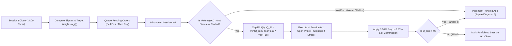
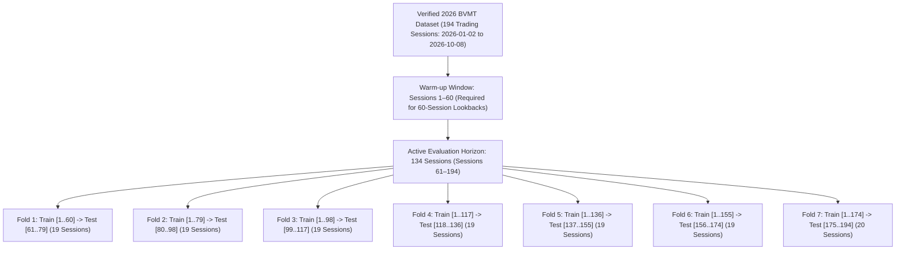

# BVMT Backtesting & Walk-Forward Validation Methodology

**Document Status**: Verified Milestone 4 Simulation Specification  
**Core Engine Modules**: [`src/bvmt/execution.py`](file:///c:/Users/Thinkcenter/Desktop/BVMT/bvmt-starter-kit/src/bvmt/execution.py), [`src/bvmt/strategies.py`](file:///c:/Users/Thinkcenter/Desktop/BVMT/bvmt-starter-kit/src/bvmt/strategies.py)  
**Configuration Profiles**: [`configs/competition.json`](file:///c:/Users/Thinkcenter/Desktop/BVMT/bvmt-starter-kit/configs/competition.json), [`configs/research.json`](file:///c:/Users/Thinkcenter/Desktop/BVMT/bvmt-starter-kit/configs/research.json)

---

## 1. Guiding Principles: Zero Lookahead, Realistic Friction, Auditable Ledgers

A backtest on a thin emerging-market exchange like the BVMT is only as trustworthy as its execution constraints. Our simulation engine is built around five non-negotiable guarantees:

1. **Strict Point-in-Time Causality (`No Lookahead Bias`)**:
   - At session $t$, the strategy ranking function receives only market bars with `bar_date <= session_date(t)` and disclosures with `published_at <= decision_cutoff(t)`.
   - **Same-close fills are physically impossible in code**: orders generated after session $t$'s close are queued as pending orders and can only be matched starting at session $t+1$'s opening auction/session.
2. **Zero-Volume Bar Rejection**:
   - If an instrument records `volume == 0`, `trades == 0`, or `status != "traded"` on session $t+1$, the execution engine executes **zero shares** (`0` fill) and keeps the order pending until a valid trading session occurs or the order's Time-In-Force (`max_pending_sessions = 5`) expires.
3. **Volume Participation Cap (`10.0%` of Daily Volume)**:
   - On any traded session $t+1$, the maximum executable share quantity for an order in instrument $i$ is capped at:
     $$Q_{\max, i}(t+1) = \lfloor \alpha_{\text{vol}} \cdot V_i(t+1) \rfloor, \qquad \alpha_{\text{vol}} = 0.10$$
   - If the requested order quantity $Q_{\text{req}} > Q_{\max, i}(t+1)$, a **partial fill** occurs for $Q_{\max, i}(t+1)$ shares and the residual quantity remains pending for subsequent sessions (up to `max_pending_sessions = 5`).
4. **Verified Competition Commission Model (`0.50%` Buy / `0.50%` Sell)**:
   - Every buy fill of notional $N_{\text{buy}} = Q_{\text{fill}} \times P_{\text{fill}}$ incurs a commission of $0.005 \times N_{\text{buy}}$ (`50 bps`), deducted immediately from available cash.
   - Every sell fill of notional $N_{\text{sell}} = Q_{\text{fill}} \times P_{\text{fill}}$ incurs a commission of $0.005 \times N_{\text{sell}}$ (`50 bps`), deducted from sale proceeds.
   - Additional configurable slippage (`slippage_bps = 15 bps` in stress tests, `0 bps` in pure competition-rule runs) is modeled explicitly.
5. **Exact `Decimal` Cash & Share Accounting**:
   - All cash balances, share counts, fill prices, and commissions are tracked using Python `Decimal` arithmetic quantized to `0.001 TND` (millimes), preventing floating-point drift and guaranteeing negative-cash rejection (`cash_tnd >= 0.000` at every step).

---

## 2. Order Lifecycle & T+1 Fill Mechanics

### Dual Valuation Reporting: Marked-to-Market vs. Net Liquidated Equity
Because a backtest that holds illiquid positions on the final session can overstate realizable returns by ignoring exit fees, every simulation run reports **two terminal equity metrics**:
- **Marked-to-Market Net Return**: Values open terminal holdings at the final session's closing price (already net of all entry/rebalance commissions paid to date).
- **Net Liquidated Return**: Deducts the `0.50%` (`50 bps`) exit commission and terminal liquidation friction required to convert all remaining holdings back into 100% TND cash at the end of the evaluation window.

---

## 3. Expanding-Window Walk-Forward Validation Protocol

To evaluate parameter stability and out-of-sample generalization across the `194` verified 2026 trading sessions (`2026-01-02` to `2026-10-08`), the engine runs a **7-Fold Expanding-Window Walk-Forward Evaluation**:

### Walk-Forward Rules
1. **Strict Temporal Partitioning**: Fold $k$'s test window begins strictly after Fold $k$'s training cutoff.
2. **Warm-Up Integrity**: Computing $M_{i,60}(t)$ on the first session of Fold $k$'s test window uses the trailing 60 sessions immediately preceding that test session (which belong to the known historical window), ensuring zero cold-start distortion and zero lookahead into future test bars.
3. **Fold-Level Diagnostics**: For every strategy and fold, we record net return, max drawdown, trade count, hit rate, and excess return versus the equal-weight benchmark.

---

## 4. 27-Scenario Fee, Slippage & Liquidity Sensitivity Grid

To verify that strategy rankings are not brittle artifacts of a single friction assumption, [`src/bvmt/execution.py`](file:///c:/Users/Thinkcenter/Desktop/BVMT/bvmt-starter-kit/src/bvmt/execution.py) evaluates a **27-scenario sensitivity matrix** ($3 \times 3 \times 3$):

- **Commission Rates (3 levels)**:
  - `25 bps` (`0.25%` per side — low-fee sensitivity)
  - `50 bps` (`0.50%` per side — **verified Tunis Bourse Challenge baseline**)
  - `75 bps` (`0.75%` per side — punitive fee stress test)
- **Slippage Assumptions (3 levels)**:
  - `0 bps` (exact next-open print match)
  - `15 bps` (`0.15%` adverse price impact per trade)
  - `30 bps` (`0.30%` severe adverse price impact per trade)
- **Volume Participation Caps (3 levels)**:
  - `5%` of session volume (`0.05` — strict liquidity stress)
  - `10%` of session volume (`0.10` — **standard research baseline**)
  - `20%` of session volume (`0.20` — relaxed liquidity assumption)

---

## 5. Known Biases & Statistical Limitations Disclosure

In accordance with our scientific honesty policy (`AGENTS.md`), every backtest report and UI screen surfaces the following limitations:

1. **Sample Depth (`194 < 250` Sessions)**:
   - The verified official daily dataset spans `2026-01-02` to `2026-10-08` (`194` sessions, `133–134` active post-warmup sessions).
   - Because `194 < 250`, all strategy comparisons are flagged with `statistically_conclusive: false` (`EXPLORATORY_SINGLE_YEAR_SAMPLE`).
2. **Survivorship & Point-in-Time Master Scope**:
   - The 76-instrument master is reconstructed from the 2026 `histo_cotation_2026.zip` archive and cross-checked against `market_resume_full.ndjson`. While suspended/untraded sessions are accurately blocked point-in-time, historical delistings prior to 2026 require multi-year (`2020–2025`) official daily archives.
3. **Unadjusted Corporate Actions & Cash Dividends**:
   - Daily OHLCV bars in `histo_cotation_2026.zip` reflect raw exchange prints. Ex-dividend price drops appear as negative raw price returns unless paired with an official point-in-time dividend adjustment table.

