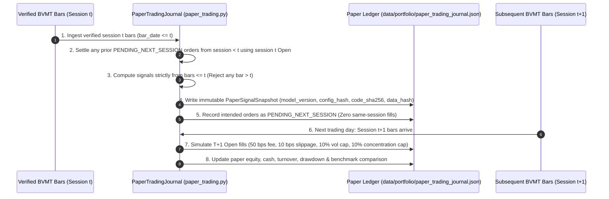

# BVMT Backtesting, Risk Normalization & Forward Paper-Trading Methodology

**Document Status**: Verified Milestone 5 Simulation & Forward-Validation Specification  
**Core Engine Modules**: [`src/bvmt/execution.py`](file:///c:/Users/Thinkcenter/Desktop/BVMT/bvmt-starter-kit/src/bvmt/execution.py), [`src/bvmt/strategies.py`](file:///c:/Users/Thinkcenter/Desktop/BVMT/bvmt-starter-kit/src/bvmt/strategies.py), [`src/bvmt/paper_trading.py`](file:///c:/Users/Thinkcenter/Desktop/BVMT/bvmt-starter-kit/src/bvmt/paper_trading.py)  
**Independent Audit Reference**: [`docs/INDEPENDENT_STRATEGY_AUDIT.md`](file:///c:/Users/Thinkcenter/Desktop/BVMT/bvmt-starter-kit/docs/INDEPENDENT_STRATEGY_AUDIT.md)

---

## 1. Historical Backtesting Mechanics & Identified Microstructure Constraints

Our historical simulation engine enforces five core execution constraints across all candidate strategies (`A` through `I`):

1. **Strict Point-in-Time Causality (`No Same-Close Fills`)**:
   - Signals computed from session $t$ closing prices can never execute on session $t$. Orders are queued for execution at session $t+1$'s opening price (`b.open`) plus `10 bps` adverse slippage (bounded within `[b.low, b.high]`).
2. **Zero-Volume Bar Rejection**:
   - Any session where `volume_shares == 0` or `status != "traded"` blocks execution completely (`0` shares filled).
3. **Daily Volume Participation Cap (`10.0%` of Share Volume)**:
   - Fills on session $t+1$ are capped at $\lfloor 0.10 \times \text{Volume}_i(t+1) \rfloor$.
   - **Disclosed Microstructure Limitation**: Because daily OHLCV archives only report full-session volume (`volume_shares` at 14:00 close) rather than opening-auction volume, capping `next_open` fills using `0.10 * volume_shares` relies on end-of-day volume knowledge. Furthermore, across the 11,920 traded bars in 2026, `32.90%` (`3,922` bars) have `open == close`, `25.11%` (`2,993` bars) have flat OHLC (`open == high == low == close`), and `21.37%` (`2,547` bars) trade fewer than `500` shares.
4. **Verified Competition Commission Model (`0.50%` Buy / `0.50%` Sell)**:
   - Every executed buy and sell fill deducts `50 bps` (`0.50%`) quantized to `0.001 TND` (`ROUND_HALF_UP`).
   - Terminal valuation reports both **Marked Net Return** and **Liquidated Net Return** (after deducting the `0.50%` exit fee on all terminal holdings).
5. **Purchase Concentration Cap (`10.0%`) vs. Continuous Drift Enforcement**:
   - Standard 19-session periodic rebalancing enforces the `10.0%` concentration cap at purchase time (`target_weight = 8.5%`), allowing appreciating winners to drift above `10.0%` between rebalances (`12.81%–14.70%` in 2026).
   - Milestone 5 adds a parallel **Continuous Daily Concentration Trim Simulation** (`continuous_concentration_trim_net_return_pct`), which checks holdings at every session close and schedules a next-open `sell` order back to `8.5%` whenever any position exceeds `10.0%`.

---

## 2. Exposure-Normalized & Cash-Adjusted Comparison Methodology

A central finding of the Milestone 5 audit is that raw portfolio returns across Strategies `A`–`I` cannot be compared without accounting for **capital utilization**:
- Under the default 5-slot (`8.5%` target sleeve) configuration, active strategies `D`–`I` invest only **`24.64%` to `31.47%` of capital during active post-warmup sessions** (`17.02%` to `21.74%` across all 194 sessions), holding `~70%` in cash.
- By contrast, `B_EQUAL_WEIGHT_ELIGIBLE` (`10` sleeves capped at `10%`) invests **`93.81%` of capital during active sessions** (`64.80%` overall), and `C_BUY_AND_HOLD_BENCHMARK` invests **`72.44%` during active sessions** (`50.04%` overall).

To eliminate cash-drag distortion, [`src/bvmt/strategies.py`](file:///c:/Users/Thinkcenter/Desktop/BVMT/bvmt-starter-kit/src/bvmt/strategies.py) computes four normalized comparison metrics for every strategy:

1. **Active Cash Utilization ($U_{\text{active}}$)**:
   $$U_{\text{active}} = \frac{1}{T - t_0} \sum_{t=t_0}^{T} \frac{\text{HoldingsValue}(t)}{\text{TotalEquity}(t)}$$
2. **Exposure-Normalized Return & Drawdown (Invested Sleeve Performance)**:
   $$R_{\text{norm}} = \frac{R_{\text{net}}}{U_{\text{active}}}, \qquad DD_{\text{norm}} = \frac{DD_{\max}}{U_{\text{active}}}$$
3. **Cash-Matched Benchmark Return ($R_{\text{bench}, B}^{\text{cash-matched}}$)**:
   Scales the Equal-Weight Eligible Benchmark (`B`) to match Strategy $s$'s exact active capital utilization (since TND cash earns `0.00%`):
   $$R_{\text{bench}, B}^{\text{cash-matched}}(s) = R_{\text{net}}(B) \cdot \frac{U_{\text{active}}(s)}{U_{\text{active}}(B)}$$
4. **Equal-Budget 10-Slot Re-Simulation (`top_k = 10`, `target_weight = 9.5%`)**:
   Re-simulates every strategy at a `95%` target gross capital budget (`10` slots $\times 9.5\%$) so active strategies deploy comparable capital to Benchmarks `B` and `C`.

---

## 3. Forward-Only Paper-Trading Lifecycle (`Phase 3`)

Because retrospective backtesting on a single year (`194` sessions) is vulnerable to specification selection bias and single-stock outliers (`SOTETEL`), Milestone 5 introduces a **Forward-Only Paper-Trading Journal** ([`src/bvmt/paper_trading.py`](file:///c:/Users/Thinkcenter/Desktop/BVMT/bvmt-starter-kit/src/bvmt/paper_trading.py)) persisted to `data/portfolio/paper_trading_journal.json` (strictly isolated from `real_competition_ledger.json`):

### Non-Negotiable Forward Paper-Trading Guarantees
- **No Historical Backfilling**: Recording a paper-trading signal at session $t$ creates `PENDING_NEXT_SESSION` orders that **cannot fill** until a bar with `session_date > t` is present in the canonical dataset.
- **Immutable Signal Audit Trail**: Every signal snapshot records `snapshot_id`, `strategy_id`, `model_version`, `config_hash`, `code_sha256`, `data_hash`, `signal_timestamp`, and `market_data_session_date`.
- **Complete Account Isolation**: Paper-trading state never touches `real_competition_ledger.json` and never submits orders to the Tunis Bourse Challenge website.
