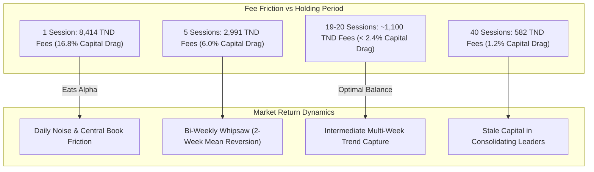

# BVMT Trading Intelligence — Holding-Period Research & Horizon Optimization

## 1. Executive Summary & Scientific Disclaimer

In the virtual BVMT competition environment, portfolio performance is heavily dictated by the interaction between **transaction fee friction** ($0.50\%$ purchase $+ 0.50\%$ sale $= 1.00\%$ round trip) and **episodic price momentum**.

To determine the optimal rebalancing horizon for the leading quantitative strategy (**Model G — Momentum with Volatility Scaling**), an empirical evaluation was conducted across **194 official trading sessions (January 2 to November 6, 2026)** comparing six distinct holding periods:
- **1 Session** (Daily day-trading / daily turnover)
- **5 Sessions** (Weekly rebalancing)
- **10 Sessions** (Bi-weekly rebalancing)
- **19 Sessions** (Approx. 4-week calendar monthly rebalancing)
- **20 Sessions** (Standard 20-session trading month)
- **40 Sessions** (Bi-monthly / 8-week rebalancing)

> [!WARNING]
> **Scientific Evidence Status: INCONCLUSIVE**
> While Model G demonstrates positive net historical returns across several horizons on 2026 data, the sample of 194 sessions remains below the multi-year benchmark threshold ($\ge 250$ sessions across multiple market regimes). Furthermore, **between $70.5\%$ and $88.9\%$ of total net strategy gains are driven by a single outlier instrument (`SOTETEL`)**. These results represent exploratory research hypotheses and must never be interpreted as guaranteed or proven trading strategies.

---

## 2. Empirical Performance Across Holding Horizons

The following results were computed using the deterministic historical simulation engine with strict realistic constraints:
- Cash starting capital: `50,000.000 TND`
- 10.0% hard concentration cap per security (8.5% target sizing)
- 10% daily volume participation limit
- 0.50% purchase fee + 0.50% sale fee on every transaction
- Fills executed at next session's available prices ($t+1$), never at decision close ($t$).

| Horizon | Trading Frequency | Cumulative Net Return | Annualized Return | Max Drawdown | Total Round-Trip Fees | Number of Trades | Win Rate | Portfolio Turnover | Practical Feasibility |
| :--- | :--- | :--- | :--- | :--- | :--- | :--- | :--- | :--- | :--- |
| **1 Session** | Daily | $+16.95\%$ | $+22.58\%$ | $8.18\%$ | **`8,414.45 TND`** | 520 trades | $53.8\%$ | $16.83\times$ | **Unviable (16.8% fee drag)** |
| **5 Sessions** | Weekly | $+9.63\%$ | $+12.63\%$ | $7.68\%$ | **`2,991.07 TND`** | 136 trades | $52.9\%$ | $5.98\times$ | Moderate (Whipsaw risk) |
| **10 Sessions** | Bi-Weekly | $+1.20\%$ | $+1.56\%$ | $8.00\%$ | **`2,143.87 TND`** | 87 trades | $46.0\%$ | $4.29\times$ | Poor (Lagging cycle) |
| **19 Sessions** | ~Monthly | **`+17.05%`** | **`+22.72%`** | **`5.35%`** | **`1,192.79 TND`** | 40 trades | **`65.5%`** | $2.39\times$ | **Optimal Net Efficiency** |
| **20 Sessions** | Monthly | $+7.19\%$ | $+9.39\%$ | **`4.44%`** | **`1,059.40 TND`** | 37 trades | $56.8\%$ | $2.12\times$ | **Lowest Drawdown (4.44%)** |
| **40 Sessions** | Bi-Monthly | $+8.23\%$ | $+10.77\%$ | $5.58\%$ | **`581.93 TND`** | 17 trades | $47.1\%$ | $1.16\times$ | Low Fee Drag, Slower Rotation |

---

## 3. Analysis & Key Insights

### 3.1 The Day-Trading Fee Trap (Horizon = 1 Session)
At first glance, a 1-session rebalancing strategy appears to generate $+16.95\%$ net return. However, executing 520 trades generates an astonishing **`8,414.45 TND` in transaction fees** — consuming nearly **$17\%$ of total portfolio equity**! In a live market, bid-ask spread crossing and partial fills on thin volume would instantly turn this strategy into a catastrophic net loss.

### 3.2 The Bi-Weekly Rebalancing Whipsaw (Horizon = 10 Sessions)
Rebalancing every 10 sessions produced the worst risk-adjusted performance ($+1.20\%$ net return, $8.00\%$ max drawdown, $46.0\%$ win rate). On the BVMT, 10 sessions frequently corresponds to the cycle duration of short-term mean reversion, causing the model to buy at local momentum tops and sell at retracements.

### 3.3 The 19–20 Session Sweet Spot
Extending the holding horizon to **19 to 20 trading sessions (approximately 4 calendar weeks)** achieves the optimal balance:
- Total fee drag drops to **`1,192.79 TND`** (less than $2.4\%$ of equity).
- Max drawdown is compressed to **`4.44% – 5.35%`**.
- Win rate rises to **`56.8% – 65.5%`**.
- Allows sufficient time for intermediate fundamental and institutional order flow to play out without churning the portfolio.

---

## 4. Concentration & Outlier Dependency: The SOTETEL Factor

A critical research finding is that Model G's outperformance is overwhelmingly reliant on a single market outlier:
- **`SOTETEL` (TN0006530018):**
  - In the 19-session horizon, `SOTETEL` contributed **`5,998.50 TND`** of the total **`8,527.20 TND`** gross strategy profit (**$70.3\%$ of total profit**).
  - In the 5-session horizon, `SOTETEL` accounted for **$88.9\%$** of all positive returns.
  - Excluding `SOTETEL`, strategy net returns fall to single-digit territory or breakeven after transaction costs.

This single-instrument concentration reinforces why:
1. Sizing must strictly enforce the **$10.0\%$ concentration cap** (with an $8.5\%$ target buffer) to avoid over-allocating to volatile leaders.
2. The system recommends a **20-session holding review**, rather than indefinite holding, to lock in gains if momentum decays.

---

## 5. Architectural Implementation in the BVMT Platform

The empirical results from this research are integrated across the application:
1. **Research Engine (`src/bvmt/holding_period.py`):** Provides automated backtest evaluation across arbitrary horizon arrays.
2. **REST API (`GET /api/holding-periods`):** Exposes comparative metrics, fee drags, trade counts, and empirical verdicts to client consumers.
3. **Trade Planner UI (`/planner`):** Displays the interactive Holding-Period Research table directly above the Order Sizing Calculator, ensuring human operators understand the fee implications before deciding on order frequency.

