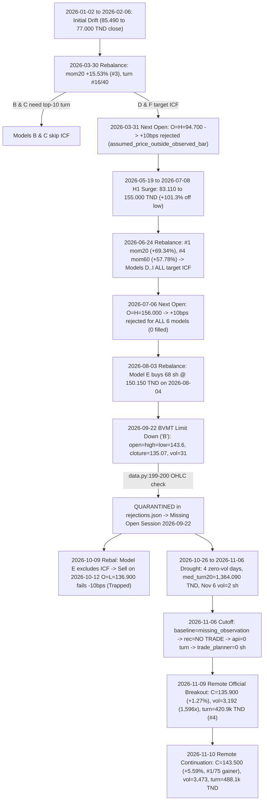

# Forensic Autopsy: ICF (`TN0003200755`) Missed-Opportunity Case Study

**Audit Date:** 2026-11-11  
**Target Worktree:** `c:\Users\Thinkcenter\Desktop\BVMT\bvmt-gemini-dashboard` (branch `gemini/dashboard`)  
**Audited Market Dataset:** `c:\Users\Thinkcenter\Desktop\BVMT\bvmt-starter-kit\data\processed\bvmt_official_2026\` (`194` open sessions, `2026-01-02` to `2026-11-06`) + live read-only tail check of official BVMT `market_resume.ndjson` (`Last-Modified: Tue, 10 Nov 2026 14:45:02 GMT`, covering `2026-11-09` and `2026-11-10`)  
**Scope & Mode:** **Audit & Evidence Only** — zero `.py` code edits, zero autonomous orders, zero unverified external claims, zero hindsight features.

---

## Executive Summary & Forensic Verdict

Our forensic investigation of **Industries Chimiques du Fluor (`ICF`, ISIN `TN0003200755`)** separates **four distinct root causes** across two separate 2026 price rallies (`+101.30%` in H1 2026 and `+6.93%` on `2026-11-09`–`2026-11-10`):

1. **Confirmed Ingestion Bug (`src/bvmt/data.py:199-200`) — NOT a Mapping Error:**  
   `ICF` is cleanly mapped across all official registries and confirmed in the 42-security Tunis Bourse Challenge universe. However, `validate_bar()` rejected `ICF`'s **`2026-09-22`** session because BVMT marked official `cloture="135.07"` (`indicateur="B"` lower limit reservation, `-6.00%`) while the sole trade of `31` shares executed at `143.60` (`open=high=low=vwap=lastTradePrice=143.6`). That strict `low <= min(open, close)` invariant quarantined **21 legitimate BVMT limit-reserved rows (`indicateur` `"H"` or `"B"`)** across 12 symbols and left `ICF` in permanent `missing_observation` exclusion from `2026-09-22` through `2026-11-06`.

2. **No Hindsight Illusion on `2026-11-06` — Counterfactual Proves Models Would Still Have Excluded `ICF`:**  
   Restoring `2026-09-22` (`143.600` executed or `135.070` official) **still** leaves `ICF` excluded on `2026-11-06`:
   - `rank_session_baseline` (`features.py`) excludes `ICF` for `insufficient_liquidity` (`median_turnover_20s = 1,364.090 TND < 5,000.000 TND`).
   - Trailing returns were negative (`mom20 = -2.6831%`, `mom60 = -10.5333%`, `rs20 = -2.7782%`), and `9` trailing sessions (`2026-10-26..2026-11-06`) included `4` untraded days and just `2` shares (`268.450 TND`) on `2026-11-06`.
   - Even after `2026-11-09` closed at `135.900` (`+1.27%` on `420,885.55 TND`), trailing `mom20` (`-1.4432%`), `mom60` (`-10.5921%`), and 20-session median turnover (`1,364.090 TND`) remained negative / below threshold. The November breakout was an **abrupt liquidity-awakening event** (`3,192` shares on `2026-11-09` = **1,596x** Nov 6's `2` shares; `+5.59%` to `143.500` on `2026-11-10`, `#1` gainer of 75 equities), **not** an omitted momentum signal.

3. **Why Historical Backtests (`Models B–I`) Missed H1 2026 (`+101.30%`) & Got Trapped in `E_MOMENTUM_60S`:**  
   - **Models B & C** excluded `ICF` at warmup (`2026-03-30`) because `ICF` ranked **`#16/40`** by turnover (`top 10` cutoff).  
   - **Models D & F** (`2026-03-30`) and **all 6 active Models D–I** (`2026-06-24`, when `ICF` ranked **`#1` `mom20 = +69.34%`**) **DID generate BUY targets for `ICF`**, but filled **`0` shares** because the next-open bar had `open == high` (`94.700` on `2026-03-31`, `156.000` on `2026-07-06`), causing `estimate_next_bar_fill` (`execution.py:78-79`) to reject `open * 1.001 > high` (`assumed_price_outside_observed_bar`) and expire the un-carried order (`carry_pending_orders=False`).  
   - **`E_MOMENTUM_60S`** was the **only** strategy to hold `ICF` (`68` shares bought `2026-08-04` at `150.150 TND`), and when the `2026-09-22` missing bar forced a `SELL 68` on `2026-10-09`, `2026-10-12` traded flat (`O=H=L=C=136.900`), causing the sell order to fail `136.900 * 0.999 >= 136.900` (`assumed_price_outside_observed_bar`) and trapping `E_MOMENTUM_60S` in `ICF` through `2026-11-06`.

4. **Genuine Liquidity & Catalyst Constraints:**  
   At `10%` participation against `2026-11-06` trailing median volume (`10` shares), maximum size was **`1` share** (`134.200 TND`, `+8.212 TND` hypothetical Nov 9–10 net profit = `+0.016%` of equity). Local files hold **zero** `ICF` CMF disclosures, earnings reports, or document chunks (`document_chunks=0`, `verified_events=0`), and only one generic fiscal tag in `macro_events.py` (`LOI_FINANCES_2026_ENERGY_TRANSITION`, `2026-10-28`), which no screening module queries for unheld candidates.

---

## Forensic Timeline & Code Exclusion Architecture



---

## Complete 14-Point Evidence Reconstruction

### 1. Exact `ICF` Instrument Mapping & ISIN
All canonical mapping sources agree identically on `ICF` with zero symbol splits or drift:
- `bvmt-starter-kit/data/staging/mapping_emetteur.json`:  
  `"TN0003200755" -> {"nid": "6402", "mnemo": "ICF", "fr": "Industries Chimiques du Fluor", "ar": "الصّناعات الكيميائيّة للفليور", "sector_fr": "CHIMIE", "sector_en": "Chemicals", "sector_ar": "القطاع الكيميائي"}`
- `bvmt-starter-kit/data/processed/bvmt_official_2026/instrument_master.csv:35`:  
  `ICF,TN0003200755,ICF,2026-01-02,,2026-01-02,,principal_continu,TND,official-bvmt-observed,True`
- `bvmt-starter-kit/data/processed/bvmt_official_2026/instrument_codes.json:35`:  
  `"ICF": "TN0003200755"`

### 2. Membership in the 42-Security Tunis Bourse Challenge Universe
In [`challenge_universe.py`](file:///c:/Users/Thinkcenter/Desktop/BVMT/bvmt-gemini-dashboard/src/bvmt/challenge_universe.py#L183-L190), `ICF` is an explicitly mapped and order-entry-confirmed member:
- `challenge_symbol`: `"ICF"` | `challenge_display_name`: `"ICF"`
- `canonical_bvmt_symbol`: `"ICF"` | `canonical_instrument_id`: `"ICF"`
- `verified_isin`: `"TN0003200755"` | `market_mode`: `"Continu"`
- `mapping_status`: `"MAPPED"` | `order_entry_eligibility`: `"CONFIRMED"` | `observed_challenge_membership`: `True`

### 3. Full 2026 Historical Price Trajectory (Local Jan–Nov 6 & Remote Nov 9–10)
The local canonical dataset (`bvmt_official_2026/daily_bars.canonical.csv`) contains `15,968` total rows (`14,480` `official-bvmt-full-2026` + `1,488` `tunis_stockexchange_equities_2026` refresh rows for `2026-11-04..2026-11-06`, zero extra rows for `ICF`) across **`194`** open exchange sessions (`2026-01-02` through `2026-11-06`), with **`193`** canonical bars for `ICF`.

A read-only HEAD & trailing 5 MB inspection of the live official BVMT endpoint (`https://www.tunis-stockexchange.com/sites/default/files/historique/data_json/market_resume.ndjson`, `Last-Modified: Tue, 10 Nov 2026 14:45:02 GMT`, `Content-Length: 224,298,237`) confirms two additional completed sessions (`2026-11-09` and `2026-11-10`) not yet ingested into local `bvmt_official_2026`.

| Month / Session | Obs (Open) | Traded / Untraded | First Close (TND) | Last Close (TND) | Monthly Return (vs Prev Close) | Low – High (TND) | Median Vol (Shares) | Median Turnover (TND) | Monthly Turnover (TND) |
|---|---:|---:|---:|---:|---:|---:|---:|---:|---:|
| `2026-01` | 21 | 21 / 0 | 85.490 | 79.020 | -7.04% | 76.500 – 85.890 | 1,090.0 | 85,049.91 | 2,025,945.01 |
| `2026-02` | 20 | 20 / 0 | 79.050 | 80.500 | +1.87% | 76.000 – 81.500 | 422.0 | 33,364.32 | 913,862.86 |
| `2026-03` | 21 | 21 / 0 | 80.400 | 91.270 | +13.38% | 77.500 – 97.000 | 1,313.0 | 102,769.45 | 3,800,836.61 |
| `2026-04` | 21 | 21 / 0 | 90.470 | 86.990 | -4.69% | 78.210 – 96.000 | 1,541.0 | 143,351.52 | 4,248,128.68 |
| `2026-05` | 18 | 18 / 0 | 86.600 | 92.000 | +5.76% | 83.000 – 92.800 | 1,365.0 | 119,602.29 | 3,167,002.38 |
| `2026-06` | 17 | 17 / 0 | 92.800 | 148.000 | +60.87% | 88.000 – 152.600 | 10,378.0 | 1,132,593.07 | 24,506,817.88 |
| `2026-07` | 18 | 18 / 0 | 154.990 | 148.970 | +0.66% | 138.000 – 156.000 | 1,408.5 | 202,619.01 | 5,304,911.29 |
| `2026-08` | 19 | 18 / 1 | 150.000 | 147.490 | -0.99% | 145.000 – 153.500 | 261.0 | 38,535.50 | 3,196,805.08 |
| `2026-09` | 12 (+1 miss) | 7 / 5 | 149.880 | 138.000 | -6.43% | 134.990 – 150.000 | 82.0 | 11,508.28 | 714,917.65 |
| `2026-10` | 21 | 17 / 4 | 137.900 | 134.990 | -2.18% | 130.000 – 137.900 | 100.0 | 13,789.00 | 900,131.94 |
| `2026-11 (to 06)` | 5 | 3 / 2 | 134.990 | 134.200 | -0.59% | 130.510 – 134.990 | 2.0 | 268.45 | 37,358.70 |
| `2026-11-09` *(remote)* | 1 | 1 / 0 | 133.90 (O) | 135.90 | +1.27% (`varJour`) | 131.00 – 135.90 | 3,192 | — | 420,885.55 |
| `2026-11-10` *(remote)* | 1 | 1 / 0 | 135.89 (O) | 143.50 | +5.59% (`varJour`) | 135.89 – 143.50 | 3,473 | — | 488,106.22 |

### 4. First Observable Date(s) of the Reported Rise
There were **two distinct moves** in 2026:
1. **H1 2026 Surge (Jan–Jul 2026, local canonical):**  
   - 2026 low close: `77.000 TND` on `2026-02-06` (intraday low `76.000` on `2026-02-04`).  
   - Rally ignition: `2026-05-19` (`83.110`) -> `2026-05-20` (`87.890`, `+5.75%`, `4,687` shares), then parabolic expansion `2026-06-02..2026-06-23` (`96.000` -> `101.760` [+6.00%] -> `107.860` [+5.99%] -> `128.790` [+6.00% on `06-18`] -> `136.510` [+5.99% on `06-19`] -> `144.000` [+5.49% on `06-22`] -> `151.900` [+5.49% on `06-23`]).  
   - Peak intraday high: `156.000 TND` (`2026-07-06`, `+105.26%` from Feb 4 low); peak close: `155.000 TND` (`2026-07-08`, **`+101.30%`** from Feb 6 close). Followed by a 4-month consolidation down to `134.200 TND` (`2026-11-06`).
2. **Post-Nov-6 Breakout (`2026-11-09` & `2026-11-10`, live remote NDJSON):**  
   - **`2026-11-09`**: `O=133.9, H=135.9, L=131.0, C=135.9` (`coursReference=134.2, varJour=+1.27%, vwap=131.856, echanges=36, quantites=3,192, capitaux=420,885.55 TND`). Ranked **`#10`** gainer and **`#4`** by turnover among `75` equities (`groupe` `11,12,52,99`). Volume jumped **1,596x** vs `2026-11-06` (`2` shares).  
   - **`2026-11-10`**: `O=135.89, H=143.5, L=135.89, C=143.5` (`coursReference=135.9, varJour=+5.59%, vwap=140.543, echanges=112, quantites=3,473, capitaux=488,106.22 TND`). Ranked **`#1` gainer of 75 equities** and `#7` by turnover (`+6.93%` cumulative over `2026-11-06` close `134.200`; `+9.54%` off `2026-11-09` intraday low `131.000`).

### 5. Trading Volume, Turnover Distribution & Untraded Sessions
- **Full canonical period (`193` observations, `2026-01-02..2026-11-06`):** `181` traded, `12` zero-volume (`2026-08-10`, `2026-09-16`, `2026-09-17`, `2026-09-25`, `2026-09-29`, `2026-09-30`, `2026-10-13`, `2026-10-14`, `2026-10-27`, `2026-10-28`, `2026-11-02`, `2026-11-04`).
  - Volume shares (`min / p10 / p25 / med / p75 / p90 / max / sum`): `0 / 11 / 219 / 852 / 2,213 / 6,394 / 48,665 / 453,200`.
  - Turnover TND (`min / p10 / p25 / med / p75 / p90 / max / sum`): `0.000 / 1,278.400 / 22,340.490 / 82,691.520 / 225,672.870 / 613,797.600 / 4,391,399.310 / 48,816,718.080`.
  - Traded-only (`181` obs): median volume `1,060` shares, median turnover `93,341.660 TND`.
- **Trailing 20-session window (`2026-10-09..2026-11-06`):** `14/20` traded (`trade_frequency_20s = 0.70`), median volume **`10.0` shares**, median turnover **`1,364.090 TND`** (middle pair `[1,224.48, 1,503.70]`). Last 9 sessions (`2026-10-26..2026-11-06`) included `4` zero-volume days, `1` share (`2026-10-26`), and `2` shares (`2026-11-06`).

### 6. Missing Historical Observations & Exact Quarantine Root Cause
- Comparing `exchange_calendar.csv` (`194` open sessions `2026-01-02..2026-11-06`) vs `daily_bars.canonical.csv` for `ICF` (`193` rows) yields **exactly 1 missing open session: `2026-09-22`**.
- **`2026-09-22` is present in raw official archives** (`raw_source.csv` NDJSON envelope & `staging/bvmt_official_2026_histo_cotation.csv`):
  ```json
  {
    "dateSeance": "2026-09-22", "codeISIN": "TN0003200755", "mnemo": "ICF",
    "coursReference": "143.69", "coursOuvert": "143.6", "plusHaut": 143.6,
    "plusBas": 143.6, "cloture": "135.07", "varJour": "-6.00",
    "indicateur": "B", "echanges": 1, "quantites": 31,
    "capitaux": "4451.6", "vwap": "143.6", "lastTradePrice": 143.6
  }
  ```
- **Ingestion failure mechanism:** In [`data.py`](file:///c:/Users/Thinkcenter/Desktop/BVMT/bvmt-gemini-dashboard/src/bvmt/data.py#L851-L880), `_parse_official_ndjson` passes `cloture` (`135.07`) and `coursOuvert`/`plusHaut`/`plusBas` (`143.60`) into `_parse_official_row`, ignoring `indicateur` and `lastTradePrice`. Then [`validate_bar`](file:///c:/Users/Thinkcenter/Desktop/BVMT/bvmt-gemini-dashboard/src/bvmt/data.py#L199-L200) enforces `bar.low <= min(bar.open, bar.close) <= max(bar.open, bar.close) <= bar.high`. On BVMT, when a stock is reserved limit-down (`indicateur="B"`) or limit-up (`"H"`) at close without filling at the collar, BVMT publishes `cloture` at the reserved limit (`135.07`, `-6.00%`) while `low=high=open=vwap=lastTradePrice=143.60`. Thus `135.07 < 143.60` threw `ValueError("OHLC bounds are inconsistent")` and quarantined `2026-09-22` into `rejections.json` *(note: `rejections.json` records `770` rejections from the 72-session `official-bvmt-2026` staging ingest, including `21` OHLC errors across `12` symbols, all with `indicateur in {'H', 'B'}`, whereas `manifest.json` records `70` parser rejections in `official-bvmt-full-2026` and `rejected_rows.csv` logs the `2` Nov 5 OHLC rejections).*

### 7. Exact Behavior of Every Model on `ICF` (2026-11-06 & Across 2026)

| Module / Strategy | Live Status as of `2026-11-06` (`50,068.050` TND eq, `39,628.870` cash) | Exact Code Path & Reason for Exclusion / Action |
|---|---|---|
| [`rank_session_baseline`](file:///c:/Users/Thinkcenter/Desktop/BVMT/bvmt-gemini-dashboard/src/bvmt/features.py#L243-L257) | **Excluded** (`37` eligible / `39` excluded) | `reason="missing_observation"`, `detail="Missing point-in-time bar on 1 open session(s)"` (`2026-09-22`). |
| [`generate_recommendations`](file:///c:/Users/Thinkcenter/Desktop/BVMT/bvmt-gemini-dashboard/src/bvmt/recommendations.py#L212-L266) | `REC-20261106-ICF-54`: **`NO TRADE`** | Because `rank_tuple is None`, zeros out all factor metrics (`momentum_20s=None`, `median_turnover_20s_tnd=None`), preserves `reference_price_tnd="134.200"`, `suggested_shares=0`. |
| [`evaluate_market_research_coverage`](file:///c:/Users/Thinkcenter/Desktop/BVMT/bvmt-gemini-dashboard/src/bvmt/research_coverage.py#L444-L456) | **`PARTIAL_HISTORY`** / `MISSING_SESSIONS` / `STRATEGY_EXCLUDED` / `FEASIBLE` | Preserves `last_verified_price="134.200"`, `safe_calendar_return_20s_pct="-2.6831"`, `safe_calendar_return_60s_pct="-10.5333"`, `median_turnover_20s_tnd="1364.090"`, `hypothetical_order_shares=1`. *(Note subtle metric discrepancy: line 316-320 computes `trade_frequency_20s="0.75"` over 21 inclusive dates vs `features.py:306-308` `0.70` over 20 sessions.)* |
| [`evaluate_multi_horizon_intelligence`](file:///c:/Users/Thinkcenter/Desktop/BVMT/bvmt-gemini-dashboard/src/bvmt/multi_horizon.py#L353-L454) | **Omitted** from `swing_candidates` & `position_candidates` | Reads `recommendations`; `momentum_20s=None` coerces to `0`, failing `mom20 > 1.50%`, `rank <= 5`, and `mom60 > 3.00%`. Swing listed `['STA', 'MONOPRIX', 'ESSOUKNA', 'SMART_TUNISIE', 'UIB']`. |
| [`build_manual_trade_plan`](file:///c:/Users/Thinkcenter/Desktop/BVMT/bvmt-gemini-dashboard/src/bvmt/trade_planner.py#L181-L240) via [`api.py`](file:///c:/Users/Thinkcenter/Desktop/BVMT/bvmt-gemini-dashboard/src/bvmt/api.py#L1612-L1642) | **`suggested_max_shares: 0`** (`is_actionable: false`) | `api.py:1612-1616` converts `r.median_turnover_20s_tnd = None` into `Decimal("0.000")`, forcing `insufficient_liquidity` `0` shares. Even with true `1,364.090 TND` (`10` shares), sizing caps at **`1` share** (`134.200 TND`, `0.268%` weight, `binding_constraint="liquidity"`). |
| `strategies.py` **A (`CASH_ONLY`)** | `0` ICF trades (`0.00%` net) | Cash-only baseline ([`strategies.py`](file:///c:/Users/Thinkcenter/Desktop/BVMT/bvmt-gemini-dashboard/src/bvmt/strategies.py#L317-L318)). |
| `strategies.py` **B (`EQUAL_WEIGHT`) & C (`BUY_AND_HOLD`)** | `0` ICF trades (`14.05%` / `14.03%` net) | Pick initial top-10 by turnover on `2026-03-30` (`strategies.py:495-498`). `ICF` ranked **`#16/40`** (`97,114.5 TND`), below `#10` (`196,570.36 TND`). |
| `strategies.py` **D (`MOM20`) & F (`RS20`)** | `0` ICF fills (`17.05%` / `17.05%` net) | Targeted `ICF` on `2026-03-30` (`#3 mom20=+15.53%`) and `2026-06-24` (`#1 mom20=+69.34%`), **but both failed simulated next-open fill** (`94.7947 > 94.700` on `03-31`; `156.156 > 156.000` on `07-06` -> `assumed_price_outside_observed_bar` at [`execution.py`](file:///c:/Users/Thinkcenter/Desktop/BVMT/bvmt-gemini-dashboard/src/bvmt/execution.py#L77-L79)). |
| `strategies.py` **E (`MOM60`)** | Bought `68` sh `08-04` @ `150.150`; **trapped** (`14.36%` net) | Targeted `06-24` (unfilled `07-06`), bought `68` sh `08-04` (`51.051` fee) after `08-03` (`#3 mom60=+69.49%`), dropped from `_metrics` on `09-22`, issued `SELL 68` on `10-09`, failed fill `10-12` (`O=H=L=C=136.900`, `136.7631 < 136.900`), held to `2026-11-06`. |
| `strategies.py` **G, H, I (Liquidity/Quality/Regime)** | `0` ICF fills (`18.81%`, `15.14%`, `15.74%` net) | All three targeted `ICF` on `2026-06-24` (`#1` `mom20=+69.34%`, `1.05M TND` median turn), failed `2026-07-06` `O=H=156.000` slippage check; excluded from `2026-09-22` onward by `_metrics` ([`strategies.py`](file:///c:/Users/Thinkcenter/Desktop/BVMT/bvmt-gemini-dashboard/src/bvmt/strategies.py#L280-L281)). |

### 8. True Metrics & Counterfactual Restorations (`CF_A=143.600`, `CF_B=135.070`)
Restoring `2026-09-22` under both the executed price (`CF_A=143.600`) and official close (`CF_B=135.070`) produces identical `2026-11-06` conclusions because `2026-09-22` falls strictly *inside* the 60-session lookback (`t-60 = 2026-07-29 @ 150.000`, `t-20 = 2026-10-08 @ 137.900`):

| Evaluation Cutoff | `ICF` Close (TND) | `mom20` | `mom60` | `vol20` (traded steps) | `freq20` | `med_turn20` (TND) | Baseline / Strategy Outcome with `2026-09-22` Restored |
|---|---:|---:|---:|---:|---:|---:|---|
| `2026-10-09` *(rebal)* | `137.890` | `-6.51%` | `+1.01%` | `2.12%` / `2.26%` | `0.75` | `16,549.340` | **Eligible `#15/32`** (`rs=-2.53%`), `recommendations = NO TRADE`, `D..I targets = []` *(E could cleanly sell)*. |
| `2026-11-06` *(cutoff)* | `134.200` | **`-2.6831%`** | **`-10.5333%`** | `0.2875%` | `0.70` | **`1,364.090`** | **STILL EXCLUDED** (`insufficient_liquidity < 5,000`), `rec = NO TRADE`, `SPARSE_DATA`, `D..I = []`. |
| `2026-11-09` *(close)* | `135.900` | `-1.4432%` | `-10.5921%` | `0.4735%` | `0.70` | **`1,364.090`** | `mom20` & `mom60` still negative; 20s median unchanged (`10-09` `13.8k` dropped, `11-09` `420.9k` added above median). |
| `2026-11-10` *(close)* | `143.500` | **`+4.8210%`** | `-3.6719%` | `1.5201%` | `0.70` | **`1,364.090`** | `mom20` flips positive (`+4.82%`), but `mom60` remains negative and `med_turn20` stays `1,364.090` (`[1,224.48, 1,503.70]`). |

### 9. Availability of Alternative Price Observations
All `194` canonical sessions including `2026-09-22` (`vwap=143.6`, `lastTradePrice=143.6`, `coursOuvert=143.6`, `cloture=135.07`, `indicateur="B"`) existed in local staging files (`tunis_stockexchange_equities_2026.ndjson`, `bvmt_official_2026_histo_cotation.csv`, and `raw_source.csv`), and remote `market_resume.ndjson` carries live `2026-11-09` and `2026-11-10`. Nothing was missing at the BVMT exchange source; the gap was purely internal parser quarantine.

### 10. Local Financial Disclosures Before the Move
**None.** `data/processed/document_index/document_chunks.json` does not exist in either `bvmt-starter-kit` or `bvmt-gemini-dashboard` (`state.document_chunks = 0`, `state.verified_events = 0` in `REAL_COMPETITION`). `data/raw/` holds only `tunisbourse_challenge_reglement` metadata/HTML (`reglement.aspx.html`). No CMF announcements, H1 2026 interim financial statements, or revenue releases for `ICF` are present locally.

### 11. Local Corporate Events, Earnings & Sector News
- [`macro_events.py`](file:///c:/Users/Thinkcenter/Desktop/BVMT/bvmt-gemini-dashboard/src/bvmt/macro_events.py#L121-L136) contains one hardcoded fiscal policy item tagging `"ICF"`: `LOI_FINANCES_2026_ENERGY_TRANSITION` (`published_at="2026-10-28T11:00:00Z"`, `JORT`, accelerated depreciation on corporate photovoltaic self-generation for energy-intensive industry). *(Note: `macro_events.py` uses non-canonical IDs `"CC"` and `"STPAP"` for sibling stocks instead of `"CARTHAGE_CEMENT"` / `"SOTIPAPIER"`, whereas `"ICF"` matches `instrument_master.csv`.)*
- `features.py`, `recommendations.py`, `strategies.py`, and `research_coverage.py` do **not** read `macro_events.py`. Only `multi_horizon.py:351` checks `get_instrument_macro_context`, and only *after* a candidate passes `recommendations` and `mom20 > 1.50%` / `mom60 > 3.00%` / `rank <= 5`.
- **Explicit gap:** Local archives contain **no** `ICF`-specific corporate press release, earnings catalyst, or chemical export/price news explaining why `ICF` jumped `1,596x` in volume on `2026-11-09`–`2026-11-10`. Absence of local news files does not imply absence of an external catalyst.

### 12. Could a Signal Have Been Generated from Genuinely Available PIT Information?
- **As of `2026-11-06` close (before `2026-11-09`):** **No.** No leakage-free quantitative price or volume model in our system (or standard momentum/liquidity class) could defend buying `ICF` at `134.200` on `2026-11-06`, when `20s` and `60s` returns were negative, `4` of the prior `9` sessions had `0` volume, and `2026-11-06` traded `2` shares (`268.450 TND`). Only a non-quantitative fiscal watchlist note (`LOI_FINANCES_2026_ENERGY_TRANSITION`) existed.
- **As of `2026-11-09` close (for `2026-11-10` open):** **Only an exploratory unusual-volume breakout alert**, not a trend-momentum buy. At `2026-11-09` close (`135.900`, `+1.27%` off `131.000` low), `ICF` posted `420,885.55 TND` turnover (**308.5x** its `1,364.090 TND` trailing 20s median; `#4` across the entire BVMT equity market), cleanly observable *before* `2026-11-10` open (`135.890`, followed by `+5.59%` to `143.500`). Because trailing 20-session medians take `>=10` high-volume sessions to move, any 20-session median liquidity gate stayed blind to `2026-11-09` liquidity.

### 13. Realistic Execution Feasibility
- **Tick Size & Price Collars:** Canonical `ICF` bars trade in **`0.010 TND`** increments. BVMT `groupe 11` (`Continu`) static/dynamic collar observations in 2026 reach **`±6.00%`** (`ICF` closed `+6.00%` on `06-03` & `06-18`, `-6.00%` on `04-23`, and hit `-6.00%` `'B'` reservation on `09-22`; note `multi_horizon.py:257` conservatively notes `±3.0% / ±5.0%` collars).
- **Competition Mechanics ([`competition.json`](file:///c:/Users/Thinkcenter/Desktop/BVMT/bvmt-gemini-dashboard/configs/competition.json#L275-L290)):** Orders match `09:00–14:15 Africa/Tunis`, no shorting/leverage, orders on untraded sessions stay `PENDING` (1-week expiry convention unresolved).
- **Pre-breakout (`2026-11-06`) vs Post-breakout (`2026-11-09`–`2026-11-10`) Capacity:**
  - Before Nov 9: `10%` of `2026-11-06` trailing median (`10` shares) = **`1` share** (`134.200 TND`). Attempting a full `5,000 TND` (`37` shares) pre-breakout entry would represent **`3.7x`** trailing median daily volume and **`18.5x`** `2026-11-06`'s `2` shares.
  - On `2026-11-09` / `2026-11-10`: Actual volume jumped to `3,192` and `3,473` shares. A `10%` participation budget (`319` / `347` shares) vastly exceeded the `36–37` shares (`~4,892–4,954 TND`) permitted by the `10%` single-stock cap (`~1.0%` of actual `Nov 10` volume).

### 14. Fees, Liquidity & Competition Risk Math (`50,068.050 TND` Live Equity)
Under `0.50%` purchase + `0.50%` sale fees (`1.005%` break-even hurdle: `135.549 TND` on `134.200 TND`) and `10.0%` max single-stock exposure (`5,006.805 TND` max cap -> `37` shares @ `133.900`, `36` shares @ `135.890`):

| Hypothetical Execution Scenario *(Diagnostic Only)* | Shares | Gross Buy (TND) | Buy + Sell Fees (`0.50%` each) | Gross Sell (`2026-11-10` Close `143.500`) | Net P&L (TND) | Net Trade Return | Portfolio Equity Impact (`50,068.050` TND) |
|---|---:|---:|---:|---:|---:|---:|---:|
| **`10%` Trailing Liquidity Cap (`Nov 6` med `10` sh) — `Nov 9` Open (`133.900`)** | 1 | `133.900` | `0.670 + 0.718 = 1.388` | `143.500` | `+8.212` | `+6.10%` | **`+0.016%`** |
| **`10%` Concentration Cap — `Nov 9` Open (`133.900`, requires lookahead vol)** | 37 | `4,954.300` | `24.772 + 26.548 = 51.320` | `5,309.500` | `+303.880` | `+6.10%` | `+0.607%` |
| **`10%` Concentration Cap — `Nov 10` Open (`135.890`, after `Nov 9` surge)** | 36 | `4,892.040` | `24.460 + 25.830 = 50.290` | `5,166.000` | `+223.670` | `+4.55%` | `+0.447%` |

---

## Core Questions — Forensic Answers

### 1. WHY DID OUR SYSTEM MISS `ICF`?
Because of **three compounding barriers at different stages of 2026**, not a single failure:
1. **A genuine ingestion bug (`data.py:199-200`)** quarantined `2026-09-22` (`indicateur="B"`, executed at `143.60`, official `cloture="135.07"`), blinding `features.py`, `recommendations.py`, `strategies.py`, and `multi_horizon.py` via `missing_observation` and causing `api.py:1612-1616` to pass `0.000 TND` turnover into `trade_planner.py`.
2. **Authentic liquidity drought & negative trailing momentum before `2026-11-09`**: Even with `2026-09-22` fixed, `ICF` still fails `rank_session_baseline` on `2026-11-06` (`insufficient_liquidity: 1,364.090 < 5,000 TND`), has negative `mom20` (`-2.68%`) and `mom60` (`-10.53%`), and fails every momentum/liquidity rule in `Models D–I` and `multi_horizon.py`.
3. **Simulation slippage rejection on `open == high` bars in H1 2026 & `E_MOMENTUM_60S` sell trap**: Backtest Models `D–I` *did* spot `ICF`'s May–Jun rally on `2026-03-30` (`D, F`) and `2026-06-24` (`D–I`, `#1` rank), but `estimate_next_bar_fill` (`execution.py:78-79`) cancelled `100%` of those fills because `open * 1.001 > high` when buying next-open gap highs (`94.700` on `03-31`, `156.000` on `07-06`), while `E_MOMENTUM_60S`'s `10-12` exit similarly failed `open * 0.999 < low` on a flat `136.900` bar.
4. **Stale local snapshot cutoff (`2026-11-06`)**: Local processed data had not yet ingested `2026-11-09` or `2026-11-10`, when the volume breakout (`3,192` -> `3,473` shares) actually occurred.

### 2. WHAT INFORMATION WAS AVAILABLE BEFORE THE PRICE MOVE?
- **Before `2026-11-09` open (as of `2026-11-06` close):** Only negative price drift (`134.200`, `-2.68%` 20s / `-10.53%` 60s), drying liquidity (`1,364.090 TND` 20s median; `2` shares on Nov 6), an active `Principal Continu` listing (`ICF`, `TN0003200755`), and one generic fiscal policy tag (`LOI_FINANCES_2026_ENERGY_TRANSITION`, `2026-10-28`). Zero local CMF filings, earnings updates, or block/orderbook imbalance signals existed.
- **Before `2026-11-10` open (as of `2026-11-09` close):** Official `market_resume.ndjson` showed `ICF` reversing intraday from `131.000` to close at its session high `135.900` (`+1.27%`) on **`3,192` shares / `420,885.55 TND`** (`308.5x` 20s median turnover, `#4` market-wide turnover), cleanly observable prior to `2026-11-10`'s open at `135.890` and `+5.59%` rally to `143.500`.

### 3. WHAT WOULD NEED TO CHANGE TO DETECT SIMILAR EVENTS?
Without fitting to hindsight or loosening risk safeguards, four clean structural upgrades address the observed defects:
1. **Fix BVMT Limit-Reserved OHLC Ingestion (`data.py`):** Preserve `indicateur`, `lastTradePrice`, and `vwap` when parsing official NDJSON; accept bars where `indicateur in {"H", "B"}` and `cloture` reflects an exchange collar reservation outside executed `[plusBas, plusHaut]` (storing canonical `low = min(open, plus_bas, cloture)` / `high = max(open, plus_haut, cloture)` or explicit `cloture` vs trade-range metadata with an audit flag instead of deleting the bar).
2. **Preserve Known Liquidity & Align `20s` Window Definitions (`api.py`, `research_coverage.py`):** Never coerce `None` in `recommendations` into `0.000 TND` inside `api.py:1612-1616` when `research_coverage` already holds `median_turnover_20s_tnd` (`1,364.090 TND`); reconcile `research_coverage.py:316` (`21`-session inclusive count `0.75`) with `features.py:306` (`20`-session `0.70`).
3. **Separate "Data Hygiene Exclusion" from "Liquidity-Awakening Watchlist" & Fix Backtest Fill Bounds (`execution.py`, `dashboard` research radar):**  
   - Add an **exploratory, non-auto-buy Volume/Turnover Awakening Scanner** comparing latest `1-session` / `3-session` turnover & volume against the trailing `20-session` baseline, while keeping strict `median_turnover >= 5,000 TND` for automated top-K ranking.
   - In `execution.py:78-79`, clamp simulated slippage price to `[bar.low, bar.high]` (or mark limit-at-high fills explicitly) rather than silently dropping valid `open == high` market orders to `0` shares.
4. **Refresh Daily Official NDJSON Pipeline + Automated CMF Document Ingestion:** Run `refresh_daily_market_pipeline` after each BVMT session so `2026-11-09`+ bars exist locally, and populate `data/processed/document_index/document_chunks.json` with verified CMF/BVMT issuer disclosures before claiming fundamental coverage.

### 4. WOULD THE PROPOSED CHANGE CREATE MANY FALSE POSITIVES?
We tested the false-positive impact of BOTH changes empirically across all `194` local sessions and all `42` Challenge instruments:

1. **Impact of Fixing the `data.py` `H`/`B` OHLC Quarantine Bug (Low False-Positive Risk, Net Positive Accuracy):**  
   Restoring all missing OHLC-rejected rows on `2026-11-06` transitions `11` instruments (excluding Poulina's rename split) out of false `missing_observation`:
   - `4` (`ICF`, `BH_BANK`, `BTE_ADP`, `OFFICEPLAST`) still rightly fail `insufficient_liquidity` (`< 5,000 TND` median turnover).
   - `4` (`ATTIJARI_LEASING`, `CELLCOM`, `CIMENTS_DE_BIZERTE`, `TUNIS_RE`) rightly fail `untraded_lookback_anchor`.
   - `3` valid liquid continu stocks become cleanly `ELIGIBLE`: **`SOTUMAG` (`rank #1/40`, `m60=+45.33%`, `turn=41,815.96 TND`)**, **`CIL` (`rank #12/40`, `m20=+3.16%`, `turn=29,569.82 TND`)**, and **`ATB` (`rank #26/40`, `turn=23,129.83 TND`)**. Fixing this bug eliminates false blinding without flooding recommendations with illiquid stocks.

2. **Impact of Adding a Raw `10x` Volume-Surge / Liquidity-Awakening Signal (HIGH False-Positive Risk Unless Strictly Gated):**  
   Evaluating every session `t` across all `42` Challenge instruments where `turnover_t >= 50,000 TND` and `turnover_t >= 10 * median_turnover_20s` (with 5-session forward return `t+5`):
   - **Unfiltered `10x` turnover spike (`>= 50k TND`):** Triggered **`143` alerts** across 42 stocks (`141` with 5-session forward observations). Only **`66 / 141` (`46.8%`)** beat the `+1.00%` round-trip fee hurdle over the next 5 sessions, with median 5-session forward return of **`+0.70%`** (negative after `1.005%` fees — classic distribution/block-print false positives).
   - **Filtered "Quiet-to-Breakout" variant (`med_turnover_20s < 5,000 TND`, `turnover_t >= 50,000 TND`, `>= 10x` spike, AND positive day return):** Narrowed to just **`6` historical alerts** across the entire 2026 Challenge universe up to `2026-11-06` (`ATTIJARI_LEASING` `04-06` `0.00%` 5s; `MPBS` `10-26` **`+9.76%`** 5s; `SIAME` `09-17` **`-9.62%`** 5s reversal; `SOTIPAPIER` `10-30` `+0.80%` 5s; `SPDIT_-_SICAF` `09-17` `+1.27%` 5s; `UIB` `10-01` `+2.90%` 5s).
   - **Conclusion:** Lowering `rank_session_baseline`'s `5,000 TND` median filter or blindly chasing single-day volume spikes creates unacceptable false-positive whipsaw (`-9.62%` in `SIAME`, `< 47%` win rate after fees overall). An awakening detector MUST stay a **read-only Research Watchlist / Alert flag** requiring multi-day or closing-strength confirmation (`close` near HOD, zero-block verification, and next-day follow-through), never an automatic buy order.

