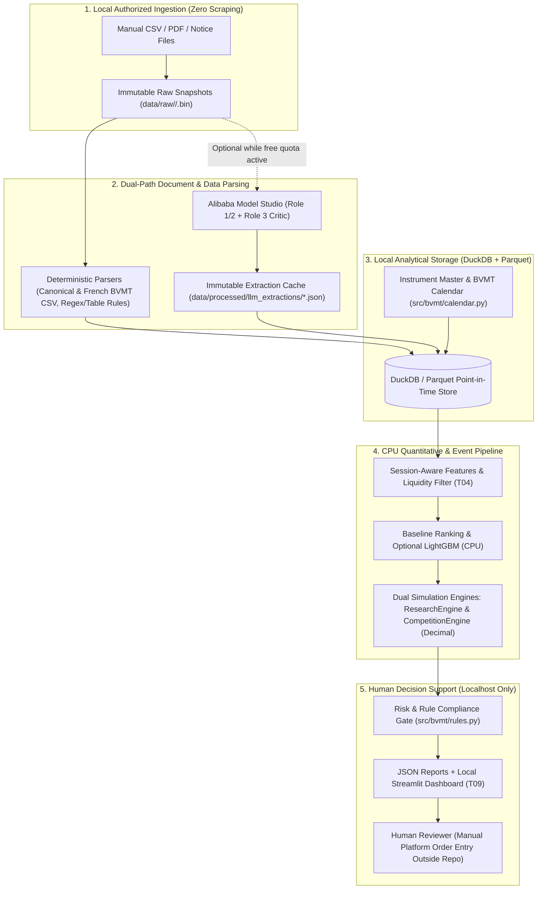

# Permanent Low-Cost Local Architecture (Zero Cloud / Zero Permanent LLM Dependency)

## 1. Design Goal
Ensure the BVMT Trading Intelligence system runs sustainably on a single standard desktop/laptop machine (**CPU-only, $0/month recurring cloud or API cost**) throughout the entire Tunis Bourse Challenge (through **May 31, 2027** and beyond), even after all Alibaba Cloud Model Studio free token allowances expire on **February 1, 2027**.

---

## 2. End-to-End Local Architecture

---

## 3. Hardware & Resource Requirements

| Resource | Minimum Requirement | Recommended (Current Machine) | Why This Is Sufficient |
|---|---|---|---|
| **CPU** | Dual-core x86_64 (Intel i3 / Ryzen 3) | 4–8 cores (Intel i5/i7 or Ryzen 5/7) | ~80 BVMT stocks × 2,500 trading days = ~200,000 rows. DuckDB + pandas + LightGBM train and backtest on this scale in **< 3 seconds** on CPU. |
| **RAM** | 4 GB | 8–16 GB | Entire 10-year BVMT Parquet dataset + event tables fit in **< 50 MB** of memory. |
| **GPU** | **None (0 GB VRAM)** | None required | LightGBM and DuckDB run natively on CPU; no local PyTorch/CUDA stack is required. |
| **Disk Storage** | 2 GB free | 10 GB free SSD | Raw CSV/PDF snapshots (`data/raw/`), Parquet tables (`data/processed/`), and `.venv` require < 1.5 GB total. |
| **Operating System** | Windows 10/11, Linux, or macOS | Windows 10/11 (PowerShell, Python 3.13 via `uv`) | Already verified on this machine during T01–T03. |

---

## 4. How the System Operates After Alibaba Free Allowances Expire

1. **Historical Extractions Are Permanently Cached (`data/processed/llm_extractions/`)**:
   - All historical CMF financial statements and BVMT corporate disclosures processed during the November 2026 – January 2027 allowance window are stored as content-addressed, schema-validated JSON and Parquet files in the repository workspace.
   - Re-running walk-forward backtests, feature engineering, or model training reads those local files directly and **never calls an external LLM API**.
2. **Deterministic Template/Rule Parsers for Recurring Disclosures**:
   - Standard BVMT notices (dividend ex-dates, trading suspensions, capital-increase tables, and tabular quarterly indicators) follow recurring French templates that can be parsed deterministically with regex/table extractors + human review.
3. **Structured Manual Entry Form / JSON Template for New Post-Feb-2027 Events**:
   - During the final months of the competition (February–May 2027), only ~1–3 material disclosures per week affect the ~40 liquid *Continu du Marché Principal* stocks.
   - If no LLM quota remains, the human researcher can either:
     - Record new events directly via a 30-second CLI/Streamlit form that validates against `schemas/event.schema.json`, or
     - Optionally point the existing OpenAI-compatible `LLMTransport` interface at a local `llama.cpp` / `Ollama` 3B–7B quantized CPU model (`http://127.0.0.1:11434/v1`) without changing a single line of pipeline code.
4. **Core Alpha & Risk Engine Is 100% Deterministic**:
   - Universe eligibility, liquidity filtering, session-aware momentum/value/quality features, `Decimal` portfolio accounting, 10% concentration caps, and 0.50% fee calculations have **zero dependency on LLMs**.
