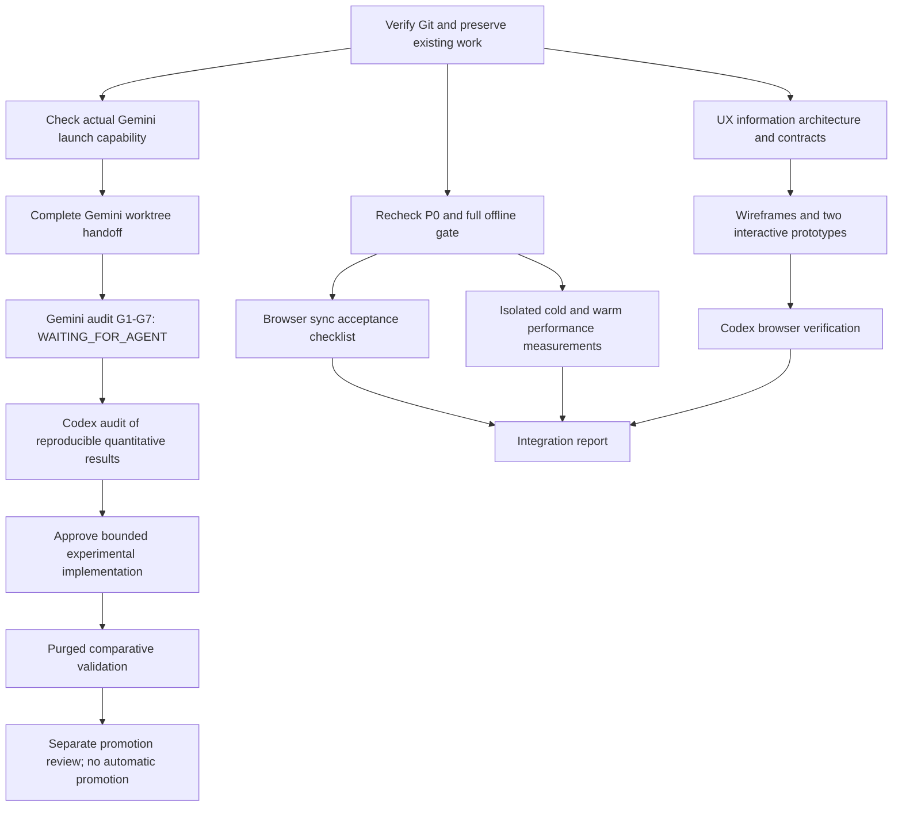

# Milestone 14 orchestration plan

Recorded 2026-11-11. Lead/integrator: actual Codex CLI 0.167.1, on main at
6f0b64dcdf36071b136bd729f89bae5778088516. Active model not exposed by checked
metadata. P0 changes remain uncommitted and are part of the tested working tree,
not part of that commit. No commits, pushes or merges authorized by this plan.

## Execution and dependencies

## Task register

Only PASS, FAIL, BLOCKED and NOT TESTED are verdicts. NOT TESTED denotes work
planned or in progress; BLOCKED may carry workflow state WAITING_FOR_AGENT.

| TASK | OWNER | STATUS | DEPENDENCIES | EVIDENCE | COMMIT |
|---|---|---|---|---|---|
| M14-00 provenance and preservation | Codex lead | PASS | none | Git/CLI commands; artifacts/m14/starting-hashes.json | base 6f0b64d; uncommitted |
| M14-01 genuine Gemini check | Codex lead | BLOCKED | M14-00 | gemini --version command unavailable; Antigravity process present, no callable agent tool | uncommitted |
| M14-02 complete quant handoff | Codex lead | PASS | M14-01 | docs/handoffs/GEMINI_M14_QUANT_TASK.md | uncommitted |
| M14-G1..G7 research and proposal | Gemini | BLOCKED | genuine agent launch | WAITING_FOR_AGENT; no outputs or session yet | none |
| M14-R reliability and sync checklist | Codex lead | PASS | M14-00 | baseline gate 439 passed; status regression 2 passed; docs/M14_BROWSER_SYNC_ACCEPTANCE.md (live NOT TESTED) | uncommitted |
| M14-P performance | Codex performance specialist | PASS | full gate finishes before timing | 21 routes warm <500ms; cache 4/4; docs/M14_PERFORMANCE_AUDIT.md | uncommitted |
| M14-U blueprint and prototypes | Codex UX specialist | PASS | P0 contracts, no Gemini dependency | eight wireframes + two interactive artifacts; docs/M14_UX_BLUEPRINT.md; docs/prototypes/m14/ | uncommitted |
| M14-V browser and contract verification | Codex lead | PASS | M14-U | Chrome desktop/mobile prototypes; 9 pages/115 fixture API responses 200; zero runtime errors | uncommitted |
| M14-Q quantitative independent review | Codex lead | BLOCKED | M14-G1..G7 | no Gemini research available | none |
| M14-E experimental v2 implementation/comparison | Gemini then Codex | BLOCKED | accepted audit and frozen experiment design | no model implemented or promoted | none |
| M14-I integration and final report | Codex lead | PASS | R/P/U/V; reports blocked Q/E honestly | docs/M14_INTEGRATION_REPORT.md | uncommitted |

## Ownership

The user's M14 ownership overrides older workstream role descriptions for this
milestone. Codex owns frontend, API, safety, performance and integration. Gemini
owns research audits, data quality/source review and isolated experiments.
Initial Gemini assignment is documentation and reproducible audit only: no
production decision changes. Codex specialists are explicitly Codex, not Gemini.
Two independent delegated tasks maximum; each receives exclusive file ownership.
The lead alone updates task.md, docs/STATE.md and the three orchestration reports.

Preserve all starting tracked/untracked changes. Preserve both dirty files in the
Gemini worktree. Hash account JSON/configs before and after. Tests use disposable
account copies. Do not expose authentication secrets, pairing tokens or snapshots.
No orders, sync confirmations, paid APIs, package installs, deployments or pushes.
Do not start an IDE agent unless genuine invocation and model provenance can be
observed. An installed IDE or named worktree is not execution evidence.

## Acceptance and rejection policy

Re-run the full offline gate and frontend typecheck. Use browser tests only for
our local UI/prototypes, never to drive external competition trading pages.
Measure cold separately from warm API/route response times; report payload and
sample count, hardware/load scope and any thresholds missed. Retain invalidation
contracts and timestamp distinctions. Browser sync live acceptance stays NOT
TESTED until the user verifies the authenticated capture and proposed diff.

Research acceptance requires all requested G1-G7 deliverables, exact code paths,
source hashes and cutoffs, ratio/percent unit checks, all-42 coverage accounting,
pre-rally ICF evidence and honest missing documents. Experiments require frozen
versioned config/trial registry, chronological purged folds with embargo,
training-only fitting and held-out/forward evidence where available. Report all
specified metrics, simple baselines, costs, zero-volume feasibility, drawdown,
false positives and outlier/capital sensitivity. A retrospective improvement,
agent claim or ICF-specific tuning cannot authorize promotion.

UX acceptance requires eight coherent destinations, information hierarchy,
contract/state matrices, real wireframes and two usable high-fidelity local
prototypes. Show missing, stale, pending and blocked states; never fake real
account data or provide trade submission. Full redesign implementation awaits
review of blueprint and contracts. Prototypes do not alter production navigation.

## Evidence interpretation

Performance PASS is limited to warm-cache target and controlled invalidation.
Cold loads remain multi-second and the prior <180ms range was not reproduced
for three routes. Read M14_PERFORMANCE_AUDIT.md for exact scope. Prototype PASS
means artifacts/browser behavior verified; human blueprint/contract approval is
NOT TESTED. All Gemini-dependent quantitative work remains BLOCKED.

## Final verification

`uv run python scripts/check.py`: exit0,441 tests passed,1 warning in139.87s;
Ruff format/check, mypy and skills validation pass. Frontend typecheck and
isolated production build pass. Chrome prototypes and fixture dashboard pass;
final9-page warm reload p95 range1.04-2.03s,6 sidebar samples0.64-0.86s.
Account16/16 starting JSON hashes unchanged, no new account JSON; original
user data.py/test_gateway.py edits intact. This closes Codex-owned delivery,
not Gemini research, user sync acceptance, v2 promotion or redesign approval.
