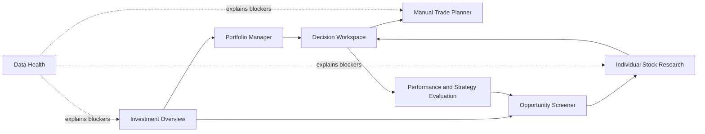

# Milestone 14 investment-management UX blueprint

Owner: Codex UX specialist (`m14_ux`), delegated by Codex lead. This is not Gemini
research. Status: design artifacts implemented for review; production redesign
NOT IMPLEMENTED. No new quantitative architecture is asserted as validated.

## Product decision

Build the experience around an investment case and its evidence lifecycle,
rather than a flat ranking of BUY labels. The first screen establishes portfolio
truth and review priorities. The research journey then moves from a universe of
questions to one issuer, a documented decision, and a separately gated manual
planning worksheet. Performance evaluates the decision process and actual account
results in separate lanes. Data Health explains what blocks reliable conclusions.

The design follows the local `bvmt-dashboard-review` skill: show cutoffs, source
age, rule state and model version; distinguish research, simulations and account
performance; retain missing values; and omit all order-entry/automatic-trade
controls. Prototypes are local, synthetic, with no account or API connection.

## Information architecture

| Destination | Primary question | Primary information | Next action | Existing source or proposed contract |
|---|---|---|---|---|
| 1 Investment Overview | What do I own and what needs attention? | Confirmed account vs local valuation; cash/exposure; timestamp strip; review queue | Open holdings, inspect staged observation, investigate issuer | `/api/overview`, `/api/holdings`, `/api/sync/preview`; proposed review-priority presentation |
| 2 Portfolio Manager | Which positions and commitments are confirmed? | Holdings, orders, cash reservations, reconciliation diff, immutable observation history | Read-only diff inspection; later explicit human confirmation in production | Holdings, `/api/orders/pending`, `/api/transactions`, `/api/snapshots`, sync preview |
| 3 Opportunity Screener | Which questions deserve research? | All-universe coverage; separate opportunity, coverage, uncertainty, feasibility and status columns | Filter and open issuer case | `/api/rankings`, `/api/market-research`; v2 evidence dimensions await Gemini audit |
| 4 Individual Stock Research | What supports or contradicts this thesis? | Identity, observed price/volume with gaps, source documents, evidence layers, risks, invalidation | Open a decision record or collect missing evidence | `/api/research`, market research and existing sparse explanations; proposed issuer document register |
| 5 Investment Decision Workspace | Can I explain a decision and its limits? | Thesis, counter-thesis, A-G evidence, constraints, review trigger, research note | Save a research draft; inspect planning blockers | Existing explanations + proposed versioned decision record; no current persistence implemented |
| 6 Trade Planner | What can be planned after deterministic checks? | Observed reference vs user limit; cash/concentration/liquidity/risk capacities; fees and horizon evidence | Review manual worksheet only when gates pass | `/api/trade-plans`, `/api/trade-plans/calculate`; P0 guard remains authoritative |
| 7 Performance and Strategy Evaluation | How did decisions and the account perform? | Account attribution, forward paper journal, retrospective comparisons, costs/drawdown/stability | Inspect reproducible experiment and independent forward evidence | Existing strategy/paper endpoints and session summary; never combine simulated and account returns |
| 8 Data Health | Which evidence blocks trust or planning? | Account/rules/identity/quotes/docs health, source registry, freshness, recovery queue | Inspect cause and authorized recovery instructions | `/api/health`, market status, sync status; proposed unified presentation only |

Navigation remains stable across pages. A single issuer identity follows the
journey. Global context carries portfolio mode, decision cutoff and verified
universe, never inferred from the current URL or a free-text symbol alone.

### Interaction map



## Data contracts proposed for review

These contracts describe UI needs. They are not production fields or implemented
model interfaces. Mapping to existing API schemas must be reviewed by the lead
before implementation. No UI-derived value may override a backend blocker.

### Shared evidence envelope

Each material observation needs `instrument_id`, verified ISIN or explicit null,
source/document identifier, source URL when permitted, content hash, observation
value and unit (nullable), market/session date, publication time (nullable),
effective date (nullable), retrieval time, first-available time (nullable), date
precision, decision cutoff, parser/model/config version and coverage limitations.
The envelope also needs state: verified, provisional, missing, stale, conflicting
or rejected. Null values have reasons, not numeric substitutes. Absent publication
timestamps prevent unsupported point-in-time causal or predictive claims.

Three clocks must be visible and separately labeled:

1. Market observation/session time. An EOD session date is not an executable quote.
2. Source publication and first availability. Retrieval does not prove publication.
3. Account capture and human confirmation. A staged capture does not change holdings.

### Decision dimensions

| Dimension | Proposed representation | Missing-data behavior | Forbidden conflation |
|---|---|---|---|
| Opportunity strength | Evidence-supported ordinal assessment, or null pending validated method | "Not established"; no aggregate number until audit/validation | Liquidity alone must not erase investment interest |
| Evidence coverage | Layer-level source count/state plus dated applicability | Show gaps explicitly; do not assume zero fundamentals | Coverage is not probability of profit |
| Signal uncertainty | Reasons and sensitivity/validation state, not invented confidence | "Uncertain" or "Not assessed" | Confidence is not a guaranteed forecast |
| Trading eligibility | Backend verdict with stable reason codes | Block planning for unknown rules, identity, quotes or account state | Attractive thesis does not imply permission |
| Portfolio suitability | Exposure/cash/reservation/risk evidence and binding constraints | "Awaiting account review"; no assumed zero orders | Eligible security does not imply suitable portfolio addition |

Keep existing baseline/version names in research provenance. "Decision Engine v2"
must show not implemented / experimental / validated-for-review as appropriate;
never silently replace Model G or sparse_research_v1.

### Evidence layers

A price/technical research, B fundamentals, C corporate events/disclosures,
D macro/sector context, E data quality/freshness, F liquidity/execution and
G competition/portfolio constraints each retain independent evidence and reasons.
The UX supports this separation without selecting weights or inventing a scoring
algorithm. Gemini's audit and a frozen experiment design remain prerequisites.

### Account and planning presentation

- Keep website-reported account and locally recalculated valuation distinct.
- A pending capture has its own identity, retrieval time, diff and status. Viewing
  the diff is read-only. Production confirmation requires explicit human action,
  expected-snapshot-ID protection and successful reconciliation; absent here.
- An empty/unverified order list must display unverified commitments, not zero
  cash reservation. Transactions incomplete means performance attribution incomplete.
- User limits remain labeled user input. Observed reference and current executable
  quote have distinct fields. Missing quote time remains null and visibly unavailable.
- When blocked, quantity, proposed notional and proposed-order fees are zero;
  cash and exposure remain unchanged. Unknown cash is unknown, not zero.
- Holding-period statements disclose evidence, sample, costs and risk. No optimal
  horizon or guaranteed stop fill is inferred from one favorable retrospective run.

## Decision-state matrix

| Product state | Meaning | Available user actions | Quantity / trade behavior |
|---|---|---|---|
| WATCH | Attention warranted without a complete thesis | Inspect observed evidence, request updates, record review trigger | No order implication |
| RESEARCH FURTHER | A specific unresolved investment question exists | Collect dated disclosures, record counter-thesis | No automatic BUY or sizing |
| PAPER-TRADE CANDIDATE | A versioned experimental hypothesis meets reviewed paper criteria | Add to forward-only paper journal under accepted protocol | Simulation only; never actual account order |
| HOLD | Existing confirmed position reviewed under available evidence | Review suitability, risk and next checkpoint | Does not imply buying more |
| REVIEW POSITION | Position needs attention due to risk, changed evidence or uncertainty | Inspect exposures and source-linked reasons | No automatic sale |
| MANUAL TRADE PLAN | Deterministic eligibility, quote, account and portfolio gates passed | Human reviews worksheet and acts separately on competition platform | Never submit from this application |
| NOT ELIGIBLE | A verified constraint prevents competition participation | Inspect exclusion reason; retain general research where permitted | Quantity zero |
| INSUFFICIENT EVIDENCE | Required evidence is absent, stale, conflicting or unverified | Inspect missing evidence and recovery path | Quantity zero; preserve unknown fields |

Status is contextual: an issuer can deserve research while being untradeable.
The prototype's synthetic Cedar case remains Research Further with blocked
manual planning; it does not imply a validated model classification.

## Operational-state matrix

| Input state | UI treatment | Chart / metric treatment | Recovery path |
|---|---|---|---|
| Empty universe | Clear empty state and source cause | No rows or fake zeros | Check source/identifier mapping |
| Missing quote/source | Unavailable + missing-field reason | No inferred price/return/confidence | Obtain permitted dated observation |
| Sparse observations | Partial coverage and explicit gaps | Plot observed points; break lines across gaps | Review ingestion and actual no-trade evidence separately |
| Stale EOD data | EOD date and age relative to cutoff | Historical reference only | Refresh authorized data; independently verify executable quote |
| Future evidence | Rejected-for-cutoff reason | Exclude from historical feature/metric | Correct availability and rerun reproducibly |
| Identity conflict | Blocked, show disagreement without merging | No action quantity | Verify stable ID/ISIN mapping |
| Pending account capture | Review-required banner and read-only diff | Confirmed account remains source of record | User reviews proposed reconciliation |
| Unverified transactions/orders | Attribution/reservation unknown | No definitive P&L or effective cash claim | Import and reconcile history with user review |
| Unknown competition rules | Blocked planning with reason/evidence link | Research can remain available | Official evidence review; do not copy research assumptions |
| Failed local source/API | Source-specific error and retained timestamp | Never relabel cached data current | Retry read-only source; disclose retained data age |
| Synthetic mode | Persistent sandbox label; separate fixture identifiers | Every chart/value clearly illustrative | No real-account transition from prototype |

## Structural wireframes

Open [the eight-page annotated wireframe](prototypes/m14/wireframes.html).
Each destination has its own layout, primary question, information hierarchy and
next-action path. These are actual HTML/SVG diagrams, not a prose-only outline.

1. Overview puts account integrity before research attention, then capital and holdings.
2. Portfolio places confirmed holdings above commitments and staged diff evidence.
3. Screener separates attention, source coverage and feasibility in the same row.
4. Issuer research uses observed-chart + decision-summary split, then evidence tabs.
5. Decision workspace presents seven independent layers with a thesis/review rail.
6. Planner places source/reference and user assumptions beside deterministic capacities.
7. Evaluation separates actual, forward paper and historical experiment lanes.
8. Health organizes evidence failures by impact and authorized recovery dependency.

## Two high-fidelity interactive prototypes

### Prototype 1: portfolio command workspace

[Open overview.html](prototypes/m14/overview.html). Views:
`#overview`, `#portfolio`, `#performance`, `#health`.

Design intent: calm navy navigation, white work surfaces, restrained teal research
accents and amber evidence alerts. Top-level structure is account truth -> capital
context -> review queue -> holdings; the hierarchy is not a collection of generic
metric cards. Actual account P&L stays unavailable while attribution is incomplete.
The illustrative chart is explicitly synthetic and separate from account truth.

Working interactions: cross-destination navigation, 30D/90D illustrative chart
period and axes, pending-capture review dialog, observation-history dialog,
portfolio/health/evaluation views. Capture dialog has close-only behavior and
cannot confirm. Evaluation shows missing artifacts instead of fabricated returns.

### Prototype 2: research and decision workspace

[Open research.html](prototypes/m14/research.html). Views:
`#screener`, `#stock`, `#decision`, `#planner`.

Design intent: dense but understandable evidence review. Each issuer row answers
why to look, how much is known and what prevents execution. The stock detail
shows genuine sparse-chart gaps, then a thesis, missing sources and invalidation.
The decision workspace keeps A-G evidence separate from portfolio constraints.

Working interactions: issuer search, coverage filter and empty-results state;
issuer research/source/risk tabs; sparse/stale/no-source scenario selector; a
research-note draft retained only in page memory; user-limit illustration with
zero permitted quantity. No-source mode hides price observations rather than
plotting zeros. User limit is never shown as an observed quote.

All companies, quantities, monetary values and price charts are synthetic design
fixtures. They are not actual BVMT securities, official quotes or account data.
No source documents, financial statements, P&L or experimental results are invented.
Document placeholders explicitly show unavailable. The files use no network,
third-party assets, cookies, localStorage or sessionStorage.

### Local review

Open either HTML file directly or serve only this folder on a loopback port:

```powershell
python -m http.server 8766 --bind 127.0.0.1 --directory docs/prototypes/m14
```

Then visit `http://127.0.0.1:8766/overview.html`, `research.html` and `wireframes.html`.
This command is a review option, not a service started by the UX specialist.
Root integrator owns independent browser measurements and screenshots.

## Visual and interaction acceptance

Desktop: persistent eight-destination navigation; consistent breadcrumbs;
persistent synthetic banner; no mixed account/model/price-clock context.
At narrow widths the nav becomes a scrollable horizontal list; two-column
workspaces stack; data tables retain horizontal scroll instead of hiding fields.
Use semantic navigation, heading hierarchy, labeled inputs, visible keyboard
focus, accessible chart descriptions and live announcements for draft/filter
feedback. Production sizing should use readable text (body at least 14px,
secondary labels at least 12px); some dense prototype captions are smaller and
require accessibility review before implementation.

Proposed, unmeasured production interaction budgets: cached lightweight route
p95 below 500ms, ordinary route navigation usable below 1s, research navigation
below 2s; cold and warm results must be reported separately. Render blocked or
pending states immediately; never wait on an account collector inside navigation.
Current M14 performance measurements are owned by the lead/performance specialist,
not supplied or inferred by this blueprint.

## Verification and review gates

UX specialist executed `node --check docs/prototypes/m14/app.js`: PASS.
Static HTML/local-link and offline-resource checks: PASS (3 HTML files, 50 local resource/fragment references; no external resources, persistent storage or known corrupt punctuation).
Independent browser rendering, keyboard/mobile QA and screenshot review: NOT TESTED
by this specialist; lead integrator will report actual results separately.
No production frontend, API, ledger, config, dataset or baseline results modified.
No Gemini invocation or quantitative audit claimed.

Before implementing the production redesign:

1. Lead reviews information architecture and API mapping, including null semantics.
2. Human reviews the two prototypes and the evidence/decision vocabulary.
3. Gemini audit defines supported evidence and a frozen experimental protocol.
4. Lead accepts a versioned data contract; UI must not invent scores in the meantime.
5. Implement one bounded read-only workflow with empty/stale/partial/failed/synthetic tests.
6. Independently verify P0 protections, timestamp separation, accessibility and performance.
7. Never use redesign approval as authorization for orders, account confirmation,
   paid APIs, model promotion or deployment.

## Independent integrator verification

Codex lead tested the artifacts in existing Chrome 157.0.8103.39 at desktop
1440px and mobile390px: all eight views, 14 interaction checks, no document-level
horizontal overflow, no page runtime errors or external requests. Desktop/mobile
screenshots were visually inspected. A misleading allocation legend was rejected
and corrected to exclusive75% cash,9% other holdings,16% industrials;25% invested.
Evidence: ignored artifacts/m14/browser-results.json and screenshots/. The
review is technical/rendering acceptance, not user approval of the design or
acceptance of proposed contracts for production. Live account sync is NOT TESTED.
