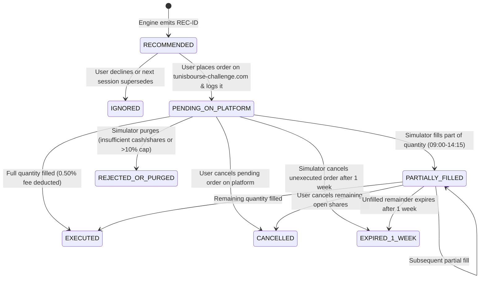

# Manual Trading & Order-Reconciliation Workflow

## 1. Core Safety Principle: Human-in-the-Loop Only
Per `AGENTS.md` and `rules.md`:
- The application **never submits orders** to `tunisbourse-challenge.com`.
- A recommendation generated by the system is a **decision-support proposal**, never an assumed fill.
- The local portfolio ledger updates **only** when the user explicitly records manual order submissions and actual platform execution outcomes.

---

## 2. Recommendation Contract (`RecommendationRecord`)

Every recommendation emitted by the engine contains:
1. **`recommendation_id`**: Deterministic unique ID, e.g., `REC-20261105-TN0001000010-01` (`SHA256(cutoff + instrument_id + action + dataset_sha256)[:12]`).
2. **`data_cutoff` & `generated_at`**: Exact UTC/Tunis timestamp of the latest market bar and disclosure used, plus when the analysis ran.
3. **`action`**: One of `BUY_CANDIDATE`, `HOLD`, `REDUCE`, `SELL_CANDIDATE`, or `NO_TRADE`.
4. **`order_proposal` (`null` when `action` is `HOLD` or `NO_TRADE`, or when portfolio state is unreconciled)**:
   - `side`: `"buy"` | `"sell"`
   - `suggested_order_type`: `"limit"` (default for thin BVMT books to avoid adverse opening/intraday spikes) or `"market"`
   - `proposed_quantity_shares`: Integer share count rounded down (`ROUND_FLOOR`) so that:
     $$\text{Existing Holding Value} + (\text{Pending Buy Value}) + (\text{Proposed Shares} \times \text{Reference Price}) \le 0.095 \times \text{Total Portfolio Value}$$
     *(Includes a 0.50% safety buffer below the simulator's hard 10.0% single-stock cap so minor price increases before execution do not trigger an automatic quantity reduction or purge.)*
   - `estimated_gross_amount_tnd`: `Decimal` (`0.001` TND precision)
   - `estimated_fee_tnd`: `0.50%` (`50 bps`) of gross amount, rounded to `0.001` TND (`ROUND_HALF_UP`)
   - `reference_price_tnd`: Latest verified `traded` close price (never an unverified or stale quote)
5. **`evidence_and_limitations`**:
   - Quantitative metrics (`momentum_20s`, `momentum_60s`, `relative_strength_20s`, `median_turnover_20s`, `trade_frequency_20s`).
   - Source document citations (`source_document_id`, `locator`, verbatim `original_text`).
   - Explicit execution warnings (e.g., *"Order represents 4.2% of 20-day median daily volume; may experience partial fill or remain pending if session activity is low."*).

---

## 3. State Machine for Manual Orders & Reconciliation

### How Each State Updates the Local Ledger (`Decimal` Accounting)

| Order State Logged by User | Available Cash (`TND`) | Reserved Cash (`TND`) | Owned Shares | Reserved Shares (Pending Sell) | Duplicate-Recommendation Guard |
|---|---|---|---|---|---|
| **`RECOMMENDED` (Not yet placed)** | Unchanged | Unchanged | Unchanged | Unchanged | Active proposal shown in UI |
| **`PENDING_ON_PLATFORM` (Buy)** | `- (qty * price * 1.005)` | `+ (qty * price * 1.005)` | Unchanged | Unchanged | **Blocks new `BUY_CANDIDATE`** for that stock while order is pending (or deducts pending value from remaining 10% cap room) |
| **`PENDING_ON_PLATFORM` (Sell)** | Unchanged | Unchanged | Unchanged | `+ qty` | **Blocks duplicate `SELL_CANDIDATE`** for those reserved shares |
| **`PARTIALLY_FILLED` (`filled_qty`, `fill_price`, `actual_fee`)** | Adjusts difference between reserved estimate and actual `(filled_qty * fill_price +/- actual_fee)` | Retains reservation for `remaining_open_qty` | `+ filled_qty` (Buy) or `- filled_qty` (Sell) | Reduced by `filled_qty` (Sell) | Tracks `remaining_open_qty` in pending queue |
| **`EXECUTED` (Full Fill)** | Finalizes cash delta using exact reported fill price & `0.50%` fee | Released (`0`) | Updated by full `filled_qty` | Released (`0`) | Position now reflected in `Owned Shares` |
| **`CANCELLED` / `REJECTED_OR_PURGED` / `EXPIRED_1_WEEK`** | Restores unused reserved cash to `Available Cash` | Released (`0`) | Unchanged | Released (`0`) | Unlocks stock for future evaluation |

---

## 4. Safeguards Against Common Competition Pitfalls

1. **Pending-Order De-Duplication**:
   - If you placed a Buy order for `DEMO_A` at `14:30` (after the `09:00–14:15` simulator execution window), that order sits `PENDING_ON_PLATFORM` until the next session.
   - Because you logged it as `PENDING_ON_PLATFORM`, the next morning's analysis sees your pending order and **will not tell you to buy `DEMO_A` a second time**.
2. **1-Week Order Expiration Tracker**:
   - Because the FAQ notes that unexecuted orders expire after **one week** (and whether this is 5 trading sessions or 7 calendar days is unresolved), the journal flags an early warning at **Day 4 (Trading Sessions)** / **Day 5 (Calendar Days)** so you can inspect `tunisbourse-challenge.com` and verify whether the order is still active or expired.
3. **Reconciliation Check Before Emitting Sizing**:
   - Before generating order quantities (`proposed_quantity_shares`), the workflow asks you to confirm that your local **Available Cash** and **Holdings** match your `tunisbourse-challenge.com` `Portefeuille` page (`last_reconciled_at`). If an unresolved discrepancy exists, order quantity sizing is withheld until reconciled.

