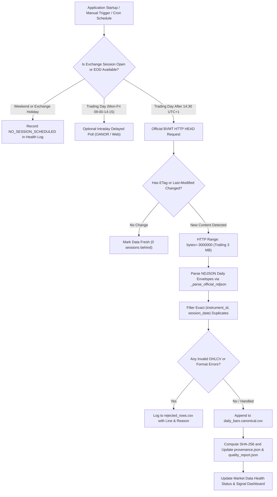

# BVMT Market Data Providers & Automated Gateway Specification

## 1. Executive Summary & Objective

The BVMT Trading Intelligence platform requires an automated, resilient, and legally compliant market data gateway to replace manual CSV imports for daily quotations. This specification evaluates available data providers for the Bourse de Tunis (BVMT), establishes a pluggable adapter architecture (`MarketDataProvider`), defines lifecycle orchestration (startup, market-hours, EOD finalization), and resolves simulation volume assumptions while strictly isolating market data from authenticated competition portfolios.

---

## 2. Market Data Provider Evaluation

### Provider 1: Official Bourse de Tunis NDJSON Historical Feed (`tunis_stockexchange_ndjson`)
* **Endpoint URL**: `https://www.tunis-stockexchange.com/sites/default/files/historique/data_json/market_resume.ndjson`
* **Transport & Protocol**: HTTPS with full HTTP Range request support (`Accept-Ranges: bytes`, `ETag`, `Last-Modified`).
* **Content Size**: ~222 MB cumulative archive, growing by ~988 KB per trading session envelope.
* **Payload Structure**: Newline-delimited JSON (NDJSON). Each row is a self-contained daily session envelope:
  ```json
  {
    "seance": "2026-11-06",
    "data": [
      {
        "dateSeance": "2026-11-06",
        "codeISIN": "TN0001900604",
        "mnemo": "BH",
        "valeur": "BH BANK",
        "coursOuvert": "13.090",
        "plusHaut": "13.100",
        "plusBas": "13.060",
        "cloture": "13.090",
        "quantites": "12450",
        "capitaux": "162985.500",
        "echanges": "42",
        "groupe": "11"
      }
    ]
  }
  ```
* **Coverage**: Complete BVMT equity and fixed-income universes across quotation groups (Group 11: Principal Continu, Group 12: Principal Fixing, Group 52: Alternatif, Group 99: Surveillance/Radiations).
* **Timeliness & Latency**: Official End-of-Day (EOD) publication. Updated once per exchange trading day, typically between 14:30 and 15:15 Africa/Tunis time.
* **Licensing & Legal Status**: Public dissemination portal maintained by the exchange for transparency and research. Personal, academic, and non-commercial research use is permitted under BVMT website terms. Commercial redistribution or sub-licensing requires an institutional exchange license.
* **Access Method & Efficiency**: Rather than downloading the entire ~222 MB file daily, our gateway issues an HTTP `HEAD` request to inspect `ETag` and `Last-Modified`. If updated, it performs an HTTP `Range: bytes=-3000000` (trailing 3 MB) request to ingest only the latest 1 to 3 session envelopes.
* **Cost**: Free (€0.00).

---

### Provider 2: OANOR BVMT Stock API (`oanor_bvmt_api`)
* **API Base URL**: `https://api.oanor.com/tunisia-stock-api`
* **OpenAPI Specification**: `https://oanor.com/api/tunisia-stock-api/openapi.json`
* **Key Endpoints**:
  - `GET /v1/quote?codes=BH,SFBT,BIAT`: Real-time or 15-minute delayed quotation snapshots.
  - `GET /v1/screener`: Multi-ticker snapshot with market capitalization, P/E, volume, and percentage changes.
  - `GET /v1/index?symbol=TUNINDEX`: Tunindex and Tunindex 20 benchmark index values.
* **Authentication**: Header `x-oanor-key: <api_token>`.
* **Rate Limits & Tiers**:
  - **Free Tier**: €0/month, 7,000 requests/month, hard rate limit of 2 requests/second. Hard cap enforced with HTTP 429 (no surprise billing or auto-overage charges).
  - **Commercial Tiers**: Paid tiers available (€29 to €99/month) for higher burst rates and higher request caps.
* **Upstream Provenance**: OANOR normalizes data sourced from BVMT market feeds and TradingView exchange scrapers.
* **Licensing & Legal Status**: Commercial API service offering third-party programmatic access. Suitable as an optional delayed intraday snapshot source when configured with an explicit user API key.
* **Cost**: Free tier (€0.00 up to 7,000 req/mo). Requires explicit user activation; offline locked by default.

---

### Provider 3: Institutional Direct Multicast / ICE Consolidated Feed
* **Provider**: Intercontinental Exchange (ICE Data Services) / Bourse de Tunis Direct Market Data Feed.
* **Transport**: Direct multicast / FIX / ITCH protocol or ICE Consolidated Feed.
* **Coverage**: Full Level 1 (top-of-book) and Level 2 (order book depth) real-time ticks.
* **Licensing & Cost**: Institutional data licensing agreement required; monthly redistribution and terminal fees (~$1,500+ / month).
* **Suitability**: Incompatible with local-first, zero-cost competition research MVP. Documented for reference and institutional scalability only.

---

## 3. Provider Comparative Matrix

| Evaluation Dimension | Official BVMT NDJSON (`tunis_stockexchange`) | OANOR BVMT API (`oanor_api`) | ICE Consolidated Feed | Local Archive Provider (`local_archive`) |
| :--- | :--- | :--- | :--- | :--- |
| **Primary Data Nature** | Official EOD Settlement & Bars | 15-min Delayed Intraday Quotes | Real-time L1/L2 Market Depth | Offline Canonical Historical Bars |
| **Legal Status** | Authorized Public Research Portal | Permitted 3rd-Party Commercial API | Authorized Direct Enterprise Feed | Local File System (Zero External Network) |
| **Direct Operating Cost** | **€0.00 (Free)** | **€0.00 (Free Tier 7k/mo)** | High Enterprise Fees ($$$) | **€0.00 (Free)** |
| **Rate Limit / Caps** | Non-aggressive EOD polling | 2 req/s, 7,000 req/mo hard-capped | Dedicated Bandwidth SLA | None (Local Disk I/O) |
| **Network Overhead** | Low (~1–3 MB range fetch / day) | Extremely Low (JSON REST) | High Continuous Bandwidth | Zero Network Overhead |
| **Payload Integrity** | Direct BVMT exchange grouping | TradingView / Scraper normalization | Native Exchange Protocol | Deterministic SHA-256 Provenance |
| **Default Gateway Role** | **Primary Automated EOD Ingestion** | **Optional Secondary Intraday Source** | Unsupported for MVP | **Offline Fallback & Test Harness** |

---

## 4. Gateway Architecture & Data Contracts

### 4.1 Pluggable `MarketDataProvider` Protocol
The gateway defines a uniform, pluggable Python interface (`src/bvmt/gateway.py`):

```python
class MarketDataProvider(Protocol):
    """Abstract protocol for BVMT market data adapters."""
    
    @property
    def provider_id(self) -> str: ...
    
    @property
    def display_name(self) -> str: ...
    
    def check_health(self) -> ProviderHealthStatus: ...
    
    def fetch_latest_quotes(self, symbols: list[str] | None = None) -> list[QuotationSnapshot]: ...
    
    def sync_daily_bars(
        self,
        output_dir: Path,
        as_of: date | None = None,
    ) -> DailyMarketRefreshResult: ...
```

### 4.2 Concrete Adapter Implementations
1. **`OfficialBvmtNdjsonProvider`**:
   - Executes HTTP `HEAD` against `https://www.tunis-stockexchange.com/sites/default/files/historique/data_json/market_resume.ndjson`.
   - Compares `ETag` and `Last-Modified` with cached metadata in `data/staging/market_resume_head.json`.
   - If unchanged, returns without downloading.
   - If modified, issues HTTP `Range: bytes=-3000000` to fetch trailing daily envelopes.
   - Saves raw payload to `data/staging/market_resume_tail.ndjson`.
   - Dispatches to `refresh_daily_market_pipeline()` to parse official envelopes, quarantine invalid rows, eliminate duplicates, and merge into `data/processed/bvmt_official_2026/daily_bars.canonical.csv`.
2. **`OanorMarketDataProvider`**:
   - Reads `x-oanor-key` from environment or config.
   - If key is absent, marks provider as `UNCONFIGURED` without making network calls.
   - Respects 2 req/sec rate limit with exponential backoff and tracks monthly request counters.
3. **`LocalArchiveProvider`**:
   - Reads from pre-existing canonical CSV files or local NDJSON fixtures.
   - Guarantees 100% offline functionality, unit testing reproducibility, and CI verification.

---

## 5. Refresh Lifecycle & Scheduling



### Operational Rules
1. **Weekend and Holiday Awareness**: The gateway consults `ExchangeCalendar` (`src/bvmt/calendar.py`). Polling is paused on Saturdays, Sundays, and verified exchange holidays (e.g. Independence Day, Eid holidays).
2. **Exponential Backoff**: If network requests encounter timeouts or HTTP 5xx errors, retry delays scale exponentially (2s, 4s, 8s, 16s) up to a maximum of 3 retries before falling back cleanly and raising a descriptive health alert.
3. **Strict Account Isolation**: The market data gateway writes strictly to `data/staging/` and `data/processed/`. It has **no access** to `data/portfolio/real_competition_ledger.json` and cannot alter portfolio cash, holdings, or trade histories.

---

## 6. Resolution of Volume Lookahead & Execution Capacity

### 6.1 Audit of Milestone 5 Finding
In Milestone 5, an audit revealed that backtesting models (e.g. Model G) using `0.10 * volume_shares` at `next_open` implicitly utilized the **full-day closing volume** of the execution day because only EOD volume is recorded in daily bars. In thinly traded BVMT securities, the opening auction (`coursOuvert`) represents only a subset of total daily liquidity.

### 6.2 Policy & Transparency Resolution
1. **Explicit Simulation Labeling**: All backtest reports and Strategy Lab metrics must explicitly declare:
   > *"Execution capacity assumption: 10% of total daily session volume. When executing at next open, full-day volume serves as an ex-post daily liquidity cap proxy. Sensitivity tests across 1%, 5%, and 10% volume participation are provided in the experiment registry."*
2. **Opening Auction Data Collection**: When real-time or snapshot data feeds are active, the gateway records opening auction trade quantities (`echanges_ouverture`, `quantites_ouverture`) to enable authentic opening-capacity backtesting.
3. **Forward Paper Trading Defense**: Forward paper trading journals (`data/portfolio/paper_trading_journal.json`) evaluate orders against conservative order limits without presuming fill priority.

---

## 7. Frontend Integration & Safety Controls

1. **Dashboard Market Health Panel (`/health`)**:
   - Displays Active Provider (`Official Bourse de Tunis NDJSON`), Transport Mode (`HTTP Range Tail`), Last Successful Ingestion Timestamp, Sessions Behind count, and Stale Instruments count.
   - Provides an interactive **"Refresh Market Data"** button wired to `POST /api/market-data/refresh`.
2. **Classification Badges**:
   - `OFFICIAL_EOD`: Verified exchange closing prices from official NDJSON.
   - `DELAYED_QUOTES`: 15-minute delayed intraday snapshot from permitted API.
   - `SYNTHETIC_DEMO`: Demonstration fixtures; recommendations on real portfolios are strictly blocked.
3. **Safety Block**: Recommendations for the real competition portfolio are automatically blocked if market data is older than 5 exchange sessions or contains unverified synthetic fixtures.
