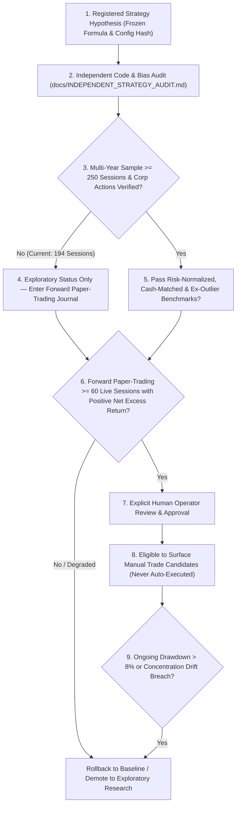

# BVMT Quantitative Model & Strategy Catalog

**Document Status**: Verified Milestone 5 Model Inventory & Audit Classification  
**Code Implementation**: [`src/bvmt/features.py`](file:///c:/Users/Thinkcenter/Desktop/BVMT/bvmt-starter-kit/src/bvmt/features.py), [`src/bvmt/strategies.py`](file:///c:/Users/Thinkcenter/Desktop/BVMT/bvmt-starter-kit/src/bvmt/strategies.py), [`src/bvmt/paper_trading.py`](file:///c:/Users/Thinkcenter/Desktop/BVMT/bvmt-starter-kit/src/bvmt/paper_trading.py)  
**Shared Execution Rules**: T+1 Next-Open Fills, `0.50%` Buy / `0.50%` Sell Fee, `10.0%` Purchase Concentration Cap, `10.0%` Daily Volume Participation Cap, `0` Fills on Zero-Volume Bars.

---

## 1. Summary Inventory of Models, Audit Status & Promotion Eligibility

Following the **Milestone 5 Independent Strategy Audit** ([`docs/INDEPENDENT_STRATEGY_AUDIT.md`](file:///c:/Users/Thinkcenter/Desktop/BVMT/bvmt-starter-kit/docs/INDEPENDENT_STRATEGY_AUDIT.md)), no strategy is promoted to an automated or guaranteed live model. All strategies remain **Exploratory Decision-Support Candidates** requiring forward paper-trading validation and explicit human approval.

| Model ID | Code Identifier | Name | Category | Audit Status (Milestone 5) | Promotion Eligible? |
| :--- | :--- | :--- | :--- | :--- | :---: |
| **Demo v0.1** | `demo-momentum-v0.1` | Synthetic 3-Bar Demo Momentum | Synthetic Fixture | **Synthetic Smoke Test Only** | No |
| **Baseline A** | `A_CASH_ONLY` | Cash-Only Baseline (`0%` Exposure) | Naïve Benchmark | **Verified Capital Floor (`0.00%`)** | Benchmark |
| **Baseline B** | `B_EQUAL_WEIGHT_ELIGIBLE` | Equal-Weight Eligible Universe | Market Benchmark | **Verified Broad Beta (`+14.05%`, `93.81%` active util)** | Benchmark |
| **Baseline C** | `C_BUY_AND_HOLD_BENCHMARK` | Buy-and-Hold Initial Top Basket | Passive Benchmark | **Verified Passive Sleeve (`+14.03%`, `72.44%` active util)** | Benchmark |
| **Baseline D** | `D_MOMENTUM_20S` | Simple 20-Session Momentum ($M_{20}$) | Single-Factor | **Exploratory (Identical to F when $\ge 5$ stocks beat mean)** | No |
| **Baseline E** | `E_MOMENTUM_60S` | Simple 60-Session Momentum ($M_{60}$) | Single-Factor | **Exploratory (`-22.18%` worst tail slice)** | No |
| **Baseline F** | `F_RELATIVE_STRENGTH_20S` | Cross-Sectional Relative-Strength ($RS_{20}$) | Rank Translation | **Redundant with D (`M_20 - mean(M_20)` is rank-invariant)** | No |
| **Baseline G** | `G_LIQUIDITY_FILTERED_MOMENTUM` | T04 Liquidity-Filtered Vol-Adjusted Momentum | Active Research Baseline | **Exploratory — High Single-Stock (`SOTETEL`) & Low-Exposure Dependency** | **No (Forward Paper Required)** |
| **Model H** | `H_DOWNSIDE_RISK_TREND_MULTIFACTOR` | Downside-Risk, Drawdown, Consistency & Liquidity Multi-Factor | Enhanced Multi-Factor | **Exploratory (`+27.76%` at 10-slot equal budget)** | **No (Forward Paper Required)** |
| **Model I** | `I_REGIME_FILTERED_QUALITY_MOMENTUM` | Market-Regime-Filtered Quality Momentum | Regime + Multi-Factor | **Exploratory — #1 Exposure-Normalized (`+63.85%`) & #1 10-Slot (`+28.82%`)** | **No (Forward Paper Required)** |
| **ML Ranker** | `lgbm_walk_forward_v0` | Walk-Forward LightGBM Cross-Sectional Ranker | Machine Learning | **Blocked (`194 < 250` sessions)** | **Blocked** |

---

## 2. Signal Generation & Time-of-Information Controls

Every real-market model (`B` through `I`) and the forward paper-trading engine ([`src/bvmt/paper_trading.py`](file:///c:/Users/Thinkcenter/Desktop/BVMT/bvmt-starter-kit/src/bvmt/paper_trading.py)) enforce strict point-in-time causality:

```mermaid
flowchart LR
    subgraph PIT["Point-in-Time Information Boundary (Session t Close)"]
        Bars["Canonical Daily Bars (bar_date <= session_t)"]
        Master["Dated Instrument Master (listed_from <= t <= listed_to)"]
        Cal["Open Exchange Sessions (closes_at <= cutoff_t)"]
    end

    subgraph Gates["7-Stage Eligibility Filter"]
        G1["1. Active Listing & Principal Segment (11/12)"]
        G2["2. >= 61 Completed Open Sessions"]
        G3["3. Zero Suspensions in 61-Session Window"]
        G4["4. Traded Anchor Bars (t, t-20, t-60) with Vol > 0"]
        G5["5. Liquidity Gate (Freq >= 60%, Turnover >= 5,000 TND)"]
    end

    subgraph Exec["Forward-Only T+1 Execution Boundary"]
        Sig["Immutable Signal Snapshot (config_hash + data_hash)"]
        Pend["Pending Order Queue (PENDING_NEXT_SESSION)"]
        NextOpen["Session t+1 Open Fill (50 bps Fee + 10 bps Slippage + 10% Vol Cap)"]
    end

    PIT --> Gates --> Sig --> Pend --> NextOpen
```

---

## 3. Detailed Mathematical Specifications & Milestone 5 Audit Findings

### 3.1 Baselines A, B, and C (Reference Benchmarks)
- **`A_CASH_ONLY`**: Holds `100%` TND cash (`50,000.000 TND`), `0` orders, `0.00%` return, `0.00%` drawdown.
- **`B_EQUAL_WEIGHT_ELIGIBLE`**: Allocates equal capped sleeves (`10.0%` cap across top 10 initial liquid eligible stocks) rebalanced every 19 open sessions (`+14.0480%` marked return, `+13.4955%` liquidated return, `93.81%` active post-warmup capital utilization, `17.1999%` max drawdown, `18.33%` exposure-normalized drawdown).
- **`C_BUY_AND_HOLD_BENCHMARK`**: Buys the same initial 10 equal sleeves once at the end of the 61-session warmup (`2026-03-31` open) and holds without rebalancing (`+14.0261%` marked return, `+13.6074%` liquidated return, `72.44%` active capital utilization, `12.6055%` max drawdown).

---

### 3.2 Baselines D, E, and F (Single-Horizon & Relative-Strength Momentum)
- **`D_MOMENTUM_20S`**:
  $$S_i^{(D)}(t) = M_{i,20}(t) = \frac{C_{i,t}}{C_{i,t-20}} - 1$$
- **`E_MOMENTUM_60S`**:
  $$S_i^{(E)}(t) = M_{i,60}(t) = \frac{C_{i,t}}{C_{i,t-60}} - 1$$
- **`F_RELATIVE_STRENGTH_20S`**:
  $$S_i^{(F)}(t) = M_{i,20}(t) - \frac{1}{|\mathcal{E}(t)|}\sum_{j \in \mathcal{E}(t)} M_{j,20}(t), \qquad S_i^{(F)}(t) > 0$$
  - **Milestone 5 Audit Finding (Mathematical Redundancy with D)**: Because the cross-sectional mean $\bar{M}_{20}(t)$ is identical for every stock on session $t$, subtracting $\bar{M}_{20}(t)$ is a strictly order-preserving translation. Whenever at least $K = 5$ eligible stocks have $M_{i,20}(t) > \bar{M}_{20}(t)$ (which occurred on all 7 rebalance dates in 2026), `D_MOMENTUM_20S` and `F_RELATIVE_STRENGTH_20S` select the **exact same 5 stocks in the exact same order** (`+17.0506%` marked return, `40` fills, `1,192.787 TND` fees).

---

### 3.3 Baseline G: Liquidity-Filtered Volatility-Adjusted Momentum (`G_LIQUIDITY_FILTERED_MOMENTUM`)
- **Mathematical Formula**:
  Requires $\text{Freq}_{i,20} \ge 0.60$, $\text{MedianTurnover}_{i,20} \ge 5,000\text{ TND}$, and $M_{i,20}(t) \ge +0.015$:
  $$S_i^{(G)}(t) = 0.50 \cdot \frac{M_{i,20}(t)}{\sigma_{i,20}(t)} + 0.50 \cdot \frac{M_{i,60}(t)}{\sigma_{i,20}(t)}$$
- **Milestone 5 Audit Status (`exploratory_unvalidated_high_outlier_dependency`)**:
  1. **Low Drawdown Explained by Low Capital Utilization**: Model G's `4.9840%` headline max drawdown occurs because its 5-slot (`8.5%` target weight) configuration and one-shot next-open volume caps invest only **`29.79%` of capital during active post-warmup sessions** (`20.57%` including the 60-session warmup). Normalized by active exposure, its invested sleeve drawdown is **`16.73%`** ($4.9840\% / 0.2979$), nearly identical to Benchmark C (`17.40%`) and Benchmark B (`18.33%`).
  2. **Single-Stock Outlier Dependency (`SOTETEL`)**: A single trade in `SOTETEL` (`+202.29%` slice gain, `+12,097.785 TND` net profit on the `100,000.000 TND` registry capital = `+12.10%` of initial equity, or `64.31%` of Model G's total profit) accounts for the majority of its headline return. When `SOTETEL` is excluded from the universe (`ex_top_winner_net_return_pct`), Model G's net return drops from **`+18.8117%` to `+7.4320%`** (still positive and the highest ex-`SOTETEL` return among `D`–`I`, outperforming cash-matched Benchmark B's `+4.46%`, but below unadjusted Benchmark B's `+14.05%` due to ~70% cash drag).
  3. **Inter-Rebalance Concentration Drift**: While all buy orders respect the `10.0%` cap at execution, `SOTETEL`'s price surge between 19-session rebalances pushes max mark-to-market weight to `14.2517%` across `22` sessions. When daily next-open concentration trimming (`>10.0%` trimmed back to `8.5%` daily) is enforced, max weight drops while locking in gains earlier.

---

### 3.4 Model H & Model I: Multi-Factor Downside-Risk & Regime-Filtered Quality Momentum
- **`H_DOWNSIDE_RISK_TREND_MULTIFACTOR`**:
  $$S_i^{(H)}(t) = S_i^{(G)}(t) - \frac{\sigma^-_{i,60}(t)}{\sigma_{i,20}(t)} - \frac{DD_{i,60}(t)}{\sigma_{i,20}(t)} + C_{i,60}(t) + \text{Freq}_{i,20}(t)\cdot \ln\!\left(1 + \frac{\text{Turnover}_{i,20}(t)}{5,000}\right)$$
- **`I_REGIME_FILTERED_QUALITY_MOMENTUM`**:
  Applies `H_DOWNSIDE_RISK_TREND_MULTIFACTOR` when cross-sectional market breadth $\bar{M}_{20}(t) \ge 0$; when $\bar{M}_{20}(t) < 0$, halves target sleeve weight (`8.5% -> 4.25%`) and requires $RS_{i,20}(t) \ge +0.02$ and $DD_{i,60}(t) \le 0.10$.
- **Milestone 5 Risk-Normalized Discovery**:
  - Once returns are normalized by active invested exposure (`exposure_normalized_return_pct`) or evaluated at an equalized **10-slot (`9.5%` target) capital budget**, **`I_REGIME_FILTERED_QUALITY_MOMENTUM` ranks #1 overall**:
    - **Exposure-Normalized Return**: **`+63.85%`** (vs `+63.15%` for Model G and `+14.97%` for Equal-Weight B).
    - **Equalized 10-Slot Budget Return**: **`+28.8225%`** with **`10.30%` max drawdown** (vs `+25.3667%` and `10.92%` max drawdown for 10-slot Model G, and `+14.0480%` and `17.20%` max drawdown for Equal-Weight B).

---

## 4. Strategy Promotion & Rollback Governance Lifecycle

