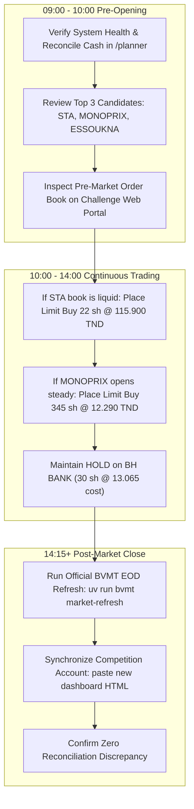

# BVMT Trading Intelligence — Monday, November 9, 2026 Operations Manual

## 1. Context & Operational Readiness Checkpoint

**Date:** Monday, November 9, 2026  
**Session Schedule:** 09:00 – 14:15 Africa/Tunis  
**Pre-Opening Phase:** 09:00 – 10:00  
**Continuous Trading Phase:** 10:00 – 14:00  
**Pre-Closing & Fixing:** 14:00 – 14:10  
**Trading at Last (TAL):** 14:10 – 14:15  

### Pre-Market System Verification Status
- **Backend Service:** Running at `http://127.0.0.1:8000` (FastAPI).
- **Frontend Interface:** Running at `http://127.0.0.1:3000` (Next.js 15).
- **Market Data Provider:** Official Bourse de Tunis Gateway (`BVMTDailyQuotationsProvider`).
- **Data Through:** 2026-11-06 (194 trading sessions, 14,480 accepted bars, SHA-256 verified).
- **Current Portfolio Mode:** `REAL_COMPETITION` (Snapshot `sync_20261107_122006.json`).
- **Account Value:** Total Equity = `50,000.750 TND`, Cash = `49,608.050 TND`.
- **Existing Position:** `BH BANK` (30 shares @ 13.090 TND = `392.700 TND`, weight `0.785%`).
- **National Ranking:** `#118 / 14,530` participants (+0.00% return).

---

## 2. Monday Action Plan by Phase



---

## 3. Pre-Calculated Order Plans for Monday

The following order plans have been sized strictly by `src/bvmt/position_sizing.py` and are visible in the Trade Planner at `http://127.0.0.1:3000/planner`:

### Candidate 1: `STA` (Société Tunisienne d'Automobiles) — Rank #1 Momentum
- **ISIN / Ticker:** `TN0007800014` / `STA`
- **Market Segment:** Continuous (Eligible)
- **Proposed Limit Price:** **`115.900 TND`**
- **Suggested Shares:** **`22 shares`**
- **Gross Order Value:** **`2,549.800 TND`** (Allocation: `5.10%` of equity)
- **Purchase Fee (0.50%):** `12.749 TND`
- **Total Required Outlay:** **`2,562.549 TND`**
- **Break-Even Exit Price:** **`117.065 TND`** (`+1.01%`)
- **Take-Profit Target (+12%):** `129.800 TND`
- **Stop-Loss Trigger (-5%):** `110.100 TND`
- **Binding Constraint:** 10% daily volume participation ($\lfloor 0.10 \times 220 \rfloor = 22$ shares).
- **Manual Action:** Log into `https://www.tunisbourse-challenge.com`, navigate to Order Entry, enter Limit Buy for `22` shares of `STA` at `115.900 TND`.

### Candidate 2: `MONOPRIX` (Société Nouvelle Maison de la Ville de Tunis) — Rank #2 Momentum
- **ISIN / Ticker:** `TN0001000124` / `MNP`
- **Market Segment:** Continuous (Eligible)
- **Proposed Limit Price:** **`12.290 TND`**
- **Suggested Shares:** **`345 shares`**
- **Gross Order Value:** **`4,240.050 TND`** (Allocation: `8.48%` of equity, safely under 10% cap)
- **Purchase Fee (0.50%):** `21.200 TND`
- **Total Required Outlay:** **`4,261.250 TND`**
- **Break-Even Exit Price:** **`12.414 TND`** (`+1.01%`)
- **Take-Profit Target (+12%):** `13.760 TND`
- **Stop-Loss Trigger (-5%):** `11.680 TND`
- **Binding Constraint:** 8.5% target concentration capacity ($\lfloor 4,250.06 / 12.290 \rfloor = 345$ shares).
- **Manual Action:** If available cash permits after STA or as alternate primary allocation, enter Limit Buy for `345` shares of `MONOPRIX` at `12.290 TND`.

### Candidate 3: `ESSOUKNA` (Société Essoukna) — Rank #3 Momentum
- **ISIN / Ticker:** `TN0006740013` / `SCN`
- **Proposed Limit Price:** **`4.640 TND`**
- **Suggested Shares:** **`125 shares`**
- **Gross Order Value:** **`580.000 TND`** (Allocation: `1.16%`)
- **Binding Constraint:** 10% daily volume participation ($\lfloor 0.10 \times 1,250 \rfloor = 125$ shares).

### Existing Position: `BH BANK` (Banque de l'Habitat)
- **Held Shares:** `30 shares` @ `13.065 TND` cost basis (`392.700 TND` current value)
- **Recommended Action:** **`HOLD`**
- **Rationale:** Position is profitable (+0.19%), below stop-loss trigger, and represents only `0.78%` of equity. No rebalancing trigger has fired.

---

## 4. Post-Session Account Reconciliation Checklist (14:15+)

After trading closes at 14:15 Africa/Tunis, perform the daily update:

1. **Download Official BVMT Closing Quotations:**
   ```bash
   uv run bvmt market-refresh
   ```
2. **Synchronize Competition State:**
   - Log into the Tunis Bourse Challenge portal.
   - Save the refreshed portfolio page HTML to `data/snapshots/`.
   - Run account synchronization:
     ```bash
     uv run bvmt sync-portfolio --snapshot data/snapshots/<new_file>.html
     ```
3. **Audit Ledger Reconciliation:**
   - Verify on `http://127.0.0.1:3000/portfolio` that `Reconciliation Discrepancy` remains **`0.000 TND`**.
   - Check whether any pending limit orders were filled or remain open in the order book.

