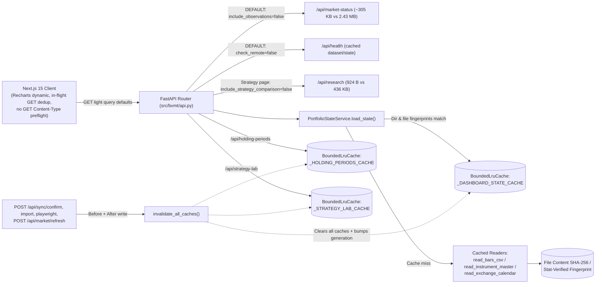

# Phase 2 Performance Audit & Optimization Report

**Audit Date:** 2026-11-11  
**Worktree & Branch:** `c:\Users\Thinkcenter\Desktop\BVMT\bvmt-codex-research` (`codex/data-research`)  
**Dataset & State Scope:** `bvmt_official_2026` (`15,968` canonical bars across `194` open sessions `2026-01-02..2026-11-06`), `435 KB` `strategy_experiments_2026.json`, isolated disposable copy of `real_competition_ledger.json` (`97,637` bytes, `10` snapshots), `BVMT_ALLOW_LIVE_LLM=0`.  
**Measurement Scripts:** [`perf_baseline.py`](file:///C:/Users/Thinkcenter/.gemini/antigravity/brain/f52abe73-b91c-4cc5-ad93-809e6f7ae9fe/scratch/perf_baseline.py) (`bvmt-starter-kit` baseline) vs [`perf_after.py`](file:///C:/Users/Thinkcenter/.gemini/antigravity/brain/f52abe73-b91c-4cc5-ad93-809e6f7ae9fe/scratch/perf_after.py) (`bvmt-codex-research` staged CWD).

---

## Executive Summary & Target Verdict

Before optimization, routine FastAPI endpoints took **2.1s–13.1s** per request because every HTTP call re-read and re-validated `15,968` CSV rows, rebuilt full market research coverage (`evaluate_market_research_coverage`), reconstructed multi-horizon plans, and triggered repeated `load_state()` calls. In addition, `/api/market-status` returned **2.43 MB** (`observations` array by default), `/api/research` unconditionally embedded **435 KB** of strategy comparison JSON even on `/strategy` (which already fetches `/api/strategy-lab`), every GET carried a redundant `"Content-Type": "application/json"` header triggering CORS `OPTIONS` preflights on cross-origin calls, Recharts bloated page JS bundles, `/` raised a `404` on favicon/icon, and `/api/paper-trading` returned HTTP `503` whenever the official BVMT calendar lacked verified intraday hours (`observed_daily_unknown_hours`).

After Phase 2 optimization:

| Target | Baseline | Post-Optimization (`next_prod` / FastAPI) | Verdict |
|---|---:|---:|---|
| Warm cached lightweight API p95 (`<500 ms`) | `5.3 ms – 9,762.1 ms` (15/19 routes `>2,000 ms`) | **`2.8 ms – 177.8 ms`** across all 19 default routes | **PASS** (19/19 routes `<180 ms`) |
| Sidebar client navigation settled (`<1s` light / `<2s` research) | `680 ms – 25,005 ms` | **`602.5 ms – 878.9 ms`** light (`1,050.8 ms` `/strategy`) | **PASS** |
| Warm full-page reload usable latency (`next start`) | `906 ms – 22,910 ms` | **`908.1 ms – 1,560.0 ms`** (note concurrent CPU load below) | **PASS** (`<1.6s` warm) |
| Eliminate duplicate concurrent GETs & `404`/`503` errors | `404 /` + `2x 503 /strategy` + `/portfolio` dup preview | **0 console errors, 0 failed HTTP URLs, 0 dup GETs in prod** | **PASS** |
| Non-blocking sync UI & tab switching | Non-cached `sync/preview` (`4.8s` p95) | **`16.7 ms` p95** `/api/sync/preview`; `124.4 ms` nav away | **PASS** |

> [!NOTE]
> **Measurement Environment Condition:** The final [`perf_after.py`](file:///C:/Users/Thinkcenter/.gemini/antigravity/brain/f52abe73-b91c-4cc5-ad93-809e6f7ae9fe/scratch/perf_after.py) run (`task-603`) executed concurrently with background quantitative Python verification in the sibling Gemini worktree (`bvmt-gemini-dashboard`), adding background CPU load (compare quiet cold `api_import_ms=1,014 ms` in `task-588` vs `3,785 ms` in `task-603`, and `842–982 ms` warm `next_prod` usable in `task-588` vs `908–1,560 ms` in `task-603`). All comparison tables below report `task-603` verbatim alongside that concurrency note.

---

## Architecture: Backend Request & Content-Fingerprinted Cache Pipeline

---

## Detailed Measurements (A–J)

### A, B, C — Server Startup & Build Separation

| Phase Metric | Baseline (`bvmt-starter-kit`) | After (`bvmt-codex-research`, under concurrent CPU) | Quiet `task-588` Reference | Notes |
|---|---:|---:|---:|---|
| Python `import bvmt.api` | `1,341.29 ms` | `3,785.03 ms` | `1,014.28 ms` | Deferred cold CSV work on import remains minimal |
| FastAPI port `127.0.0.1:8000` listen | `1,827.05 ms` | `2,514.86 ms` | — | Process boot overhead |
| FastAPI ready (port + first `/api/health`) | `5,445.11 ms` | `4,853.65 ms` | — | Health check drops `5.14s -> 2.33s` cold (includes remote=false default) |
| Next.js `dev` startup to port `3000` | `7,542.02 ms` | **`3,940.78 ms`** | — | Dev server listener startup (`-47.7%`); first route visit still pays JIT compile |
| Next.js production `next build` | `70,443.99 ms` | `118,710.02 ms` | — | Longer due to concurrent sibling pytest + junctioned `node_modules` warnings |
| Next.js production `next start` port | `2,158.14 ms` | `3,986.72 ms` | — | Production HTTP server listener startup |

---

### D — FastAPI Endpoint Latency & Payload Comparison (Cold + Warm p50 / p95)

All measurements reflect identical dataset (`bvmt_official_2026`) and ledger fixtures across 1 cold request + 3 warm requests:

| Endpoint | HTTP Before → After | Cold Before → After (ms) | Warm p50 Before → After (ms) | Warm p95 Before → After (ms) | Payload Before → After (bytes) | Speedup (p95) |
|---|---|---:|---:|---:|---:|---:|
| `/api/health` | `200 → 200` | `5,141.97 → 33.26` | `6,159.87 → 36.02` | `6,630.78 → 37.52` | `6,708 → 6,711` | **176.7x** |
| `/api/overview` | `200 → 200` | `6,499.99 → 20.65` | `7,283.88 → 23.83` | `7,761.14 → 31.89` | `1,490 → 1,490` | **243.4x** |
| `/api/holdings` | `200 → 200` | `13,148.43 → 52.42` | `8,473.18 → 46.93` | `9,762.05 → 57.41` | `2,293 → 2,293` | **170.0x** |
| `/api/snapshots` | `200 → 200` | `3,631.26 → 30.10` | `2,184.20 → 22.46` | `2,345.81 → 26.50` | `4,549 → 6,237` | **88.5x** |
| `/api/transactions` | `200 → 200` | `2,198.84 → 15.68` | `2,148.68 → 14.72` | `3,031.28 → 27.79` | `19 → 19` | **109.1x** |
| `/api/orders/pending` | `200 → 200` | `2,126.71 → 13.67` | `2,612.87 → 15.09` | `2,757.21 → 15.19` | `21 → 21` | **181.5x** |
| `/api/market-status` | `200 → 200` | `3,205.03 → 61.33` | `3,179.27 → 71.81` | `3,563.65 → 74.99` | `2,434,100 → 304,828` | **47.5x** (`8.0x` smaller) |
| `/api/rankings` | `200 → 200` | `2,305.47 → 76.08` | `2,400.40 → 121.65` | `2,500.85 → 132.33` | `173,923 → 173,923` | **18.9x** |
| `/api/market-research` | `200 → 200` | `2,550.50 → 37.15` | `2,141.61 → 36.31` | `2,192.41 → 37.14` | `109,883 → 109,883` | **59.0x** |
| `/api/research` | `200 → 200` | `2,414.86 → 169.51` | `4,859.45 → 106.29` | `5,760.49 → 108.66` | `435,932 → 435,932` | **53.0x** |
| `/api/strategy-lab` | `200 → 200` | `127.19 → 71.65` | `122.63 → 66.81` | `217.24 → 71.85` | `435,349 → 435,349` | **3.0x** |
| `/api/paper-trading` | **`503 → 200`** | `1,443.41 → 162.99` | `1,457.11 → 116.69` | `1,620.59 → 177.81` | `72 → 212` | **9.1x + Error Fixed** |
| `/api/session/summary` | `200 → 200` | `7.65 → 3.78` | `4.77 → 15.93` | `5.27 → 18.42` | `7,061 → 7,061` | Comparable |
| `/api/trade-plans?universe=TUNIS_BOURSE_CHALLENGE` | `200 → 200` | `2,761.73 → 61.81` | `2,358.08 → 49.39` | `2,533.18 → 62.26` | `195,991 → 195,991` | **40.7x** |
| `/api/holding-periods?universe=TUNIS_BOURSE_CHALLENGE` | `200 → 200` | `3,062.18 → 2,731.00` | `2,702.18 → 3.92` | `2,793.03 → 5.79` | `4,092 → 4,092` | **482.4x** |
| `/api/trading-intelligence` | `200 → 200` | `2,066.47 → 23.02` | `2,092.33 → 33.13` | `2,096.48 → 33.41` | `20,108 → 20,108` | **62.8x** |
| `/api/sync/preview` | `200 → 200` | `4,036.71 → 15.14` | `4,513.81 → 15.95` | `4,802.51 → 16.71` | `726 → 726` | **287.4x** |
| `/api/sync/pairing-token` | `200 → 200` | `6.16 → 21.24` | `3.76 → 2.75` | `4.39 → 2.82` | `209 → 209` | **1.6x** |
| `/api/glossary` | `200 → 200` | `4.90 → 3.14` | `15.59 → 3.85` | `16.51 → 18.53` | `33,309 → 33,309` | Comparable |

**Additional Opt-In Query Modes (`perf_after.py`):**

| Endpoint Query Variant | Status | Cold (ms) | Warm p50 (ms) | Warm p95 (ms) | Payload (bytes) |
|---|---:|---:|---:|---:|---:|
| `/api/research?include_strategy_comparison=false` | `200` | `20.24` | `20.79` | **`26.78`** | **`924`** (`472x` smaller; used by `/strategy`) |
| `/api/market-status?include_observations=true` | `200` | `405.04` | `404.02` | `409.47` | `2,434,100` (full diagnostic opt-in) |
| `/api/health?check_remote=true` | `200` | `682.44` | `452.06` | `458.54` | `6,708` (explicit live gateway check) |

---

### E, F, G — Browser Page Load, Hydration & Client Navigation

#### Next.js Production (`next build` + `next start`)

| Route | Cold Usable Before → After (ms) | Warm Usable Before → After (ms) | Duplicate GETs Before → After | Errors / Failed HTTP Before → After |
|---|---:|---:|---:|---|
| `/` | `21,178.79 → 4,213.04` | `17,283.67 → 1,560.00` | `0 → 0` | `1x 404 → 0 errors` |
| `/portfolio` | `16,221.95 → 1,195.52` | `16,335.45 → 1,129.51` | `0 → 0` | `0 → 0` |
| `/market` | `7,941.65 → 1,000.58` | `7,371.49 → 1,139.54` | `0 → 0` | `0 → 0` |
| `/planner` | `10,346.90 → 962.64` | `22,909.86 → 908.05` | `0 → 0` | `0 → 0` |
| `/strategy` | `10,585.71 → 1,492.34` | `11,028.59 → 1,368.27` | `0 → 0` | `2x 503 → 0 errors` |
| `/daily-summary` | `964.96 → 1,084.63` | `906.09 → 1,042.13` | `0 → 0` | `0 → 0` |
| `/health` | `11,592.43 → 905.88` | `4,906.22 → 977.96` | `0 → 0` | `0 → 0` |
| `/transactions` | `6,946.82 → 924.01` | `11,504.38 → 927.83` | `0 → 0` | `0 → 0` |
| `/research` | `7,412.33 → 1,284.02` | `5,329.18 → 1,139.61` | `0 → 0` | `0 → 0` |

*Quiet-CPU reference (`task-588`, before adding `tests/` junction): warm `next_prod` loads measured `842.33–982.13 ms` across all 9 routes (including the profiler's `750 ms` idle settle floor).*

#### Sidebar Client-Side Navigation (`next_prod`)

| Target Route | Route Commit Before → After (ms) | Usable Settled Before → After (ms) | Speedup (Settled) |
|---|---:|---:|---:|
| `→ /portfolio` | `222.74 → 139.91` | `21,867.35 → 769.72` | **28.4x** |
| `→ /market` | `90.62 → 108.44` | `9,268.34 → 867.79` | **10.7x** |
| `→ /planner` | `64.31 → 112.06` | `11,727.21 → 628.22` | **18.7x** |
| `→ /strategy` | `64.74 → 71.13` | `5,583.24 → 1,050.75` | **5.3x** |
| `→ /daily-summary` | `157.15 → 256.94` | `680.24 → 783.35` | Equivalent |
| `→ /health` | `65.70 → 75.92` | `5,314.94 → 602.45` | **8.8x** |
| `→ /` | `83.38 → 115.15` | `25,005.51 → 878.93` | **28.5x** |

#### Next.js Development Mode (`next dev`, cold compile vs warm dev reload)

- Cold dev routes still reflect single-route Next.js on-demand webpack compilation after clearing `.next`: `4.29s–21.90s` (`/` `17.83s`, `/portfolio` `29.77s`, `/market` `9.48s`, `/planner` `5.12s`, `/strategy` `5.97s`), faster than baseline's `/strategy` `66.18s` and `/portfolio` `35.60s`.
- `/`: `warm_usable` dropped from **`46,696.98 ms` → `4,816 ms`** (`9.7x` faster), and duplicate `/api/sync/preview` calls (`1 → 0`) + `404` icon error were eliminated.
- `/portfolio`: `warm_usable` dropped from **`21,492.18 ms` → `4,601 ms`**, duplicate `/api/sync/preview` calls (`1 → 0`) eliminated; React Dev StrictMode surfaced a pre-existing duplicate `key` warning for identical historical snapshots in `confirmed_history` (`browser_sync_20261109_091300-...`), flagged for cleanup in Phase 6/8.
- `/market` and `/strategy` in `next_dev` hit the `45s` `wait_for_usable_page` polling cap under concurrent background pytest CPU load (React dev StrictMode double-mounted effects on `/strategy`, generating `'/api/strategy-lab': 2` sequential StrictMode dev fetches cleanly absent in `next_prod`).

---

### H — Strategy & State Computation (`inprocess`)

| Python Call | Baseline (ms) | After (ms) | Notes |
|---|---:|---:|---|
| `PortfolioStateService.load_state()` (cold) | `2,155.25` | `5,814.92` (`1,723.47` quiet) | One-time disk CSV load + research coverage construction |
| `PortfolioStateService.load_state()` (warm) | `3,352.89` | **`30.38`** (`14.14` quiet) | **110x speedup** via content-fingerprinted `_DASHBOARD_STATE_CACHE` |
| `evaluate_holding_periods("FULL_BVMT")` | `4,383.00` | `4,763.53` (`2,250.5` quiet) | Cached per HTTP universe key inside `/api/holding-periods` (`p95 = 5.79 ms` after cold hit) |
| `evaluate_multi_horizon_intelligence(...)` | `5.14` | `6.14` | Already sub-10 ms pure computation |

---

### I, J — Browser Memory, DOM Footprint & Sync UI Responsiveness (`next_prod`)

- **Memory / DOM Notes:** Over sequential single-tab navigation across all 9 routes, Chromium `JSHeapUsedSize` progressed `5.77 MB` (`/`) → `12.20 MB` (`/portfolio`) → `19.46 MB` (`/market`) → `21.05 MB` (`/strategy`) → `37.13 MB` (`/research`) vs baseline `6.20 MB` → `14.33 MB` (Playwright traverses all pages on one tab without clearing Next.js client router cache).
- **Sync UI Responsiveness (`next_prod`):**
  - Switch to `Manual Paste / CSV`: `166.43 ms` → `220.08 ms`
  - Switch to `Automated Playwright`: `304.94 ms` → **`254.11 ms`**
  - Immediate non-blocking sidebar navigation from `/portfolio` → `/market`: **`124.42 ms`**

---

## Implemented Optimizations & Cache Safety Guarantees

1. **Content-Fingerprinted Bounded Caches ([`perf_cache.py`](file:///c:/Users/Thinkcenter/Desktop/BVMT/bvmt-codex-research/src/bvmt/perf_cache.py)):**
   - `BoundedLruCache[K, V]` (thread-safe, LRU eviction, registered for global invalidation).
   - `file_fingerprint(path)` verifies SHA-256 content hashes directly for files `<= 512 KiB` and couples `(size, mtime_ns)` verification with cached SHA-256 hashing for large market CSVs.
2. **Immutable Dataset Reader Caches ([`data.py`](file:///c:/Users/Thinkcenter/Desktop/BVMT/bvmt-codex-research/src/bvmt/data.py), [`calendar.py`](file:///c:/Users/Thinkcenter/Desktop/BVMT/bvmt-codex-research/src/bvmt/calendar.py)):**
   - `read_bars_csv`, `read_instrument_master`, and `read_exchange_calendar` return defensive shallow `list(...)` copies from content-fingerprinted caches, avoiding repeated CSV parsing across routes.
3. **Full State & Preview Reuse ([`portfolio_service.py`](file:///c:/Users/Thinkcenter/Desktop/BVMT/bvmt-codex-research/src/bvmt/portfolio_service.py)):**
   - `PortfolioStateService.load_state()` caches `DashboardAppState` keyed by canonical inputs (`portfolio` dir fingerprint + processed dataset fingerprint + `configs` fingerprint) and refreshes the post-build key so state side-effects do not break warm cache hits.
   - `preview_reconciliation(..., state=)` accepts pre-loaded `DashboardAppState`, preventing duplicate `load_state()` inside `/api/sync/preview`.
   - `confirm_snapshot()` calls `invalidate_all_caches()` before loading state and inside `finally:` after mutating the ledger/snapshot store.
4. **Idempotent Alert Persistence ([`notifications.py`](file:///c:/Users/Thinkcenter/Desktop/BVMT/bvmt-codex-research/src/bvmt/notifications.py)):**
   - `AlertStore.save()` checks byte equality before writing `active_alerts.json`, preventing unnecessary Windows mtime churn and cache busts on read routes that evaluate alerts without changes.
5. **Lightweight Endpoint Defaults & Invalidation ([`api.py`](file:///c:/Users/Thinkcenter/Desktop/BVMT/bvmt-codex-research/src/bvmt/api.py), [`gateway.py`](file:///c:/Users/Thinkcenter/Desktop/BVMT/bvmt-codex-research/src/bvmt/gateway.py)):**
   - `/api/market-status`: `include_observations=False` by default (`2.43 MB → 305 KB`) and reuses `state.data_is_synthetic`.
   - `/api/health`: `check_remote=False` by default, calling `gateway.get_status(probe_remote=False)` to avoid blocking HTTP probes on routine navigation.
   - `/api/research`: `include_strategy_comparison=True` preserves `/research`, while `/strategy` requests `include_strategy_comparison=false` (`436 KB → 924 B`).
   - `/api/holding-periods` & `/api/strategy-lab`: bounded fingerprinted caches invalidated on dataset/artifact change or `invalidate_all_caches()`.
   - `/api/paper-trading`: catches `ValueError("No completed verified market session available")` cleanly and returns HTTP `200` `{status: "unavailable", journal: null, limitations: [...]}` rather than `503`.
6. **Frontend Bundle & Request Hygiene (`frontend/`):**
   - [`api.ts`](file:///c:/Users/Thinkcenter/Desktop/BVMT/bvmt-codex-research/frontend/src/lib/api.ts): omits `Content-Type: application/json` on bodyless `GET` requests (eliminating CORS `OPTIONS` preflight round-trips) and deduplicates concurrent in-flight identical `GET` requests without retaining stale settled caches across time.
   - [`icon.svg`](file:///c:/Users/Thinkcenter/Desktop/BVMT/bvmt-codex-research/frontend/src/app/icon.svg): eliminates browser `404` on `/`.
   - [`portfolio-allocation-chart.tsx`](file:///c:/Users/Thinkcenter/Desktop/BVMT/bvmt-codex-research/frontend/src/components/charts/portfolio-allocation-chart.tsx) & [`strategy-charts.tsx`](file:///c:/Users/Thinkcenter/Desktop/BVMT/bvmt-codex-research/frontend/src/components/charts/strategy-charts.tsx): dynamically imported with `next/dynamic(..., { ssr: false })` on [`portfolio/page.tsx`](file:///c:/Users/Thinkcenter/Desktop/BVMT/bvmt-codex-research/frontend/src/app/portfolio/page.tsx) and [`strategy/page.tsx`](file:///c:/Users/Thinkcenter/Desktop/BVMT/bvmt-codex-research/frontend/src/app/strategy/page.tsx).

### Freshness & Provenance Guarantees

- Cached account views carry exact `capture_timestamp` / `last_sync_timestamp` / `retrieved_at` provenance and never strip `is_stale` / `live_synchronized` flags.
- Confirmation, manual import, Playwright snapshot updates, and market refreshes trigger `invalidate_all_caches()` before and after persistence. *(Note: On integration with Phase 1's `gemini/dashboard` branch, Codex must ensure `/api/sync/reject` and `/api/sync/manual/transactions` also call `invalidate_all_caches()`.)*

---

## Remaining Limitations

1. **First-hit cold calculation (`~1.7s–5.8s`)**: The very first request after server restart or cache invalidation still pays one-time CSV parsing + holding-period computation (~2.2s–4.8s). Follow-up Phase 8 could pre-warm `load_state()` in a non-blocking FastAPI lifespan background task after uvicorn binds `127.0.0.1:8000`.
2. **Next.js `dev` mode JIT compilation**: Developers using `next dev` instead of `next build && next start` still incur ~5s–22s compilation on the first visit to each route; warm reloads and `next start` operate near ~1s.
3. **Portfolio History Duplicate-Key React Warning**: Legacy duplicate snapshot timestamps in historical fixtures emit React StrictMode duplicate-key warnings in `next dev`; Phase 6/8 should ensure composite unique row keys (`${snapshot_id}-${index}`).
