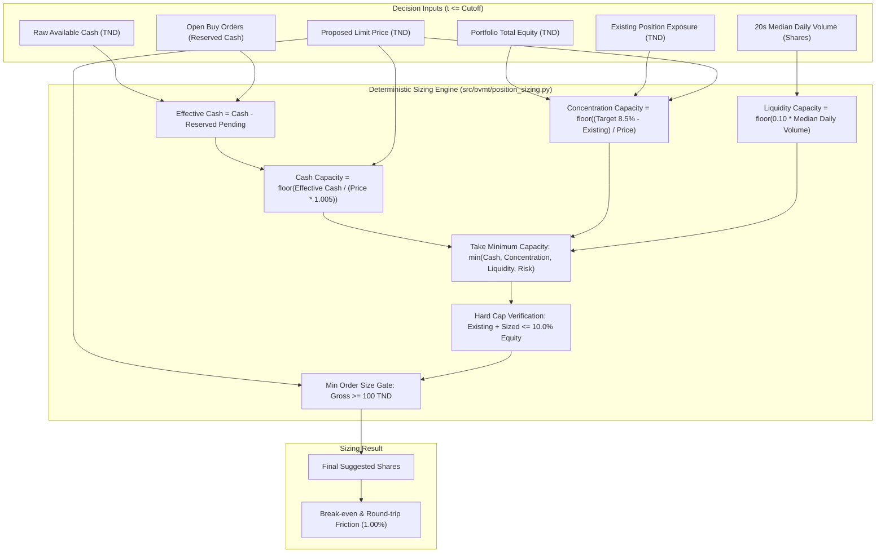

# BVMT Trading Intelligence — Deterministic Position Sizing Architecture

## 1. Overview & Objectives

In the **Tunis Bourse Challenge** (`https://www.tunisbourse-challenge.com`), naive portfolio allocation rules fail due to high transaction costs (**`0.50%` purchase + `0.50%` sale fee**), strict single-stock concentration regulations (**`10.0%` maximum equity cap**), and episodic equity liquidity where orders on zero-volume days remain pending for up to one week.

The **Deterministic Position Sizing Engine** (`src/bvmt/position_sizing.py`) computes exact, reproducible integer share recommendations that strictly satisfy all market, portfolio, risk, and liquidity constraints simultaneously.

---

## 2. Core Constraints & Sizing Formulas

Every proposed order is sized according to the **minimum capacity** across all active constraints:

### 2.1 Cash Constraint & Pending Order Reservations
Purchasing power must account for cash already committed to open, unfulfilled orders:
$$\text{Reserved Cash} = \sum_{o \in \text{Pending Buys}} \text{Shares}_o \times P_{\text{limit}, o} \times (1 + \text{Fee Rate})$$
$$\text{Effective Cash} = \max(0, \text{Raw Cash} - \text{Reserved Cash})$$
$$\text{Capacity}_{\text{cash}} = \left\lfloor \frac{\text{Effective Cash}}{P_{\text{limit}} \times (1 + \text{Purchase Fee Rate})} \right\rfloor$$

### 2.2 Concentration Constraints (10.0% Cap, 8.5% Target)
To avoid concentration penalties and leave buffer for price appreciation:
- **Maximum Concentration Cap:** $10.0\%$ of total equity.
- **Target Buffer Allocation:** $8.5\%$ of total equity.
$$\text{Remaining Target Room (TND)} = \max\left(0, (0.085 \times \text{Equity}) - (\text{Held Shares} \times P_{\text{limit}})\right)$$
$$\text{Capacity}_{\text{concentration}} = \left\lfloor \frac{\text{Remaining Target Room}}{P_{\text{limit}}} \right\rfloor$$

### 2.3 Executable Liquidity Constraint (10% Daily Volume)
To prevent market impact in thin order books and reduce queue expiry risk:
$$\text{Capacity}_{\text{liquidity}} = \left\lfloor 0.10 \times \text{Median Daily Volume}_{20s} \right\rfloor$$

### 2.4 Transaction Cost & Break-Even Calculation
Round-trip transaction friction is exactly $0.50\%$ entry and $0.50\%$ exit:
$$\text{Purchase Fee} = \text{Gross Value} \times 0.0050$$
$$\text{Total Outlay} = \text{Gross Value} + \text{Purchase Fee}$$
$$\text{Break-Even Exit Price} = P_{\text{limit}} \times \frac{1 + 0.0050}{1 - 0.0050} \approx P_{\text{limit}} \times 1.01005$$
A minimum price appreciation of **`+1.01%`** is required merely to recover transaction fees.

---

## 3. Worked Example with Real Figures (STA on 2026-11-09)

| Parameter | Value | Source / Formula |
| :--- | :--- | :--- |
| **Security** | `STA` (`TN0007800014`) | Rank #1 Momentum Leader |
| **Limit Price ($P_{\text{limit}}$)** | `115.900 TND` | Verified EOD Close (`2026-11-06`) |
| **Total Account Equity** | `50,000.750 TND` | Reconciled Competition Ledger |
| **Raw Available Cash** | `49,608.050 TND` | Website Reported Snapshot |
| **Pending Order Reservations** | `0.000 TND` | 0 active pending buy orders |
| **Effective Purchasing Cash** | `49,608.050 TND` | `49,608.050 - 0.000` |
| **20-Session Median Daily Volume** | `220 shares` | Official BVMT Trading Logs |
| **Cash Capacity** | `425 shares` | $\lfloor 49,608.050 / (115.900 \times 1.005) \rfloor$ |
| **Target 8.5% Capacity** | `36 shares` | $\lfloor (50,000.750 \times 0.085) / 115.900 \rfloor$ |
| **10% Liquidity Capacity** | **`22 shares`** | $\lfloor 0.10 \times 220 \rfloor$ (**Binding Constraint**) |
| **Final Suggested Quantity** | **`22 shares`** | $\min(425, 36, 22) = 22$ |
| **Gross Order Value** | **`2,549.800 TND`** | $22 \times 115.900\text{ TND}$ |
| **Purchase Fee (0.50%)** | **`12.749 TND`** | $2,549.800 \times 0.0050$ |
| **Total Outlay Required** | **`2,562.549 TND`** | $2,549.800 + 12.749\text{ TND}$ |
| **Remaining Account Cash** | **`47,045.501 TND`** | $49,608.050 - 2,562.549\text{ TND}$ |
| **Proposed Position Weight** | **`5.10%`** | $2,549.800 / 50,000.750 \times 100$ |
| **Break-Even Exit Price** | **`117.065 TND`** | $115.900 \times 1.005 / 0.995$ (`+1.01%`) |

