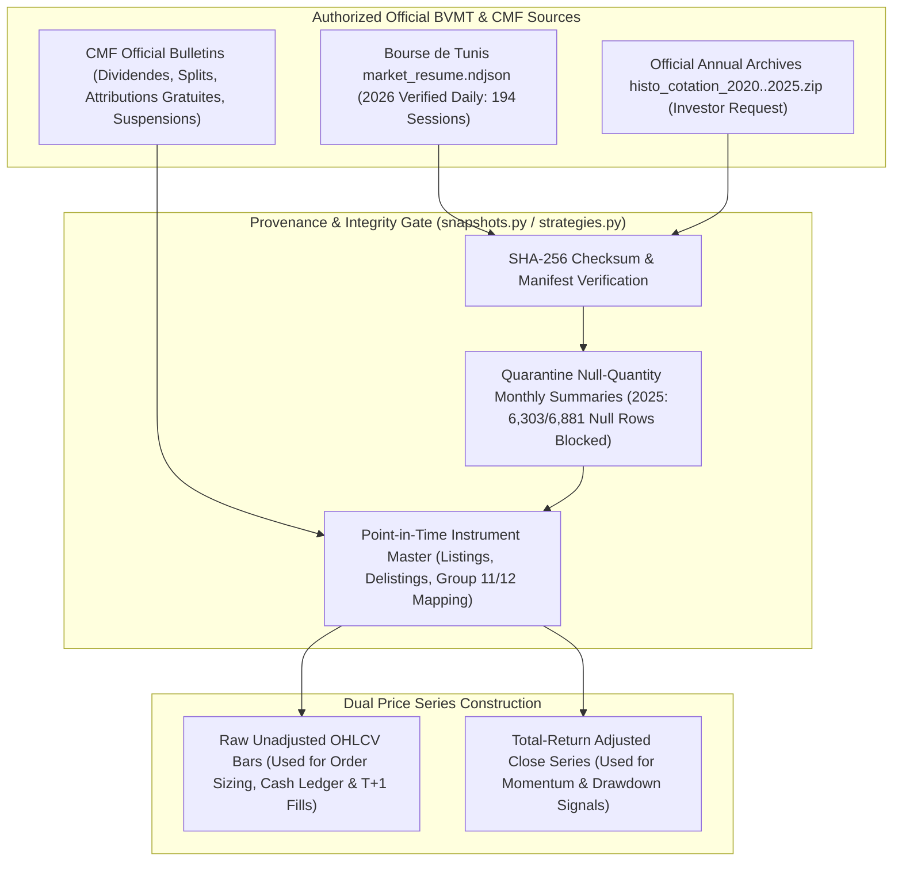

# BVMT Quantitative Research Roadmap & Strategy Promotion Governance

**Document Status**: Verified Milestone 5 Roadmap & Promotion Protocol  
**Current Baseline**: Milestone 5 Audited Strategy Suite (`Models A–I`) + Forward-Only Paper-Trading Journal (`src/bvmt/paper_trading.py`)

---

## 1. Historical Data Provenance & Corporate-Action Adjustment Workflow

Our #1 scientific blocker for statistical conclusiveness (`>= 250` trading sessions) is the absence of pre-2026 daily OHLCV bars and point-in-time corporate-action adjustment tables in the public `market_resume.ndjson` feed. Below is the target data provenance and adjustment workflow:

---

## 2. Prioritized Research Workstreams (Post-Milestone 5)

### Priority 1: Multi-Year Official Daily Archives (`2020–2025`)
- **Current Blocker**: `data/staging/market_resume_full.ndjson` contains `0` records for `2020–2024` and only `12` monthly summary envelopes for `2025` (`6,303` of `6,881` rows have `quantites: null`). Legacy `bvmt.com.tn` historical ZIP endpoints return `0` bytes.
- **Required Action**: Obtain authorized annual daily quotation files (`histo_cotation_2020.zip`–`histo_cotation_2025.zip`) from the Bourse de Tunis Data Services desk to expand the canonical dataset from `194` sessions to `~1,400+` sessions without fabricating or interpolating a single bar.

### Priority 2: Forward-Only Paper-Trading Accumulation (`>= 60` Live Sessions)
- **Current State**: Implemented in [`src/bvmt/paper_trading.py`](file:///c:/Users/Thinkcenter/Desktop/BVMT/bvmt-starter-kit/src/bvmt/paper_trading.py) and surfaced in the Strategy Lab (`/strategy`).
- **Required Action**: Record immutable forward paper-trading signal snapshots after each verified BVMT session close (`POST /api/paper-trading/record-signal`) and settle hypothetical orders strictly at the subsequent session's opening print (`session_date > signal_session_date`). Accumulate at least `60` true forward out-of-sample sessions before considering any strategy for formal promotion.

### Priority 3: Intraday Opening-Auction Volume & Bid-Ask Spread Capture
- **Current Blocker**: Daily historical archives report only end-of-day total share volume (`volume_shares`), which means a `10%` daily volume participation cap at `next_open` uses full-day volume information and may overstate opening-auction liquidity on thin stocks (`21.37%` of traded bars have `volume_shares < 500`).
- **Required Action**: Capture opening-auction volume and top-of-book bid-ask spreads during daily incremental refreshes so forward paper-trading fills are bounded by actual opening liquidity.

### Priority 4: Point-in-Time Dividend & Split Adjustment Ledger
- **Current Blocker**: High dividend yields on Tunisian banks and leasing companies (`5%–9%`) cause ex-dividend price drops in raw closing prices, distorting 20- and 60-session price momentum (`mom_20`, `mom_60`) and understating buy-and-hold benchmark returns (`B` and `C`).
- **Required Action**: Build a verified point-in-time `corporate_actions.csv` table from CMF notices so signal lookbacks use dividend-adjusted total returns while execution ledgers continue using raw exchange prices.

---

## 3. How a Strategy Becomes Eligible for Actual Manual Trading Recommendations

No strategy in this repository can ever execute orders autonomously. For a candidate research model (such as `G_LIQUIDITY_FILTERED_MOMENTUM` or `I_REGIME_FILTERED_QUALITY_MOMENTUM`) to graduate from **Exploratory Research** to **Validated Manual Recommendation Baseline**, it must pass all five mandatory gates:

1. **Gate 1 — Independent Code & Bias Audit (`PASSED`)**:
   - Zero lookahead in signal computation; T+1 next-open execution; `0.50%` buy/sell fees; documented in [`docs/INDEPENDENT_STRATEGY_AUDIT.md`](file:///c:/Users/Thinkcenter/Desktop/BVMT/bvmt-starter-kit/docs/INDEPENDENT_STRATEGY_AUDIT.md).
2. **Gate 2 — Risk-Normalized & Outlier-Adjusted Robustness (`IN REVIEW`)**:
   - Must outperform `B_EQUAL_WEIGHT_ELIGIBLE` and `C_BUY_AND_HOLD_BENCHMARK` on **exposure-normalized return**, **cash-matched excess return**, **equal-budget (10-slot) net return**, and **ex-top-winner (`ex-SOTETEL`) cash-matched return**.
3. **Gate 3 — Continuous Concentration Compliance (`REQUIRED`)**:
   - Must enforce the `10.0%` per-stock concentration limit continuously (via daily `>9.5%` / `>10.0%` next-open trim orders), not merely at 19-session rebalance dates.
4. **Gate 4 — Forward Paper-Trading Validation (`IN PROGRESS`)**:
   - Must accumulate immutable forward-only paper-trading records in `data/portfolio/paper_trading_journal.json` with zero future data leakage and positive net excess return after fees.
5. **Gate 5 — Explicit Human Operator Sign-Off (`MANDATORY`)**:
   - A human operator must review the Strategy Lab audit card, verify the latest browser-synced competition portfolio (`0.000 TND` reconciliation gap), and manually enter any chosen order on the Tunis Bourse Challenge website.
