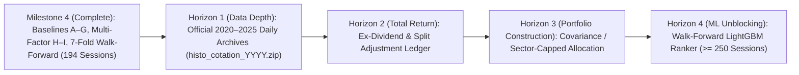

# BVMT Quantitative Research Roadmap

**Document Status**: Verified Milestone 4 Prioritized Research Plan  
**Current Baseline**: Commit `392daf6` + Milestone 4 Comparative Strategy Suite (`Models A–I`)

---

## 1. Executive Summary & Strategic Priorities

Our research roadmap is organized into four sequential horizons designed to move the BVMT Trading Intelligence system from **single-year (2026) exploratory validation** (`194` sessions) to **multi-year, corporate-action-adjusted statistical conclusiveness** (`>= 250` sessions).

---

## 2. Prioritized Research Workstreams

### Priority 1: Multi-Year Official Daily Data Acquisition (`2020–2025`)
- **Problem**: As documented in [`artifacts/backtest_audit_2026.json`](file:///c:/Users/Thinkcenter/Desktop/BVMT/bvmt-starter-kit/artifacts/backtest_audit_2026.json), the local `market_resume_full.ndjson` file contains `0` records for `2022–2024` and only `12` monthly summary lines for `2025` (`quantites: null` on `91.6%` of rows). Only `2026` (`histo_cotation_2026.zip`, `194` sessions) has verified daily OHLCV bars.
- **Action**:
  1. Acquire official annual BVMT quotation archives (`histo_cotation_2020.zip` through `histo_cotation_2025.zip`) from the official BVMT historical data portal or authorized university/CMF feeds.
  2. Ingest each archive through [`ingest_official_bvmt_daily_archive()`](file:///c:/Users/Thinkcenter/Desktop/BVMT/bvmt-starter-kit/src/bvmt/snapshots.py#L465) with SHA-256 provenance manifests.
  3. Unblock the `>= 250` session statistical sufficiency gate (`~1,250+` trading sessions across 5 years).

### Priority 2: Point-in-Time Corporate Actions & Dividend Adjustment Table
- **Problem**: Tunisian equities (especially banks, leasing companies, and insurers) distribute substantial annual cash dividends (`5%–9%` dividend yields). On the ex-dividend date, raw exchange closing prices drop by approximately the gross dividend amount, which raw price momentum ($M_{20}, M_{60}$) misinterprets as a negative price shock.
- **Action**:
  1. Populate `corporate_actions.jsonl` from official BVMT / CMF *Avis de distribution de dividendes* and *Avis d'attribution gratuite* notices.
  2. Compute parallel **Total-Return Adjusted Close** series alongside raw execution prices so momentum factors measure true economic return while order sizing continues to use actual unadjusted share prices.

### Priority 3: Sector-Cap & Intraday Order-Book Depth Modeling
- **Problem**: Banking and financial-services stocks represent over `45%` of BVMT Principal Market capitalization and liquidity. Pure momentum rankings can select 3–5 banking stocks simultaneously, creating concentrated sector exposure even when each individual stock is capped at `8.5%`.
- **Action**:
  1. Add a configurable sector concentration cap (`max_sector_weight_pct = 0.25`) in [`src/bvmt/recommendations.py`](file:///c:/Users/Thinkcenter/Desktop/BVMT/bvmt-starter-kit/src/bvmt/recommendations.py) and [`src/bvmt/strategies.py`](file:///c:/Users/Thinkcenter/Desktop/BVMT/bvmt-starter-kit/src/bvmt/strategies.py) using the verified BVMT sector codes (`data-sect` / ICB classification).
  2. Integrate top-of-book bid-ask spread snapshots captured during daily market sessions to refine the `15 bps` slippage estimate per stock.

### Priority 4: Walk-Forward Machine Learning Promotion (`>= 250` Sessions)
- **Problem**: Non-linear feature interactions (e.g., momentum conditioned on volume surge and sector dispersion) cannot be safely estimated with gradient boosting on `194` sessions without overfitting.
- **Action**:
  1. Once Priority 1 provides $\ge 250$ verified sessions, enable the gated walk-forward `LightGBM` cross-sectional ranker (`lgbm_walk_forward_v0`) using purged expanding folds with a 5-session embargo window.
  2. Require the ML candidate to beat both **Baseline G (T04)** and **Model H (Multi-Factor Quality Momentum)** net of `0.50%` fees across out-of-sample walk-forward folds and pass the Deflated Sharpe Ratio / multiple-testing haircut before human review.

---

## 3. Governance & Promotion Rules

| Transition Stage | Required Evidence | Approval Authority |
| :--- | :--- | :--- |
| **Exploratory -> Candidate** | Deterministic implementation in `src/bvmt/strategies.py`, zero lookahead unit tests, full evaluation on 2026 dataset (`194` sessions) | Automated Quality Gate (`scripts/check.py`) |
| **Candidate -> Promoted Research Baseline** | Positive excess return vs. Equal-Weight (`B`) and Cash (`A`) net of `0.50%` fees, lower max drawdown than `D`/`E`, verified across 7 walk-forward folds | **Explicit Human Operator Approval** |
| **Promoted Baseline -> Live Competition Trade** | Reconciled browser sync (`0.000 TND` gap), human inspection of recommendation card & CMF disclosures, manual order entry on `displayp.aspx` | **100% Manual Human Execution Only** |

