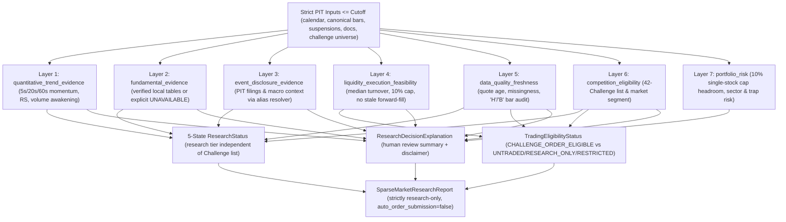
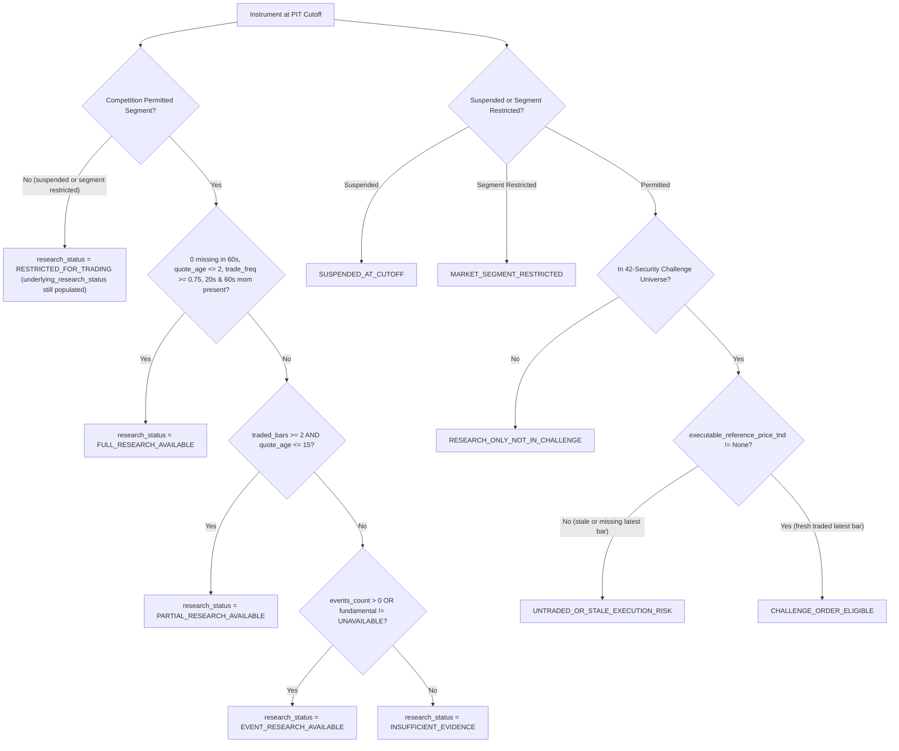

# BVMT Sparse-Data Multi-Layer Research Architecture (`sparse_research_v1`)

> **Status**: Milestone 13 — Phases 4 & 7 Implementation Documentation
> **Model Version**: `sparse_research_v1` (Frozen Config SHA256: `abd3841ab77e20ef21e97babf850cbf5388839e9cce00ce35b03b4247cf5b8fe`)
> **Safety Boundary**: Strictly research-only, 100% localhost, `auto_order_submission: false`, zero live LLM/network calls (`BVMT_ALLOW_LIVE_LLM=0`).

---

## 1. Purpose & Motivation

Following the Phase 3 forensic audit ([ICF_MISSED_OPPORTUNITY_AUTOPSY.md](ICF_MISSED_OPPORTUNITY_AUTOPSY.md)), the original baseline screening contract ([`rank_session_baseline`](../src/bvmt/features.py)) conflated three distinct questions into a single binary `eligible: bool` gate:
1. **Research visibility** — whether useful quantitative, event, or fundamental evidence exists at the point-in-time (PIT) cutoff.
2. **Data integrity** — whether one missing/untraded bar or unrecovered `'H'/'B'` limit-reserved session invalidates the whole security across a 60-session lookback.
3. **Competition order eligibility** — whether a security belongs to the 42-stock Tunis Bourse Challenge list and can realistically execute at the next open.

[`src/bvmt/sparse_research.py`](../src/bvmt/sparse_research.py) resolves these failure modes without altering [`src/bvmt/strategies.py`](../src/bvmt/strategies.py) Models A–I or [`src/bvmt/data.py`](../src/bvmt/data.py) strict OHLC ingestion validation.

---

## 2. Multi-Layer Stock Research Architecture

Every listed BVMT security is evaluated independently across **7 PIT-enforced layers** inside [`evaluate_sparse_market_research`](../src/bvmt/sparse_research.py#L1943-L1985), producing a typed [`SparseInstrumentResearchAssessment`](../src/bvmt/sparse_research.py#L857-L903).

### Summary of the 7 Independent Layers

| Layer | Dataclass | Key Fields & Guarantees |
|---|---|---|
| **1. Quantitative Trend** | [`QuantitativeTrendEvidence`](../src/bvmt/sparse_research.py#L582-L628) | `momentum_5s_pct`, `momentum_20s_pct`, `momentum_60s_pct`, `relative_strength_20s_pct`, `observed_trade_return_pct`, `trailing_traded_5_return_pct`, `turnover_awakening_ratio`, `awakening_detected`, `is_partial_horizon`, `quantitative_score`. Missing horizons stay `None` (never `0`). |
| **2. Fundamentals** | [`FundamentalEvidence`](../src/bvmt/sparse_research.py#L632-L648) | `availability_status` (`AVAILABLE`, `PARTIAL`, `UNAVAILABLE`), `gap_reason`, `latest_period`, `published_at`, `revenue_yoy_pct`, `net_income_yoy_pct`, `pe_ratio`, `pbv_ratio`, `dividend_yield_pct`. Explicitly `UNAVAILABLE` when no verified local financial table exists. |
| **3. Events & Disclosures** | [`EventDisclosureEvidence`](../src/bvmt/sparse_research.py#L652-L668) | `availability_status` (`EVENTS_FOUND`, `MACRO_CONTEXT_ONLY`, `NO_VERIFIED_EVENTS`), `events_count`, `macro_context_count`, `company_disclosure_count`, `synthetic_excluded_count`, `matched_aliases`. Strictly `published_at <= cutoff`; maps symbols cleanly via [`resolve_instrument_aliases`](../src/bvmt/macro_events.py) (`CC`↔`CARTHAGE_CEMENT`, `STPAP`↔`SOTIPAPIER`, `PGH`↔`POULINA_GROUP_HOLDING`, `DH`↔`DELICE_HOLDING`, `BH`↔`BH_BANK`, `TJARI`↔`ATTIJARI_BANK`, `AB`↔`AMEN_BANK`, `SOTET`↔`SOTETEL`). |
| **4. Liquidity & Execution** | [`LiquidityExecutionFeasibility`](../src/bvmt/sparse_research.py#L672-L724) | `median_turnover_20s_tnd`, `median_traded_turnover_20s_tnd`, `trade_frequency_20s`, `zero_volume_share_ratio_20s`, `participation_10pct_max_shares`, `participation_10pct_max_tnd`, `executable_reference_price_tnd`, `last_verified_close_tnd`, `tick_rule_status`, `daily_collar_pct`, `collar_risk_flag`, `execution_status`. Zero coercion of missing turnover (`None` stays `None`) and **no stale forward-filling**. |
| **5. Data Quality & Freshness** | [`DataQualityFreshness`](../src/bvmt/sparse_research.py#L728-L776) | `last_verified_traded_date`, `latest_observed_bar_date`, `observation_coverage_ratio`, `traded_coverage_ratio`, `quote_age_open_sessions`, `missing_open_sessions_60s`, `missing_open_sessions_20s`, `missing_open_session_dates_60s`, `limit_reserved_bars_in_window`, `limit_reserved_events`, `has_unrecovered_limit_reserved_gap`, `freshness_tier`. |
| **6. Competition Eligibility** | [`CompetitionEligibilityStatus`](../src/bvmt/sparse_research.py#L780-L792) | `in_challenge_universe`, `challenge_symbol`, `order_entry_eligibility`, `market_segment`, `market_mode`, `is_competition_permitted`, `restriction_reason`. Decoupled from whether research is valid. |
| **7. Portfolio Risk** | [`PortfolioRiskContext`](../src/bvmt/sparse_research.py#L796-L822) | `held_shares`, `held_value_tnd`, `held_weight_pct`, `max_single_stock_cap_pct` (`10.0%`), `cap_headroom_tnd`, `cap_headroom_shares`, `sector`, `sector_exposure_pct`, `sector_concentration_warning`, `execution_trap_risk`. |

---

## 3. Sparse-Data Decision Handling & Semantics

### Separation of `research_status` and `trading_eligibility`

The 5-state [`ResearchStatus`](../src/bvmt/sparse_research.py#L75-L81) is classified independently from [`TradingEligibilityStatus`](../src/bvmt/sparse_research.py#L826-L835) in [`_classify_statuses`](../src/bvmt/sparse_research.py#L1680-L1752):

### Non-Negotiable Sparse-Data Integrity Rules

1. **Explicit `None` vs `0`**:
   - Missing 20-session or 60-session exact calendar returns stay `None` (`null` in JSON) — never coerced to `0.0`.
   - Missing turnover stays `None` (never formatted as `0.000`).
2. **Stale Closes Never Forward-Filled into Executable Prices**:
   - `last_verified_close_tnd` retains the most recent traded close for reference only.
   - `executable_reference_price_tnd` is populated **only** when the latest open session itself has a verified traded bar with `close > 0`. Otherwise it is `None` and `trading_eligibility.status` becomes `UNTRADED_OR_STALE_EXECUTION_RISK`.
3. **20-Session Window Off-by-One Fix in `research_coverage.py`**:
   - Fixed [`src/bvmt/research_coverage.py`](../src/bvmt/research_coverage.py) so 20-session liquidity/turnover metrics (`median_turnover_20s_tnd`, `trade_frequency_20s`, `zero_volume_share_ratio_20s`) slice strictly the trailing 20 sessions (`window_20[1:]`) rather than 21 sessions.
4. **Non-Destructive Limit-Reserved (`'H'/'B'`) Sensitivity Handling**:
   - [`extract_limit_reserved_bars_from_rejections`](../src/bvmt/sparse_research.py#L393) inspects BVMT `rejections.json` / `rejected_rows.csv` (`20` unique `(instrument_id, session_date)` `'H'/'B'` bars in `bvmt_official_2026`, e.g., `SOTUMAG`, `ATB`, `BH_BANK`, `BTE_ADP`, `CIL`, `OFFICEPLAST`, `ICF`).
   - By default (`hb_limit_reserved_experiment.enabled_by_default = false`), canonical bars remain untouched, while `DataQualityFreshness` flags `limit_reserved_bars_in_window` and `has_unrecovered_limit_reserved_gap` so gaps are transparently attributed rather than mislabeled as silent market inactivity.
   - When `allow_recovery=True` is passed explicitly in sensitivity experiments via [`merge_canonical_with_hb_recovery`](../src/bvmt/sparse_research.py#L521-L538), threshold closes are audited non-destructively without touching `src/bvmt/data.py` or `src/bvmt/strategies.py`.
5. **Structured Human Explanations (`ResearchDecisionExplanation`)**:
   - Every assessment populates [`ResearchDecisionExplanation`](../src/bvmt/sparse_research.py#L839-L853) with `why_interesting`, `why_uncertain`, `missing_data`, `supporting_evidence`, `contradicting_evidence`, `is_tradable`, `execution_risk`, `review_trigger`, and an explicit non-advice `disclaimer`.

---

## 4. Frozen Configuration (`configs/sparse_research_v1.json`)

The active research specification is frozen in [`configs/sparse_research_v1.json`](../configs/sparse_research_v1.json) and loaded via [`load_frozen_sparse_research_config`](../src/bvmt/sparse_research.py#L264):

- **SHA256 Digest**: `abd3841ab77e20ef21e97babf850cbf5388839e9cce00ce35b03b4247cf5b8fe`
- **Core Parameters**:
  - Lookbacks: `5` / `20` / `60` open sessions; awakening baseline `20` sessions (minimum `5` bars).
  - Full-tier bounds: `full_max_quote_age_sessions = 2`, `full_min_trade_freq_20s = 0.75`, `full_max_missing_in_60s = 0`.
  - Partial-tier bounds: `partial_max_quote_age_sessions = 15`, `min_partial_traded_bars = 2`.
  - Liquidity bands: feasible `>= 5000.000` TND, marginal `>= 1000.000` TND.
  - Awakening trigger: turnover ratio `>= 3.0x` and day turnover `>= 10000.000` TND with non-negative day return.
  - Scoring modifiers: `partial_horizon_score_multiplier = 0.65`, `awakening_score_bonus = 6.0`, `event_catalyst_score_bonus = 2.5`, `sparse_zero_vol_penalty = 3.0` (when zero-volume share `>= 0.4`), `candidate_min_quant_score = 5.0`, `candidate_top_k = 8`.
  - Costs & Risk: `0.50%` buy + `0.50%` sell fees, `20` bps slippage, `10%` volume participation cap, `10%` max single-stock cap (`8.50%` target position slice), `3.00%` daily static collar reference.

---

## 5. Phase 7 Forward-Validation Ledger & Conservative Promotion Gates

To prevent hindsight overfitting after inspecting `ICF`, Phase 7 defines an append-only JSONL forward-tracking pipeline in [`src/bvmt/sparse_research.py`](../src/bvmt/sparse_research.py#L2341-L2844):

1. **Snapshot Recording ([`record_prospective_signal`](../src/bvmt/sparse_research.py#L2428) / [`record_prospective_report_signals`](../src/bvmt/sparse_research.py#L2440))**:
   - Writes immutable [`ProspectiveSignalRecord`](../src/bvmt/sparse_research.py#L2341-L2366) entries keyed by unique `signal_id = "{model_version}:{session_date}:{instrument_id}"` (duplicate IDs raise `ValueError`) containing `config_sha256`, `input_data_sha256`, `evidence_summary`, and `reference_close_tnd`.
2. **Strict Future Settlement ([`settle_prospective_signal`](../src/bvmt/sparse_research.py#L2533-L2654) / [`settle_pending_prospective_signals`](../src/bvmt/sparse_research.py#L2662))**:
   - Requires `latest_bar_date >= target_horizon_dates[-1]` (never prematurely settles immature signals even when the exchange calendar lists future open dates).
   - Computes realistic next-open fill with `10%` volume cap, `20 bps` slippage, and `0.50%` buy + `0.50%` sell fees into [`SettledSignalOutcome`](../src/bvmt/sparse_research.py#L2370-L2396).
3. **Promotion Gate Evaluation ([`evaluate_promotion_readiness`](../src/bvmt/sparse_research.py#L2686-L2844))**:
   - Enforces every threshold in `configs/sparse_research_v1.json` -> `promotion_gates`:
     - `prospective_settled_count >= 20`
     - `prospective_sessions >= 20`
     - `non_icf_settled_count >= 15` (**forbids promotion based solely on retrospective ICF performance**)
     - `false_positive_rate <= 0.45` and uplift vs baseline `<= +0.05`
     - `mean_net_return_after_costs_pct >= 0.0%`
     - `non_icf_mean_net_return_pct > 0.0%` (`require_non_icf_positive_expectancy = true`)
     - `max_drawdown_pct <= 15.0%`
   - Any unmet gate produces `eligible_for_promotion = False` with explicit `failed_gates`.

