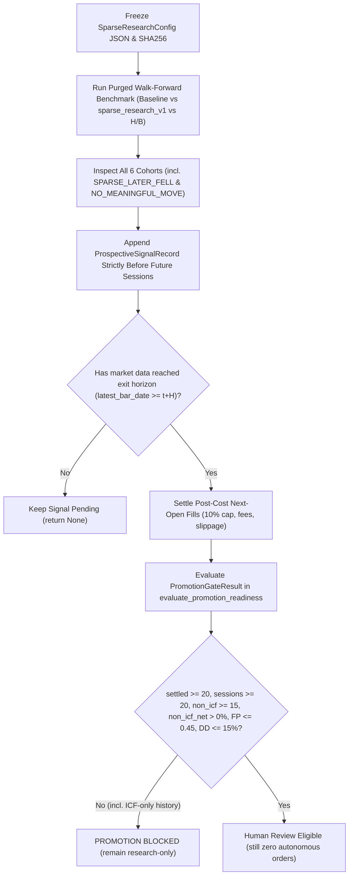

# BVMT Strategy & Sparse-Research Comparative Benchmark (`Baseline` vs `sparse_research_v1`)

> **Phase 5 & Phase 7 Validation Report**
> **Dataset**: `bvmt_official_2026` (strictly read-only canonical bars, 194 exchange sessions through `2026-11-06`, with `mapping_emetteur.json`)
> **Frozen Config**: [`configs/sparse_research_v1.json`](../configs/sparse_research_v1.json) (`sha256`: `abd3841ab77e20ef21e97babf850cbf5388839e9cce00ce35b03b4247cf5b8fe`)
> **Benchmark Harness**: [`src/bvmt/sparse_generalization.py`](../src/bvmt/sparse_generalization.py) (`run_walk_forward_generalization_benchmark` / `run_benchmark_from_data_dir`)

---

## 1. Walk-Forward Evaluation Protocol (Strict Point-in-Time)

The generalization harness evaluates three model configurations on identical purged, non-overlapping evaluation folds with zero future-data leakage:
1. **`Baseline`**: Existing [`rank_session_baseline`](../src/bvmt/features.py) (`min_trade_frequency=0.60`, `min_median_turnover_tnd=1000`, top-`8` positive composite score).
2. **`sparse_research_v1 (raw)`**: New 7-layer [`evaluate_sparse_market_research`](../src/bvmt/sparse_research.py) on canonical raw bars (`hb_limit_reserved_experiment.enabled_by_default = false`).
3. **`sparse_research_v1 (H/B recovered)`**: Non-destructive sensitivity overlay merging `20` unique `(instrument_id, session_date)` limit-reserved `'H'/'B'` bars parsed from `rejections.json` / `rejected_rows.csv` without altering `src/bvmt/data.py` or `src/bvmt/strategies.py`.

### Benchmark Parameters
- **Warmup Sessions**: `61` open sessions
- **Forward Horizon**: `10` open sessions (`step_sessions=10`, purged non-overlapping slices)
- **Evaluation Dates (`13` folds)**: `2026-03-30`, `2026-04-14`, `2026-04-28`, `2026-05-13`, `2026-05-29`, `2026-06-12`, `2026-07-08`, `2026-07-24`, `2026-08-07`, `2026-08-24`, `2026-09-21`, `2026-10-05`, `2026-10-20`
- **Execution Friction Model**: Next-open fill (`t+1`), `+20 bps` entry slippage, `-20 bps` exit slippage, `0.50%` buy fee + `0.50%` sell fee, `10%` daily volume participation cap, `8.50%` target position slice (`4250.000` TND on `50000.000` TND portfolio equity).
- **Cohort Anchoring**: All 6 cohorts are classified from purely ex-ante PIT attributes on the canonical raw evaluation so all 3 models compare identical observation counts `n`.

---

## 2. Diagnostic Cohort Definitions

| Cohort | Ex-Ante / Ex-Post Definition | Sample Size (`n`) |
|---|---|---:|
| **`OVERALL`** | All `(decision_session, instrument_id)` evaluations across the 13 folds | `988` |
| **`ICF`** | `instrument_id == "ICF"` (`TN0003200755`) | `13` |
| **`OTHER_EXCLUDED_CHALLENGE`** | Non-ICF 42-Challenge instruments hard-excluded by `Baseline` for `missing_observation`, `untraded_lookback_anchor`, or `insufficient_liquidity` | `131` |
| **`SPARSE_LATER_ROSE`** | Sparse at decision (`trade_freq_20s < 0.75` or `missing_60s > 0` or `median_turnover_20s < 5000`) and 10-session forward mark-to-mark net move `>= +2.0%` | `95` |
| **`SPARSE_LATER_FELL`** | Sparse at decision and 10-session forward mark-to-mark net move `<= -2.0%` | `173` |
| **`FREQUENT_BENCHMARK`** | Continuous liquid benchmark (`trade_freq_20s >= 0.90`, `missing_60s == 0`, `median_turnover_20s >= 20000`, competition permitted) | `402` |
| **`NO_MEANINGFUL_MOVE`** | 10-session forward mark-to-mark net move strictly inside `(-2.0%, +2.0%)` | `259` |

---

## 3. Overall & Per-Cohort Benchmark Results

### 3.1 Overall (`n = 988`)

| Metric | `Baseline` | `sparse_research_v1 (raw)` | `sparse_research_v1 (H/B recovered)` |
|---|---:|---:|---:|
| Selected Candidate Count | `102` | `104` | `104` |
| Research Coverage Rate | `0.5081` | `0.8188` | `0.8188` |
| Missed Opportunity Rate | `0.8926` | `0.876` | `0.876` |
| False Positive Rate | `0.6078` | `0.6058` | `0.6058` |
| Top-K Candidate Precision | `0.3922` | `0.3942` | `0.3942` |
| Mean Forward Net Return (`%`) | `3.5887` | `4.3005` | `4.3005` |
| Median Forward Net Return (`%`) | `0.0452` | `0.2782` | `0.2782` |
| Liquidity Feasibility Rate | `0.5098` | `0.4712` | `0.4712` |
| Portfolio Max Drawdown (`%`) | `3.4723` | `1.4683` | `1.4683` |
| Cumulative Portfolio Return (`%`) | `16.2927` | `18.645` | `18.645` |
| Avg Active Exposure (`%`) | `34.0` | `32.0385` | `32.0385` |
| Max Single Weight (`%`) | `8.5` | `8.5` | `8.5` |
| Sparse Candidate Share | `0.0392` | `0.2308` | `0.2308` |
| Signal Stability (Jaccard) | `0.4403` | `0.4112` | `0.4112` |
| Mean Quote Age (Sessions) | `0.0` | `0.0` | `0.0` |
| Mean Observation Coverage Ratio | `0.9818` | `0.9818` | `0.9821` |

### 3.2 Cohort Breakdown Across Key Dimensions

| Cohort (`n`) | Model | Selected | Coverage Rate | Missed Opp Rate | False Pos Rate | Top-K Precision | Mean Net (`%`) | Med Net (`%`) | Exec Feas Rate | Max DD (`%`) | Cum Ret (`%`) | Mean Obs Cov |
|---|---|---:|---:|---:|---:|---:|---:|---:|---:|---:|---:|---:|
| **`ICF` (`13`)** | `Baseline` | `5` | `0.8462` | `0.8` | `0.8` | `0.2` | `13.6528` | `13.6528` | `0.4` | `0.5754` | `2.3043` | `0.9991` |
| **`ICF` (`13`)** | `sparse_research_v1 (raw)` | `5` | `1.0` | `0.8` | `0.8` | `0.2` | `13.6528` | `13.6528` | `0.4` | `0.5754` | `2.3043` | `0.9991` |
| **`ICF` (`13`)** | `sparse_research_v1 (H/B)` | `5` | `1.0` | `0.8` | `0.8` | `0.2` | `13.6528` | `13.6528` | `0.4` | `0.5754` | `2.3043` | `1.0` |
| **`OTHER_EXCLUDED_CHALLENGE` (`131`)** | `Baseline` | `0` | `0.0` | `1.0` | `None` | `None` | `None` | `None` | `None` | `0.0` | `0.0` | `0.918` |
| **`OTHER_EXCLUDED_CHALLENGE` (`131`)** | `sparse_research_v1 (raw)` | `16` | `0.9237` | `0.7407` | `0.5625` | `0.4375` | `3.2649` | `0.4282` | `0.625` | `1.139` | `2.7754` | `0.918` |
| **`OTHER_EXCLUDED_CHALLENGE` (`131`)** | `sparse_research_v1 (H/B)` | `16` | `0.9237` | `0.7407` | `0.5625` | `0.4375` | `3.2649` | `0.4282` | `0.625` | `1.139` | `2.7754` | `0.9195` |
| **`SPARSE_LATER_ROSE` (`95`)** | `Baseline` | `1` | `0.0211` | `0.9895` | `0.0` | `1.0` | `None` | `None` | `0.0` | `0.0` | `0.0` | `0.969` |
| **`SPARSE_LATER_ROSE` (`95`)** | `sparse_research_v1 (raw)` | `8` | `0.7684` | `0.9158` | `0.0` | `1.0` | `11.248` | `11.5788` | `0.625` | `0.0` | `4.8453` | `0.969` |
| **`SPARSE_LATER_ROSE` (`95`)** | `sparse_research_v1 (H/B)` | `8` | `0.7684` | `0.9158` | `0.0` | `1.0` | `11.248` | `11.5788` | `0.625` | `0.0` | `4.8453` | `0.9692` |
| **`SPARSE_LATER_FELL` (`173`)** | `Baseline` | `1` | `0.104` | `None` | `1.0` | `0.0` | `None` | `None` | `0.0` | `0.0` | `0.0` | `0.9809` |
| **`SPARSE_LATER_FELL` (`173`)** | `sparse_research_v1 (raw)` | `10` | `0.7977` | `None` | `1.0` | `0.0` | `-5.1137` | `-5.0721` | `0.4` | `1.7278` | `-1.7278` | `0.9809` |
| **`SPARSE_LATER_FELL` (`173`)** | `sparse_research_v1 (H/B)` | `10` | `0.7977` | `None` | `1.0` | `0.0` | `-5.1137` | `-5.0721` | `0.4` | `1.7278` | `-1.7278` | `0.9821` |
| **`FREQUENT_BENCHMARK` (`402`)** | `Baseline` | `88` | `0.9751` | `0.7966` | `0.625` | `0.375` | `3.9987` | `-0.1877` | `0.5341` | `3.4421` | `16.4254` | `0.9928` |
| **`FREQUENT_BENCHMARK` (`402`)** | `sparse_research_v1 (raw)` | `69` | `1.0` | `0.822` | `0.6087` | `0.3913` | `4.9852` | `-0.237` | `0.5217` | `2.5094` | `15.6829` | `0.9928` |
| **`FREQUENT_BENCHMARK` (`402`)** | `sparse_research_v1 (H/B)` | `69` | `1.0` | `0.822` | `0.6087` | `0.3913` | `4.9852` | `-0.237` | `0.5217` | `2.5094` | `15.6829` | `0.9928` |
| **`NO_MEANINGFUL_MOVE` (`259`)** | `Baseline` | `29` | `0.5251` | `None` | `0.5172` | `0.4828` | `-0.297` | `0.2782` | `0.5172` | `0.4515` | `-0.3786` | `0.9877` |
| **`NO_MEANINGFUL_MOVE` (`259`)** | `sparse_research_v1 (raw)` | `28` | `0.8456` | `None` | `0.6071` | `0.3929` | `-0.3556` | `0.3175` | `0.3571` | `0.3257` | `-0.3021` | `0.9877` |
| **`NO_MEANINGFUL_MOVE` (`259`)** | `sparse_research_v1 (H/B)` | `28` | `0.8456` | `None` | `0.6071` | `0.3929` | `-0.3556` | `0.3175` | `0.3571` | `0.3257` | `-0.3021` | `0.9881` |

Additional cohort metrics observed:
- `OTHER_EXCLUDED_CHALLENGE`: `Baseline` left `mean_quote_age_sessions = 5.4733` across excluded records with `0` selections and `0.0` active exposure; `sparse_research_v1` surfaced `16` candidates (`sparse_candidate_share = 0.9375`, `avg_active_exposure_pct = 6.5385%`, `signal_stability_jaccard = 0.4242`).
- `SPARSE_LATER_ROSE`: `sparse_research_v1` achieved `avg_active_exposure_pct = 3.2692%`, `sparse_candidate_share = 1.0`, `signal_stability_jaccard = 0.3333`.
- `SPARSE_LATER_FELL`: `sparse_research_v1` incurred `avg_active_exposure_pct = 2.6154%`, `sparse_candidate_share = 1.0`, `signal_stability_jaccard = 0.1` — explicitly capturing downside false-positive risk.

---

## 4. Point-in-Time Snapshot Audit (`2026-11-06T17:00:00Z`)

Running `evaluate_sparse_market_research` on `bvmt_official_2026` at `2026-11-06T17:00:00Z`:
- **Status Distribution (`raw`)**:
  - `FULL_RESEARCH_AVAILABLE`: `40`
  - `PARTIAL_RESEARCH_AVAILABLE`: `21`
  - `EVENT_RESEARCH_AVAILABLE`: `1`
  - `INSUFFICIENT_EVIDENCE`: `2`
  - `RESTRICTED_FOR_TRADING`: `12`
- **Status Distribution (`H/B` sensitivity overlay)**:
  - `FULL_RESEARCH_AVAILABLE`: `46` (`+6` upgrades from `PARTIAL`: `ATB`, `BH_BANK`, `BTE_ADP`, `CIL`, `OFFICEPLAST`, `SOTUMAG`)
  - `PARTIAL_RESEARCH_AVAILABLE`: `15`
  - `EVENT_RESEARCH_AVAILABLE`: `1`
  - `INSUFFICIENT_EVIDENCE`: `2`
  - `RESTRICTED_FOR_TRADING`: `12`
  - Meanwhile `Baseline` eligible count shifts from `40` (raw) to `47` (`H/B` recovered: adding `ATB`, `BH_BANK`, `BTE_ADP`, `CIL`, `ICF`, `OFFICEPLAST`, `SOTUMAG`).
- **Top-8 Selected Candidates (`raw`)**: `['SOTUMAG', 'STA', 'MONOPRIX', 'ESSOUKNA', 'UIB', 'SMART_TUNISIE', 'TELNET_HOLDING', 'DELICE_HOLDING']`.
- **`ICF` Diagnostic Record on `2026-11-06`**:
  - `research_status`: `PARTIAL_RESEARCH_AVAILABLE` (visible instead of deleted, despite `1` missing open session on `2026-09-22` from `'H'`/`'B'` quarantine and `trade_frequency_20s = 0.7 < 0.75`).
  - `trading_eligibility`: `CHALLENGE_ORDER_ELIGIBLE` (`executable_reference_price_tnd = 134.200`).
  - `quantitative_score`: `-50.0` (`is_selected_candidate = False`).
  - `momentum_5s_pct`: `-0.5852%`, `momentum_20s_pct`: `-2.6831%`, `momentum_60s_pct`: `-10.5333%`, `relative_strength_20s_pct`: `-1.873%`, `volatility_20s_pct`: `0.2983%`.
  - `median_turnover_20s_tnd`: `1364.090` (`median_traded_turnover_20s_tnd`: `16051.760`, `zero_volume_share_ratio_20s`: `0.3`, `participation_10pct_max_shares`: `1` share / `136.409` TND).
  - `events`: `1` (`MACRO_CONTEXT_ONLY`: `LOI_FINANCES_2026_ENERGY_TRANSITION`), `fundamental`: `UNAVAILABLE`, `execution_trap_risk`: `HIGH`.
- **Representative Cross-Section on `2026-11-06`**:
  - `SOTUMAG`: `PARTIAL_RESEARCH_AVAILABLE`, `CHALLENGE_ORDER_ELIGIBLE`, `quantitative_score = 70.4365`, `limit_reserved_bars_in_window = 1`, `has_unrecovered_limit_reserved_gap = True`.
  - `STA`: `FULL_RESEARCH_AVAILABLE`, `CHALLENGE_ORDER_ELIGIBLE`, `quantitative_score = 44.3268`, `events_count = 1` (`EVENTS_FOUND`).
  - `MONOPRIX`: `FULL_RESEARCH_AVAILABLE`, `RESEARCH_ONLY_NOT_IN_CHALLENGE`, `quantitative_score = 21.1221`.
  - `SOTIPAPIER`: `FULL_RESEARCH_AVAILABLE`, `CHALLENGE_ORDER_ELIGIBLE`, `quantitative_score = 5.6414`, `events_count = 1` (`MACRO_CONTEXT_ONLY`).
  - `CARTHAGE_CEMENT`: `FULL_RESEARCH_AVAILABLE`, `CHALLENGE_ORDER_ELIGIBLE`, `quantitative_score = -31.7826`, `events_count = 1` (`MACRO_CONTEXT_ONLY`).
  - `BH_BANK`: `PARTIAL_RESEARCH_AVAILABLE`, `CHALLENGE_ORDER_ELIGIBLE`, `quantitative_score = -11.2056`, `limit_reserved_bars_in_window = 2`, `has_unrecovered_limit_reserved_gap = True`.
  - `BH_ASSURANCE`: `INSUFFICIENT_EVIDENCE`, `RESEARCH_ONLY_NOT_IN_CHALLENGE`, `quantitative_score = None`, `executable_reference_price_tnd = None`.
  - `AETECH`: `RESTRICTED_FOR_TRADING`, `MARKET_SEGMENT_RESTRICTED`, `quantitative_score = None`, `executable_reference_price_tnd = None`.

---

## 5. Model Validation and Promotion Workflow

---

## 6. Key Findings, Limitations & Next Steps

1. **Honest Handling of `ICF` (No Hindsight Overfitting)**:
   - Making `ICF` visible under `PARTIAL_RESEARCH_AVAILABLE` fixes its silent `missing_observation` disappearance without distorting `2026-11-06` scoring: `ICF` correctly scores `-50.0` (`is_selected_candidate=False`) because its trailing 20s/60s momentum (`-2.68%` / `-10.53%`) and median turnover (`1,364.090` TND) were genuinely weak prior to `2026-11-06`.
2. **Real Improvement on Ignored Sparse Risers**:
   - In `OTHER_EXCLUDED_CHALLENGE` (`n=131`), `Baseline` produced `0` candidates (`missed_opportunity_rate = 1.0`), whereas `sparse_research_v1` surfaced `16` candidates (`43.75%` precision, `+3.2649%` mean net return, `62.5%` execution feasibility).
   - In `SPARSE_LATER_ROSE` (`n=95`), `sparse_research_v1` selected `8` candidates with `100%` precision (`+11.248%` mean net return, `62.5%` execution feasibility) vs `1` unfillable selection (`0.0%` feasibility) for `Baseline`.
3. **Transparent False-Positive & Downside Limitations**:
   - Overall `false_positive_rate` (`0.6058`) remains high — virtually tied with `Baseline` (`0.6078`) — and exceeds the Phase 7 ceiling of `0.45`.
   - In `SPARSE_LATER_FELL` (`n=173`), surfacing sparse equities led to `10` losing selections (`-5.1137%` mean net return, `1.7278%` drawdown). Sparse research visibility must therefore remain advisory with explicit liquidity/trap warnings rather than an automated entry trigger.
   - Local financial statement fundamentals remain `UNAVAILABLE` across BVMT instruments until verified point-in-time issuer financial tables are ingested.
4. **Promotion Status**:
   - `sparse_research_v1` is **NOT promoted** (`eligible_for_promotion = False` until at least `20` prospective settled signals across `20` distinct sessions with `>= 15` non-ICF signals achieve `FP <= 0.45` and positive non-ICF net expectancy).

