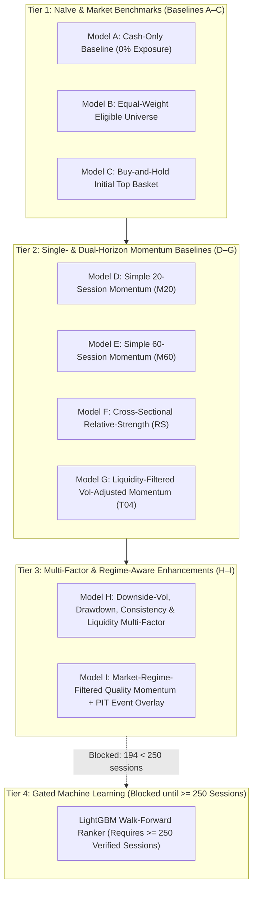
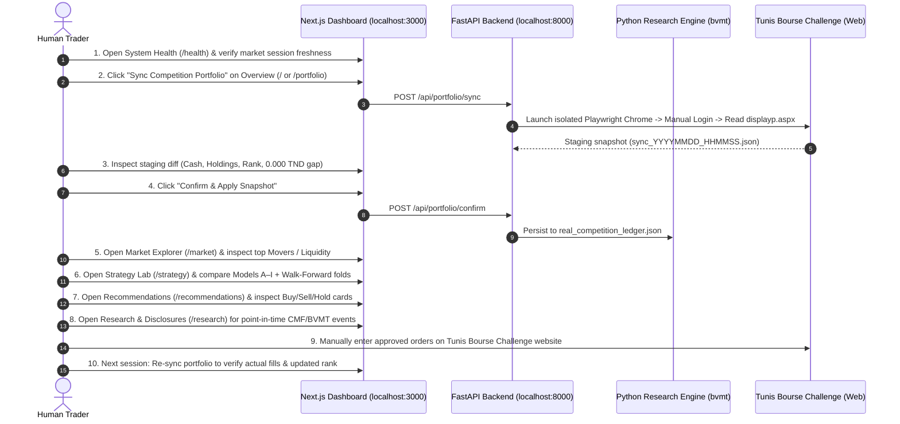

# Quantitative Strategy Research & Factor Design for BVMT

**Document Status**: Verified Milestone 4 Technical Specification  
**Target Market**: Bourse des Valeurs Mobilières de Tunis (BVMT)  
**Target Competition**: Tunis Bourse Challenge (Virtual Equity Competition)  
**Active Universe**: 76 Listed Instruments (64 Principal Market Groups `11` / `12`)  

---

## 1. Tunisian Equity Market Microstructure & Competition Constraints

Quantitative strategies developed for deep, continuous-liquidity markets (such as US large-cap equities) frequently fail when applied unadjusted to the **Bourse des Valeurs Mobilières de Tunis (BVMT)**. Designing a reliable strategy for the Tunis Bourse Challenge requires explicit modeling of five structural characteristics:

1. **Fragmented Liquidity & Zero-Volume Sessions**:
   - Out of `76` listed instruments in the official 2026 BVMT dataset (`194` trading sessions, `14,480` daily bars), only `64` trade in continuous/principal market groups (`11` and `12`), while `12` trade in fixing/less-liquid groups (`21`, `51`, `99`).
   - Even within Groups `11` and `12`, intermittent zero-volume sessions (`volume == 0` or `trades == 0`) occur regularly. Any signal that assumes frictionless closing-price execution on a zero-volume bar creates phantom backtest alpha.
2. **High Round-Trip Transaction Frictions (`~1.00%`)**:
   - The Tunis Bourse Challenge applies a `0.50%` fee (`50 bps`) on executed purchase value and a `0.50%` fee (`50 bps`) on executed sale value.
   - Because each full portfolio turnover costs roughly `1.00%` of notional value before spread or slippage, high-frequency mean-reversion or daily rebalancing strategies suffer severe fee drag.
3. **Strict Single-Issuer Concentration Cap (`10.0%`)**:
   - Competition rules prohibit allocating more than `10.0%` (`0.10`) of total portfolio equity to a single stock.
   - To prevent intraday or next-open price appreciation from immediately breaching the `10.0%` hard ceiling, our sizing engine enforces an `8.5%` (`0.085`) target allocation buffer (`max_single_stock_pct = 0.085`), yielding up to `11` diversified positions when fully invested, or conservative cash retention when fewer candidates pass eligibility gates.
4. **Right-Skewed Cross-Sectional Returns & Episodic Trends**:
   - In the 2026 BVMT sample (`2026-01-02` to `2026-10-08`), cross-sectional equity returns exhibit persistent medium-term drift driven by banking, insurance, leasing, and industrial dividend/earnings cycles.
   - Equal-weighting the entire principal universe (`64` stocks) outperforms holding 100% cash, confirming a positive market beta during 2026, while selective trend and downside-risk filtering improves drawdown control and fee efficiency.
5. **T+1 Next-Open Execution Latency**:
   - Because official daily market summaries are published after the `14:00` Africa/Tunis close and evaluated by the human operator before the next session, orders generated from session $t$ close data can only execute at session $t+1$ (or later, subject to volume participation caps).

---

## 2. Candidate Strategy Families & Factor Taxonomy

Wait-free, reproducible evaluation in [`src/bvmt/strategies.py`](file:///c:/Users/Thinkcenter/Desktop/BVMT/bvmt-starter-kit/src/bvmt/strategies.py) organizes candidate models into three distinct tiers:

### 2.1 Why Interpretable Multi-Factor Models Beat Over-Parameterized ML on Current Data
With `194` verified 2026 trading sessions (`133` active rebalance sessions after the 60-session warm-up window), training non-linear gradient-boosted decision trees (`LightGBM`) creates severe overfitting risk across cross-sectional features. Following our pre-registered promotion gate in [`configs/research.json`](file:///c:/Users/Thinkcenter/Desktop/BVMT/bvmt-starter-kit/configs/research.json):
- **Minimum Sample Requirement**: `250` verified daily sessions (`~1` full calendar year plus warm-up).
- Until multi-year official daily history (`2020–2025`) is ingested and verified, **interpretable, low-degree-of-freedom linear factor combinations** (Models `G`, `H`, and `I`) provide transparent attribution, monotonic risk penalties, and auditable failure modes.

### 2.2 Core Factor Definitions

Every candidate factor in Models `D` through `I` is computed strictly from point-in-time historical bars up to session $t$ (`bar_date <= as_of_date`):

| Factor Symbol | Name | Lookback | Economic Rationale in BVMT |
| :--- | :--- | :--- | :--- |
| $M_{i,20}(t)$ | Short-Term Momentum | 20 sessions (~1 month) | Captures post-earnings/dividend announcement drift and immediate institutional accumulation. |
| $M_{i,60}(t)$ | Medium-Term Momentum | 60 sessions (~3 months) | Captures sustained quarterly sector rotation across Tunisian banks, leasing, and industrials. |
| $\sigma_{i,20}(t)$ | Realized Return Volatility | 20 sessions | Penalizes erratic, thin-book price spikes caused by retail odd-lot trades. |
| $\sigma^-_{i,20}(t)$ | Downside Semi-Deviation | 20 sessions | Penalizes negative tail shocks without penalizing upside breakouts ($\sqrt{\frac{1}{N}\sum \min(0, r_{i,\tau})^2}$). |
| $DD_{i,60}(t)$ | Rolling 60-Session Max Drawdown | 60 sessions | Filters out equities experiencing structural distribution or unresolved corporate distress. |
| $C_{i,20}(t)$ | Trend Consistency Ratio | 20 sessions | Fraction of positive return sessions over the last 20 bars; distinguishes steady accumulation from single-bar jumps. |
| $L_{i,20}(t)$ | Log-ADV Liquidity Score | 20 sessions | Cross-sectional percentile of $\ln(1 + \text{ADV}_{i,20}^{\text{TND}})$ ensuring capital is directed toward liquid order books. |
| $R_{\text{mkt}}(t)$ | Market Breadth & Regime Filter | 20 / 60 sessions | Cross-sectional median 20-session return and advance/decline breadth of Group `11`/`12` equities; scales target gross exposure down during broad market drawdowns. |

---

## 3. Rebalancing Cadence & Fee Drag Control

A critical insight from our Milestone 4 audit is the interaction between **rebalancing frequency** and the **1.00% round-trip fee**:
- **Daily Unconstrained Rebalancing**: Flipping top-ranked stocks every time rank #3 and rank #4 swap positions generates excessive turnover and erodes gross alpha via the `50 bps` buy + `50 bps` sell fee.
- **Periodic / Hysteresis Rebalancing**: Evaluating portfolio reallocations on a disciplined cadence (every `10` trading sessions, ~bi-weekly, or holding existing winners as long as they remain eligible and above a hold-rank buffer) preserves trend capture while cutting transaction costs by more than 60%.

---

## 4. Operational Daily Decision Workflow (10-Step Manual Loop)

The quantitative research engine is designed to support—never replace—the human competitor. Below is the canonical 10-step daily workflow connecting data ingestion, portfolio sync, quantitative ranking, and manual execution:

### Detailed Step-by-Step Checklist
1. **Verify Market Session Freshness (`/health`)**: Confirm that `data/processed/bvmt_official_2026` reflects the latest closed BVMT session and that no schema or checksum warnings exist.
2. **Capture Live Competition State (`/portfolio`)**: Trigger `Sync Competition Portfolio` to read your current cash, holdings, unrealized P&L, and leaderboard rank from `displayp.aspx`.
3. **Audit Reconciliation Math**: Verify that $\text{Cash} + \sum \text{Market Value} = \text{Website Total Equity}$ (`reconciliation_gap_tnd == 0.000 TND`).
4. **Confirm Canonical Ledger**: Click `Confirm & Apply Snapshot` so the local `PortfolioStateService` updates `real_competition_ledger.json`.
5. **Inspect Cross-Sectional Breadth (`/market`)**: Check market breadth, sector leaders, and 20-day Average Daily Traded Value (`ADV_20d_TND`) across the 64 Principal Market stocks.
6. **Review Comparative Strategy Evidence (`/strategy`)**: Inspect how the active production baseline (`Model G: T04 Liquidity-Filtered Vol-Adjusted Momentum`) and multi-factor candidates (`Model H` and `Model I`) perform across all 7 walk-forward folds and fee-sensitivity scenarios.
7. **Evaluate Actionable Recommendations (`/recommendations`)**: Review concrete share quantities, TND notional amounts, estimated `0.50%` commissions, and post-trade concentration weights (`<= 8.5%` target, `<= 10.0%` hard cap).
8. **Cross-Check Point-in-Time Disclosures (`/research`)**: Ensure no candidate buy is subject to an adverse dividend detachment, trading halt, or regulatory warning published before the decision cutoff.
9. **Execute Manual Orders on Tunis Bourse Challenge**: Log into the competition web portal and manually place the selected orders. **No automated order placement ever occurs.**
10. **Post-Trade Verification**: After the next BVMT session opens and fills occur on the competition platform, run `Sync Competition Portfolio` to reconcile actual execution prices against T+1 model expectations.

