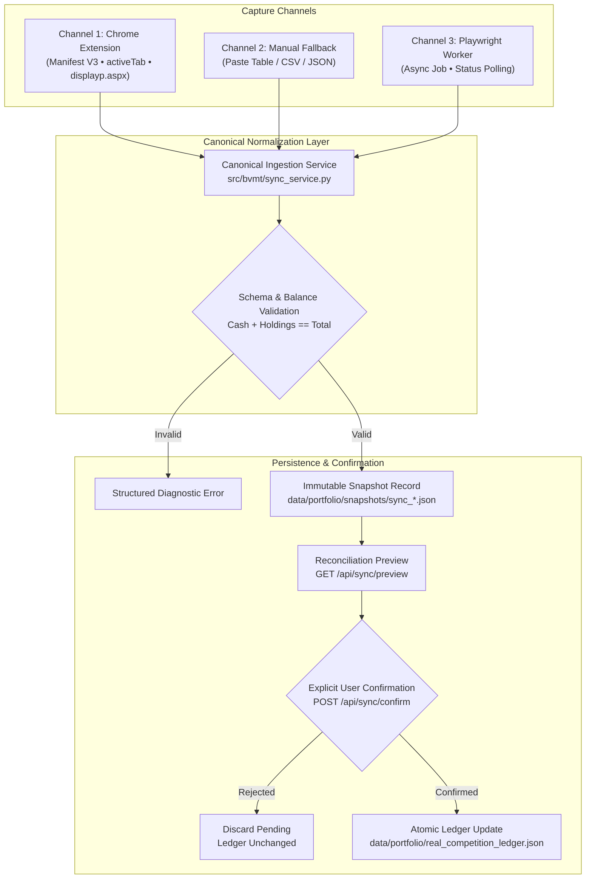

# BVMT Account Synchronization Architecture Audit

**Milestone 10 — Phase 0 Audit Report**  
**Date**: Monday, November 9, 2026  
**Auditor**: Gemini Lead Integration Orchestrator  
**Target Repository**: `https://github.com/medYousseffathallah/onetimetradingbot.git`  
**Governing Policy**: Read-Only Localhost Decision Support • Zero Autonomous Order Execution • Zero Paid Cloud/LLM Calls  

---

## 1. Executive Summary

The BVMT Trading Intelligence platform relies on verified portfolio valuations and holdings from the official Tunis Bourse Challenge virtual competition (`https://www.tunisbourse-challenge.com`). While the financial reconciliation engine and ledger persistence (`src/bvmt/ledger.py`, `src/bvmt/portfolio_service.py`) correctly compute Decimal-safe mark-to-market valuations and enforce competition caps, the **ingestion boundary** has experienced operational friction:

1. **Profile Isolation Conflict**: The Playwright collector launches an isolated Chromium profile (`data/browser_profile`), which does not share session cookies with the user's everyday Google Chrome browser. The user is forced to re-authenticate manually in a new window every time.
2. **Profile Lock Contention**: Concurrent browser instances or unclean subprocess terminations cause file-lock collisions on `data/browser_profile/lockfile`, resulting in HTTP 422/500 errors.
3. **Reverse-Proxy Request Timeouts**: The synchronous `POST /api/sync/browser` endpoint blocks for up to 180 seconds. Reverse proxies (Next.js App Router, browser HTTP client) frequently drop the socket connection after 30–60 seconds, emitting HTTP 500 (`ECONNRESET`) while Playwright is still running.
4. **Lack of Alternative Ingestion Channels**: Prior to Milestone 10, there was no manual paste or CSV fallback. If browser automation failed, the user was completely blocked from updating their account.

Milestone 10 introduces a **resilient, local-first tri-channel synchronization architecture**:
- **Primary**: User-triggered Chrome Browser Companion extension (Manifest V3, activeTab, zero credential exposure).
- **Secondary**: Manual paste & CSV import with structured field preview and explicit confirmation.
- **Fallback**: Asynchronous, non-blocking Playwright background worker with job status polling and safe profile cleanup.

---

## 2. In-Depth Audit of Existing Components

### 2.1 Authentication Flow (`src/bvmt/browser.py`)
- **Mechanism**: Playwright launches Chromium using `launch_persistent_context(user_data_dir="data/browser_profile", headless=False)`.
- **Navigation Target**: `https://www.tunisbourse-challenge.com/displayp.aspx`.
- **User Action**: The user must manually type their username and password on `default.aspx`.
- **Detection**: A polling loop (`time.sleep(0.75)`) checks `page.content().lower()` for `"votre portefeuille"` and `"liquidit"`.
- **Defect**: The persistent profile is stored locally in `data/browser_profile`. Because modern cookies are partitioned and encrypted per browser profile, credentials saved in standard Chrome do not carry over.

### 2.2 Browser-Profile Lock Handling (`src/bvmt/browser.py`)
- Chromium creates an exclusive operating-system lockfile (`SingletonLock` on POSIX, `lockfile` on Windows) inside `user_data_dir`.
- If a user closes the window unexpectedly, or if the subprocess is interrupted, the lock remains held until the OS process tree terminates.
- Subsequent calls to `launch_persistent_context` fail immediately with `TargetClosedError` or process exit code 1.

### 2.3 Request Timeout Mechanisms (`src/bvmt/api.py`, `frontend/src/lib/api.ts`)
- **Backend**: `run_browser_sync_subprocess` takes `timeout_seconds: int = 180`. The FastAPI route `POST /api/sync/browser` waits synchronously for the subprocess to finish.
- **Frontend**: The Next.js frontend calls `api.triggerBrowserSync(180)`.
- **Failure Mode**: Node.js HTTP client and browser `fetch` implementations enforce keep-alive/idle timeouts. When manual authentication takes longer than 60 seconds, the frontend socket is severed (`ECONNRESET`), throwing HTTP 500 even if the backend successfully writes a snapshot 10 seconds later.

### 2.4 Session Expiry Behavior
- If the ASP.NET session cookie expires, the competition server issues an HTTP 302 redirect to `default.aspx`.
- `parse_competition_portfolio_html` checks for `"mot de passe"` or absence of `"tab_portefeuille"`.
- When expired, it raises `AuthenticationExpiredError`, which FastAPI maps to HTTP 400.

### 2.5 Snapshot Schema (`CompetitionPortfolioDOMSnapshot`)
Located in `src/bvmt/browser.py` lines 170–225:
- `source_url`: str
- `retrieved_at`: datetime (ISO 8601 UTC)
- `portfolio_total_tnd`: Decimal (quantized to 0.001 TND)
- `available_cash_tnd`: Decimal
- `holdings_market_value_tnd`: Decimal
- `holdings`: tuple of `BrowserHoldingItem` (`symbol`, `quantity`, `acquisition_price_tnd`, `latest_price_tnd`, `market_value_tnd`, `gain_tnd`, `gain_pct`)
- `competition_rank`: int | None
- `total_participants`: int | None
- `displayed_overall_performance_pct`: Decimal | None
- `is_reconciled`: bool (tolerance `0.05 TND`)
- `reconciliation_gap_tnd`: Decimal
- `challenge_period_text`: str
- `transactions`: tuple of `BrowserTransactionItem` (from `display_histo.aspx`)
- `pending_orders`: tuple of `BrowserPendingOrderItem` (from `display_histo.aspx`)

### 2.6 Parsing Assumptions & Fragility
- Expects French number formats (`parse_french_number`: comma decimal separator `,`, space thousand separator `12 500,000`).
- Expects table structure `#tab_portefeuille` with columns: *Valeur*, *Quantité*, *Cours d'achat*, *Dernier cours*, *Total*.
- Cash balance is extracted via regex `Liquidit[ée]s\s*:?\s*([0-9\s,\.]+)`.
- Fragility: If the website alters whitespace or table class names, `LayoutChangedError` is raised.

### 2.7 Financial Reconciliation Logic (`src/bvmt/ledger.py`)
- `reconcile_with_snapshot()`:
  - Compares snapshot cash against ledger cash.
  - Compares snapshot holdings against ledger holdings (`HoldingPosition`).
  - Evaluates reconciliation gap: `gap = abs(cash_ledger + holdings_value_ledger - snapshot_total)`.
  - Discrepancy tolerance: `0.050 TND` (to absorb millime rounding on the competition website).
  - Preserves exact historical transactions without duplication.

### 2.8 Confirmation and Persistence Flow (`src/bvmt/portfolio_service.py`)
- Unconfirmed snapshots are saved as immutable files: `data/portfolio/snapshots/sync_YYYYMMDD_HHMMSS.json`.
- `PortfolioStateService` detects unconfirmed snapshots: any snapshot whose `retrieved_at` is not in `ledger.snapshot_history` is treated as `pending_browser_snapshot`.
- The active ledger (`data/portfolio/real_competition_ledger.json`) is **NEVER mutated** until the user explicitly sends `POST /api/sync/confirm` with `confirmed_by_user = true`.
- On confirmation, `apply_confirmed_browser_sync_to_state()` atomically updates the ledger, appends to `snapshot_history`, and writes to disk.

### 2.9 Error Recovery
- In Milestone 8, a recovery check was added to `api.py`: if `run_browser_sync_subprocess` returns an error, the backend checks if a valid snapshot was written to disk anyway. If so, it returns it.
- However, if the process crashes before writing, or if lock contention occurs, no structured retry is available.

### 2.10 Status Reporting (`api.py:overview`)
- Reports `live_synchronized`, `is_stale`, `last_sync_timestamp`, `has_pending_snapshot`.
- In the frontend, if an error occurs, the UI previously showed conflicting badges simultaneously (e.g., stale warning + error toast + pending confirmation banner).

---

## 3. Root Cause Classification Matrix

| Root Cause ID | Severity | Root Cause Description | Failure Symptom | Milestone 10 Resolution |
|:---|:---:|:---|:---|:---|
| **RC-01: Profile Isolation** | High | Playwright Chromium instance runs in an isolated profile (`data/browser_profile`), separate from the user's primary Google Chrome browser. | User has to log in twice; session cookies are not shared. | **Browser Companion Extension (Manifest V3)**: Captures directly from the user's active, already-authenticated Chrome tab. |
| **RC-02: Synchronous HTTP Timeout** | High | Single synchronous blocking HTTP call (`POST /api/sync/browser`) waits up to 180s. Next.js App Router and browser fetch socket timeout after 30–60s. | `500 Internal Server Error` / `ECONNRESET` in browser console. | **Asynchronous Job Lifecycle**: For Playwright fallback, return job ID immediately; frontend polls `GET /api/sync/jobs/{id}`. |
| **RC-03: Profile Lock Contention** | Medium | Playwright context crashes or concurrent calls attempt to lock `data/browser_profile/lockfile`. | `TargetClosedError` / `422 Unprocessable Content`. | Lock cleanup helper, dedicated isolated run directories, and Browser Companion alternative. |
| **RC-04: Single-Source Fragility** | Medium | Platform solely relied on automated Playwright DOM extraction; no user-accessible fallback if DOM changed. | Complete ingestion block if website HTML modified. | **Manual Paste & CSV Import Fallback**: User can paste HTML/table text or upload CSV; normalized through same pipeline. |
| **RC-05: Confusing Simultaneous States** | Low | UI simultaneously presented stale warnings, pending confirmations, and error toasts. | High cognitive friction for human trader. | **Unified Sync UX**: Distinct state hierarchy: (1) Last Confirmed, (2) Current Attempt, (3) Source Connection. |

---

## 4. Milestone 10 Architectural Blueprint

### Invariant Rules
1. **Single Source of Truth**: All three ingestion channels must pass through `CanonicalSyncService.ingest_observation()`.
2. **Deterministic Representation**: All financial amounts must be `Decimal` quantized to `0.001 TND`.
3. **No Phantom Zeroes**: Unavailable fields must remain `None`, never fabricated as `0.000` or `0`.
4. **Zero Cloud/Secret Leakage**: Extension transmits strictly structured numerical/text fields to `http://127.0.0.1:8000/api/sync/extension` accompanied by a local pairing token. Cookies and passwords are never read or transmitted.
5. **Human-in-the-Loop**: No snapshot updates the confirmed competition ledger without explicit user confirmation.

