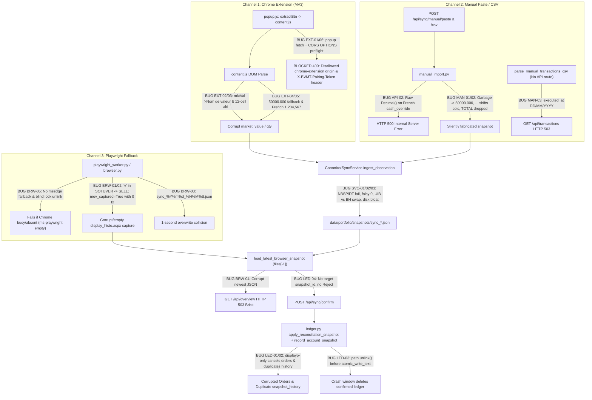
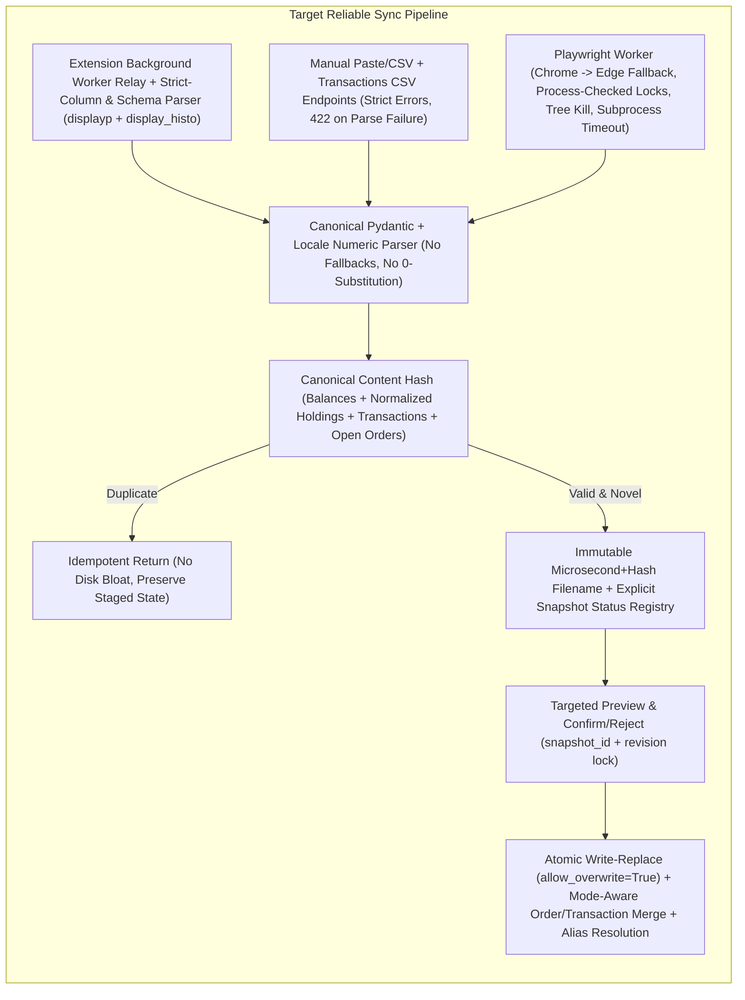

# BVMT Account Synchronization Reliability Audit (Phase 1)

**Target Worktree:** `c:\Users\Thinkcenter\Desktop\BVMT\bvmt-gemini-dashboard` (branch `gemini/dashboard`)  
**Read-Only Inspection Source:** `c:\Users\Thinkcenter\Desktop\BVMT\bvmt-starter-kit\data\portfolio\`  
**Baseline Test Run:** `tests/test_extension.py`, `tests/test_sync_service.py`, `tests/test_manual_import.py`, `tests/test_browser_collector.py` -> **45 passed** (`20.81s`, existing suite masks critical gaps via narrow mock fixtures).

> [!CAUTION]
> **Audit Scope & Safety:** This Phase 1 deliverable is strictly an audit and failure-reproduction report. No `.py`, `.js`, `.ts`, or data files were modified. No pairing tokens, cookies, passwords, or raw private account dumps are included below; only sanitized structural facts, aggregate file metadata, and synthetic reproduction outputs are recorded.

---

## 1. Executive Summary & Sync Channel Matrix

End-to-end tracing of `Chrome Extension -> DOM Extraction -> Localhost API -> Snapshot Validation -> Reconciliation -> User Confirmation -> Ledger Persistence` (plus `Manual Paste/CSV` and `Playwright Fallback`) identified **24 concrete, reproduced findings** across every layer of the stack: **10 CRITICAL**, **12 HIGH**, and **2 MEDIUM**.

| Sync Channel | Primary Entrypoint | Portfolio Balances (`displayp.aspx`) | Transactions & Open Orders (`display_histo.aspx`) | Confirmation & Restart Safety | Overall Reliability Status |
| :--- | :--- | :--- | :--- | :--- | :--- |
| **1. Chrome Extension Companion** | `extension/popup.js` -> `POST /api/sync/extension` | **BROKEN in real browser CORS preflight & fragile DOM edge cases** (`colMap.mktVal` matches `"Nom de valeur"`, `50000.000` fallback, French thousands `1.234,567`, popup closing aborts fetch) | **UNSUPPORTED** (`source_page_type` hardcoded `"displayp.aspx"`; confirming extension sync silently **cancels** open orders & resets `transactions_imported=False`) | **FRAGILE** (CORS blocks `chrome-extension://*` + `X-BVMT-Pairing-Token`; TOCTOU confirm; duplicate disk writes) | **UNRELIABLE / BLOCKED IN BROWSER** |
| **2. Manual Paste & CSV Fallback** | `src/bvmt/manual_import.py` -> `POST /api/sync/manual/{paste,csv}` | **UNSAFE** (`50000.000` silent fallback on garbage input; French `cash_override` triggers HTTP 500; `"..."` shifts columns; `TOTAL` stock names dropped; row errors silently swallowed) | **BROKEN / UNWIRED** (`parse_manual_transactions_csv` has no API route, misclassifies `"VENTE PARTIELLE"` as `"BUY"`, leaves `executed_at` unnormalized causing HTTP 503 on `/api/transactions`) | **PARTIAL** (creates disk snapshot in `snapshots_dir`, but shares same dedup & confirm bugs) | **UNSAFE / PARTIALLY WIRED** |
| **3. Playwright Local Collector** | `src/bvmt/playwright_worker.py` & `src/bvmt/browser.py` -> `/api/sync/playwright/*` & `/api/sync/browser` | **FRAGILE** (only falls back from `chrome` to absent `ms-playwright` Chromium, ignoring installed `msedge.exe`; 1s filename overwrite collision; unguarded `clean_stale_profile_lock`) | **BROKEN ON REAL LAYOUTS** (`"v" in side_raw` turns `SOTUVER`/`"Achat validé"` into `SELL`; missing headers yield `0` rows while marking `movements_page_captured=True`) | **BROKEN ON RESTART / ERROR** (`api.py:1368` returns HTTP 200 on error; in-memory job dict wiped on restart; corrupt file crashes `GET /api/overview` with 503) | **FRAGILE / SILENTLY CORRUPTS ORDERS** |

---

## 2. End-to-End Architecture & Failure Flow (Current vs. Target)





---

## 3. Forensic Evidence from Real Portfolio Artifacts (Read-Only Inspection)

Read-only structural audit of `c:\Users\Thinkcenter\Desktop\BVMT\bvmt-starter-kit\data\portfolio\snapshots\` (`10` files) and `real_competition_ledger.json` directly confirms multiple production failures from the live competition run (`2026-11-07` through `2026-11-10`):

1. **Corrupted `"VENDRE"` Chrome Extension Snapshots Persisted to Confirmed Ledger:**
   - `sync_20261109_120109.json`, `sync_20261109_120310.json`, and `sync_20261109_120411.json` (`source_url=bvmt-sync://chrome_extension/displayp.aspx`) were captured 3 minutes apart with **identical corrupted holdings**: 5 rows all parsed as `symbol='VENDRE'` with numeric DOM IDs as quantities (`223375, 223493, 223529, 223514, 223516`) and `total=50000.000` (`cash=36939.520`).
   - Even worse, `real_competition_ledger.json` contains **two duplicate entries** of `browser_sync_20261109_120411` (`['VENDRE', 'VENDRE', 'VENDRE', 'VENDRE', 'VENDRE']`) in `snapshot_history`.
2. **Duplicate Snapshot Files & Duplicate `snapshot_history` Entries:**
   - `sync_20261110_092042.json` and `sync_20261110_092129.json` are duplicate extension captures 47 seconds apart (`total=50006.570`, `cash=39628.870`, 5 holdings).
   - `sync_20261110_110400.json` and `sync_20261110_110702.json` are duplicate unconfirmed extension captures 3 minutes apart (`total=49993.430`, `cash=38752.350`, 6 holdings incl. `UIB` qty `24`).
   - `real_competition_ledger.json` (`hist_count=10`, `audit_log=19`) records:
     - `SNAP-TBC-USER-001` (`capture_timestamp=None`, 1 holding) x1
     - `browser_sync_20261107_122006` x1
     - `browser_sync_20261109_091300` **x3 duplicates**
     - `browser_sync_20261109_120411` **x2 duplicates** (corrupt `VENDRE` holdings)
     - `browser_sync_20261109_144000` x1 (unnormalized aliases `'BH', 'DH', 'NBL'`)
     - `browser_sync_20261110_092129` **x2 duplicates**
3. **`display_histo.aspx` Captured Without Any Extracted Transactions:**
   - `sync_20261107_122006.json` (`mov_captured=True`, `tx=0`, `pend=0`, holdings `[('BH BANK', 30)]`) and `sync_20261109_091300.json` (`mov_captured=True`, `tx=0`, `pend=0`, holdings `[('BH BANK', 30), ('DELICE HOLDING', 263)]`) both visited `display_histo.aspx`, set `movements_page_captured=True`, and extracted **zero transactions** even though shares had been purchased.
   - Resulting ledger state: `transactions_imported=False`, `pending_orders_verified=False`, `orders=0`.
4. **Symbol / Instrument ID Drift Across Sync Channels:**
   - `sync_20261109_144000.json` (`https://www.tunisbourse-challenge.com/displayp.aspx`) recorded symbols `'BH'`, `'DH'`, `'NBL'`, `'STA'`, whereas `sync_20261110_092042.json` (`chrome_extension`) recorded `'BH BANK'`, `'DELICE HOLDING'`, `'NEW BODY LINE'`, `'SMART TUNISIE'`, `'STA'`. Neither matches `configs`/`instrument_master.csv` reliably without canonical alias mapping (`challenge_universe.py`).

### Comparison with Uncommitted `main` Diff (`c:\Users\Thinkcenter\Desktop\BVMT\bvmt-starter-kit`)
Inspection of the uncommitted diff in `bvmt-starter-kit` (`main`) showed only a **surface display/dedup patch**:
- `src/bvmt/api.py:983-1000`: Filters empty `capture_timestamp` and deduplicates `snapshot_history` by `(snapshot_id, capture_timestamp)` in `GET /api/snapshots`.
- `src/bvmt/ledger.py:2158-2169`: Deduplicates `(snapshot_id, capture_timestamp)` in `record_account_snapshot` before appending to `snapshot_history`.
- `frontend/src/app/page.tsx` & `frontend/src/app/portfolio/page.tsx`: Appends array index suffixes to React list keys.

**What `main`'s uncommitted patch does NOT fix:**
1. It is not yet merged into `bvmt-gemini-dashboard`.
2. It still writes duplicate `audit_log` entries and executes `apply_reconciliation_snapshot` (`ledger.py:2509-2715`) even when `record_account_snapshot` skips `snapshot_history.append(...)`.
3. It still uses `snapshot_id` (`browser_sync_%Y%m%d_%H%M%S`) + `capture_timestamp`, so two distinct snapshots in the same second collide, and identical snapshots taken seconds apart (e.g., `120109` vs `120411`) still create duplicate disk files and duplicate `snapshot_history` entries.
4. It does not address any of the CORS, DOM, French numeric parsing, Playwright fallback, transaction reconciliation, confirmation TOCTOU, or `path.unlink()` persistence defects below.

---

## 4. Detailed Findings & Reproduced Defects

### A. Chrome Extension & DOM Extraction (`extension/`)

#### `[EXT-01]` CORS Preflight Blocks Chrome Extension `POST /api/sync/extension` and `X-BVMT-Pairing-Token`
- **Component / File:Line:** `src/bvmt/api.py:89-94, 862-868` & `extension/popup.js:218-225` & `extension/background.js:1-6`
- **Severity:** `CRITICAL`
- **Root Cause:** `CORSMiddleware` in `src/bvmt/api.py:862-868` restricts `allow_origins` to `LOCAL_ORIGINS` (`http://127.0.0.1:3000`, `http://localhost:3000`, `http://127.0.0.1:8000`, `http://localhost:8000`) and `allow_headers=["Content-Type"]`. In Chrome Manifest V3, popup/extension fetches use `Origin: chrome-extension://<extension-id>` (subject to CORS when sending non-simple headers like `"X-BVMT-Pairing-Token"` in `popup.js:222`). Furthermore, `popup.js` performs `fetch()` inside the ephemeral popup window rather than delegating to `background.js`, so clicking onto the dashboard tab before `fetch` settles aborts the request.
- **Reproduction Steps & Observed Output:**
  Ran `TestClient` `OPTIONS /api/sync/extension` in `repro_sync_audit.py`:
  ```text
  OPTIONS chrome-extension origin: 400 Disallowed CORS origin, headers
  OPTIONS localhost:3000 + X-BVMT-Pairing-Token: 400 Disallowed CORS headers
  ```
- **Proposed Fix:** Add `X-BVMT-Pairing-Token` to `CORSMiddleware(allow_headers=["Content-Type", "X-BVMT-Pairing-Token"])` and `allow_origin_regex=r"^chrome-extension://[a-z]{32}$"` (localhost-only, pairing-token gated). Relay network transmission through `background.js` via `chrome.runtime.sendMessage` so popup dismissal never aborts an in-flight POST.
- **Proposed Regression Test:** FastAPI `TestClient` CORS preflight test sending `OPTIONS /api/sync/extension` with `Origin: chrome-extension://...` and `Access-Control-Request-Headers: content-type,x-bvmt-pairing-token` expecting `200` with `Access-Control-Allow-Headers` containing `X-BVMT-Pairing-Token`.

#### `[EXT-02]` `colMap.mktVal` Substring Collision Corrupts `market_value_tnd` + Header Row Parsed as Holding
- **Component / File:Line:** `extension/content.js:89-98, 109-118`
- **Severity:** `CRITICAL`
- **Root Cause:**
  1. Line 95 defines `mktVal: headers.findIndex(h => h.includes("capital") || h.includes("valeur"))`. Because column `1` is `"Nom de valeur"`, `h.includes("valeur")` matches index `1` (the symbol column!) instead of column `6` (`"Capital"`). Any symbol containing digits (e.g., `"2L"`, Tunisie Leasing `TLS`, etc.) parses via `parseFloat("2L") = 2`, overwriting `market_value_tnd` with `"2.000"`. Non-numeric symbols silently drop `"Capital"` and recompute `qty * latPx`, discarding the website's reported `Capital` whenever `Dernier` is `"..."`.
  2. Header skip logic (lines 109-118) only checks `cells[0]` (`first`), which for the real challenge table is `"Vendre"`. Consequently, the header row `["Vendre", "Nom de valeur", ...]` enters row extraction and appends `"Invalid quantity 0 for NOM DE VALEUR"` to `validationErrors` on every single capture.
- **Reproduction Steps & Observed Output:**
  Executed `repro_extension_dom.js` (`EXT-REPRO-1` & `EXT-REPRO-2`) against `extension/content.js`:
  ```json
  // EXT-REPRO-1: header ["Vendre","Nom de valeur",...,"Capital"], row ["vendre","2L","100","10,000","1 000,000","...","1 050,000","50,000","5,00%"]
  "market_value_tnd": "2.000",
  "reconciliation_gap_tnd": "998.000",
  "validation_errors": ["Invalid quantity 0 for NOM DE VALEUR"]

  // EXT-REPRO-2: row ["vendre","BH BANK","30","13,065","391,950","...","392,700","0,750","0,19%"]
  "latest_price_tnd": "13.065",
  "market_value_tnd": "391.950",
  "is_reconciled": false,
  "reconciliation_gap_tnd": "0.750"
  ```
- **Proposed Fix:** Prioritize exact header matches in two passes (`capital` / `valeur marche` / `valorisation` excluding `nom de valeur`), check `<thead>` or full joined row keywords for header rows, and detect `<th>` elements directly so header rows never generate `validationErrors`. When `Dernier` is `"..."` or `null`, preserve `Capital` (`mktVal`) and derive missing `latPx = Capital / qty` rather than falling back to `acqPx`.
- **Proposed Regression Test:** Node/Python fixture test matching `"Nom de valeur"` + `"2L"` and `"..."` in `"Dernier"`, asserting `market_value_tnd == "1050.000"`, `Capital == "392.700"`, and `validation_errors == []`.

#### `[EXT-03]` 12-Cell `tbody.alri` Layout Without Header Extracts Hidden Numeric ID (`223375`) as Share Quantity
- **Component / File:Line:** `extension/content.js:140-178`
- **Severity:** `CRITICAL`
- **Root Cause:** On live `tunisbourse-challenge.com/displayp.aspx`, `<tbody class="alri">` rows contain 12 cells: `[vendre, ticker, numeric_id, full_name, qty, A, acqPx, acqAmt, latPx, mktVal, gainDt, gainPct]`. When no header row is found (`colMap === null`), positional fallback slices `cells.slice(2)` and pushes every numeric cell into `nums`, making `nums[0] = 223375` (`qty`) and `nums[1] = 30` (`acqPx`).
- **Reproduction Steps & Observed Output:**
  Executed `repro_extension_dom.js` (`EXT-REPRO-3`):
  ```json
  // Input row: ["vendre","BH","223375","BH BANK","30","A","13.065","391.95","...","392.70","0.75","0.19%"]
  "symbol": "BH",
  "quantity": 223375,
  "acquisition_price_tnd": "30.000",
  "acquisition_amount_tnd": "6701250.000",
  "gain_tnd": "392.700",
  "gain_pct": "0.75"
  ```
- **Proposed Fix:** Detect `<tbody class="alri">` / 12-cell rows explicitly (matching hidden `<td class="no">` or `a[href*="display.aspx"]` full name, `qty`, `A` code, and numeric columns matching `browser.py`'s `_parse_holding_row`), and reject any fallback row where `qty * acqPx` deviates wildly from `montant` or `equity`.
- **Proposed Regression Test:** 12-cell `tbody.alri` extension DOM test asserting `symbol == "BH BANK"` (or canonical alias), `quantity == 30`, `acquisition_price_tnd == "13.065"`, `market_value_tnd == "392.700"`.

#### `[EXT-04]` Silent `"50000.000"` Fabrication & Failed-Row `0`-Holding Snapshot
- **Component / File:Line:** `extension/content.js:132-136, 220-253`
- **Severity:** `CRITICAL`
- **Root Cause:**
  1. Line 244-245 outputs `account_equity: equity !== null ? equity.toFixed(3) : "50000.000"` and `available_cash: cash !== null ? cash.toFixed(3) : "50000.000"` when balance regexes fail on a table-bearing page.
  2. Line 220 auto-calculates `equity = cash + holdingsSum` and returns `success: true, is_reconciled: true, holdings: []` even when every row in the holdings table failed parsing (`validationErrors.length > 0`).
- **Reproduction Steps & Observed Output:**
  Executed `repro_extension_dom.js` (`EXT-REPRO-4` `4a` and `4b`):
  ```json
  // 4a: Table present with BH BANK row, balances absent from bodyText:
  "success": true,
  "account_equity": "50000.000",
  "available_cash": "50000.000",
  "reconciliation_gap_tnd": "392.700"

  // 4b: Liquidites 40 000 DT present, BH BANK row unparseable ("N/A"):
  "success": true,
  "account_equity": "40000.000",
  "available_cash": "40000.000",
  "holdings": [],
  "is_reconciled": true,
  "validation_errors": ["Invalid quantity 0 for NOM DE VALEUR", "Invalid quantity 0 for BH BANK"]
  ```
- **Proposed Fix:** Never invent `"50000.000"`. Require explicit `cash !== null && equity !== null` (or emit explicit `PARSE_ERROR` with `success: false`). If `validationErrors.length > 0`, set `success: false` / block snapshot submission in `popup.js` and `POST /api/sync/extension`.
- **Proposed Regression Test:** Test missing balances and unparseable table rows asserting `success === false` and non-empty `error` without `"50000.000"` substitution.

#### `[EXT-05]` `parseFrenchNumber` Dot Thousand-Separator Truncation, Suffix Truncation & `|| 0` Coercion
- **Component / File:Line:** `extension/content.js:8-19, 37, 45-46`
- **Severity:** `HIGH`
- **Root Cause:** `parseFrenchNumber` converts `,` to `.` without checking dot thousand separators (`1.234,567` becomes `1.234.567` -> `parseFloat` returns `1.234`). `parseFloat` also silently truncates trailing letters (`"2L"` -> `2`), and `cashMatch`/`eqMatch` regexes omit leading `-` signs for negative equity/PnL or `"Performance générale"`.
- **Reproduction Steps & Observed Output:**
  Executed `repro_extension_dom.js` (`EXT-REPRO-5`):
  ```json
  // Input: "Votre portefeuille : 50.000,000 DT", "Liquidités : 48.765,433 DT", Montant "1.234,560"
  "account_equity": "50.000",
  "available_cash": "48.765",
  "acquisition_amount_tnd": "1.234"
  ```
- **Proposed Fix:** Strip thousands separators cleanly (`1.234,567` when both `.` and `,` appear with 3-digit grouping -> `1234.567`), validate full cleaned token against `/^-?\d+(\.\d+)?$/` (rejecting `"2L"` instead of `parseFloat` prefix parsing), and stop using `|| 0` / `|| acqPx` on numeric fields so missing prices stay `null`.
- **Proposed Regression Test:** Unit test `parseFrenchNumber` with `"1.234,567"`, `"19\xa0095,000 DT"`, `"-12,340"`, `"2L"`, `"..."`, `"N/A"`.

#### `[EXT-06]` Missing Schema Version, Silent `res.error` Mischeck, Unhandled Validation Errors & Domain Scope Gaps
- **Component / File:Line:** `extension/popup.js:2, 6-22, 169-172, 205-225` & `extension/manifest.json:11-18`
- **Severity:** `MEDIUM`
- **Root Cause:**
  1. `popup.js:170` checks `if (res.error)` instead of `if (res.success === false || res.error)`.
  2. `popup.js:174` displays preview and permits transmit even when `res.is_reconciled === false` or `res.validation_errors.length > 0`.
  3. `popup.js:205-216` omits `source_schema_version` (`"2026.11-v2"`), `validation_errors`, and `reconciliation_gap_tnd` from the JSON POST payload, and `ExtensionSyncRequest` (`api.py:513-526`) omits those fields too.
  4. `manifest.json:11-18` does not cover non-`www` `http://tunisbourse.com.tn/*` / `https://tunisbourse.com.tn/*` or custom localhost ports (`BACKEND_URL` hardcoded `http://127.0.0.1:8000` on line 2).
- **Reproduction Steps & Observed Output:** Static inspection of `popup.js:169-225` & `manifest.json:11-18`; `repro_extension_dom.js` (`EXT-REPRO-1`) produces `is_reconciled: false` and `validation_errors: [...]` yet `res.error` is `undefined`, so `popup.js` proceeds to transmit corrupted data.
- **Proposed Fix:** Require `res.success === true && (!res.validation_errors || res.validation_errors.length === 0)` before enabling Transmit; include `source_schema_version` in `ExtensionSyncRequest` & `popup.js`; align `manifest.json` host permissions and support `background.js` relay + configurable localhost URL.
- **Proposed Regression Test:** Popup unit test verifying `res = {success: false}` or non-empty `validation_errors` blocks submission and renders an actionable alert.

---

### B. Localhost API (`src/bvmt/api.py`) & Sync Normalization (`src/bvmt/sync_service.py`)

#### `[API-01]` `POST /api/sync/browser` Type Mismatch (`datetime not in list[CompetitionScreenshotSnapshot]`) Returns HTTP 200 on Error
- **Component / File:Line:** `src/bvmt/api.py:1363-1375`
- **Severity:** `CRITICAL`
- **Root Cause:** On `BrowserCollectorError`, `api.py:1368` executes `if latest.retrieved_at not in state.ledger.snapshot_history:`. `latest.retrieved_at` is a `datetime` object while `state.ledger.snapshot_history` holds `CompetitionScreenshotSnapshot` dataclasses. `datetime in list[CompetitionScreenshotSnapshot]` ALWAYS evaluates to `False`, so `not in` is ALWAYS `True`! Whenever Playwright crashes, `POST /api/sync/browser` suppresses the failure and returns **HTTP 200** pretending the stale already-confirmed snapshot was newly captured.
- **Reproduction Steps & Observed Output:**
  Executed `repro_sync_audit.py` Section 2 (confirmed an initial `2026-11-07T12:00:00Z` snapshot, then patched `run_browser_sync_subprocess` to raise `BrowserCollectorError("Simulated Playwright crash")`):
  ```text
  Confirmed initial snap: 200 ...
  BrowserCollectorError with existing confirmed snapshot returned: 200 captured_retrieved_at= 2026-11-07T12:00:00Z
  ```
- **Proposed Fix:** Record `before_timestamps = {s.retrieved_at.isoformat() for _, s in base.list_browser_snapshots()}` BEFORE calling `run_browser_sync_subprocess`, compare against `{s.capture_timestamp for s in state.ledger.snapshot_history if s.capture_timestamp}`, and only recover if a **newly written** snapshot newer than before exists; otherwise re-raise HTTP `422`/`500` with the actual collector error detail.
- **Proposed Regression Test:** Mock `run_browser_sync_subprocess` raising `BrowserCollectorError` when `snapshots_dir` already has a confirmed snapshot; assert `POST /api/sync/browser` returns `422` (never `200`).

#### `[API-02]` Unhandled `decimal.InvalidOperation` Crashes Sync Endpoints with HTTP 500 Internal Server Error
- **Component / File:Line:** `src/bvmt/api.py:870-879, 1406-1409, 1436-1437, 1474-1475` & `src/bvmt/sync_service.py:125, 142`
- **Severity:** `HIGH`
- **Root Cause:**
  1. `manual_paste_sync` (`api.py:1436-1437`) and `manual_csv_sync` (`api.py:1474-1475`) pass raw user strings to `Decimal(body.cash_override)` / `Decimal(body.equity_override)` outside any `try` block. French strings like `"44 586,070"` raise `decimal.InvalidOperation`, which inherits from `ArithmeticError` (not `ValueError`), bypassing FastAPI's `@application.exception_handler(ValueError)` at `api.py:875` and triggering HTTP 500.
  2. `extension_sync` (`api.py:1406-1409`) catches `(ValueError, KeyError)` around `NormalizedAccountObservation.from_dict`, but `sync_service.py:142` calls `Decimal(str(data["gain_pct"]))` directly (so `"0,19%"` -> HTTP 500), and `sync_service.py:125` sends `None` to `quantize_tnd(None)` (`"Invalid TND monetary value: 'None'"`).
- **Reproduction Steps & Observed Output:**
  Executed `repro_sync_audit.py` Section 3:
  ```text
  manual/paste French cash_override status: 500 Internal Server Error
  extension French gain_pct status: 500 Internal Server Error
  extension latest_price_tnd=None status: 422 {"detail":"Failed to parse extension payload: Invalid TND monetary value: 'None'"}
  ```
- **Proposed Fix:** Parse `cash_override`, `equity_override`, and `gain_pct` with locale-aware `quantize_tnd` inside explicit `try ... except (ValueError, KeyError, InvalidOperation)` blocks returning HTTP `422` with field-level details. Make `latest_price_tnd` and `gain_pct` nullable (`None`) when genuinely unavailable on the page instead of passing `str(None)` to `Decimal`.
- **Proposed Regression Test:** API tests posting `cash_override="44 586,070"` to `/api/sync/manual/{paste,csv}` (expect `200` once parsed, or `422` on `"abc"` — never `500`), and `gain_pct="0,19%"` / `latest_price_tnd=None` to `/api/sync/extension`.

#### `[API-03]` Global Pairing Token Path Ignores `snapshots_dir.parent` & Restart Context
- **Component / File:Line:** `src/bvmt/api.py:790-793` & `src/bvmt/sync_service.py:424-441`
- **Severity:** `MEDIUM`
- **Root Cause:** `create_app` constructs `CanonicalSyncService(portfolio_service=base, snapshots_dir=base.snapshots_dir)` without passing `pairing_token_path=base.snapshots_dir.parent / "pairing_token.txt"`. It defaults to relative `"data/portfolio/pairing_token.txt"`, breaking isolation and causing tests or services launched from a different working directory to read/write an unexpected CWD token file.
- **Reproduction Steps & Observed Output:**
  Executed `repro_sync_audit_part2.py` (`P2-5`):
  ```text
  CanonicalSyncService default pairing_token_path: data/portfolio/pairing_token.txt (expected under snapshots_dir.parent = C:/Users/THINKC~1/AppData/Local/Temp/tmptrndfvl3/p2_4 )
  ```
- **Proposed Fix:** Pass `pairing_token_path=base.snapshots_dir.parent / "pairing_token.txt"` in `create_app`, and default `CanonicalSyncService` to `snapshots_dir.parent / "pairing_token.txt"` when `pairing_token_path is None`.
- **Proposed Regression Test:** Instantiate `create_app(svc)` pointing to a temp `snapshots_dir` and assert `GET /api/sync/pairing-token` persists inside `svc.snapshots_dir.parent / "pairing_token.txt"`, surviving app recreation without writing to CWD `data/`.

#### `[SVC-01]` `quantize_tnd` Fails on NBSP (`\xa0`, `\u202f`), `DT`/`TND`/`%`, and Dot Thousand Separators
- **Component / File:Line:** `src/bvmt/sync_service.py:64-76`
- **Severity:** `HIGH`
- **Root Cause:** `quantize_tnd` only calls `.strip().replace(" ", "").replace(",", ".")`. French browser copies routinely contain non-breaking spaces (`\xa0`), narrow NBSP (`\u202f`), currency suffixes (`DT`, `TND`), percentage signs (`%`), and dot thousands separators (`1.234,567`), all raising `ValueError`.
- **Reproduction Steps & Observed Output:**
  Executed `repro_sync_audit.py` Section 4:
  ```text
  quantize_tnd('19\xa0095,000') FAILED: ValueError: Invalid TND monetary value: '19\xa0095,000'
  quantize_tnd('19\u202f095,000') FAILED: ValueError: Invalid TND monetary value: '19\u202f095,000'
  quantize_tnd('44 586,070 DT') FAILED: ValueError: Invalid TND monetary value: '44 586,070 DT'
  quantize_tnd('1.234,567') FAILED: ValueError: Invalid TND monetary value: '1.234,567'
  ```
- **Proposed Fix:** Consolidate all numeric parsing across `sync_service.py`, `manual_import.py`, and `browser.py` into one shared locale-strict helper supporting `\xa0`, `\u202f`, normal spaces, optional `DT`/`TND`/`%`, and deterministic thousand-vs-decimal separator detection (`1.234,567` -> `1234.567`), while explicitly rejecting placeholders (`"..."`, `"—"`) rather than returning `0`.
- **Proposed Regression Test:** Parameterized test matrix for `quantize_tnd` covering `\xa0`, `\u202f`, `DT`, `1.234,567`, `-450,000`, `0`, and rejecting `"..."` / `"N/A"`.

#### `[SVC-02]` Falsy-Zero Bugs Corrupt Break-Even (`gain_tnd = 0`) & Missing `None` Fields
- **Component / File:Line:** `src/bvmt/sync_service.py:133, 138, 299-305`
- **Severity:** `HIGH`
- **Root Cause:**
  1. `NormalizedHoldingObservation.from_dict` uses `if data.get("acquisition_amount_tnd"):` (line 133) and `if data.get("gain_tnd"):` (line 138). When `gain_tnd` is `0` or `0.0` (exact break-even), Python treats `0` as falsy and recomputes `mkt - acq` instead of preserving `0.000`.
  2. `to_dom_snapshot` (lines 299-305) writes `h.gain_tnd or quantize_tnd(h.market_value_tnd - (h.acquisition_amount_tnd or Decimal(0)))` — again treating `Decimal("0.000")` and `None` as falsy, so `acquisition_amount_tnd=None, gain_tnd=None` fabricates `gain_tnd == full market_value_tnd` (`1050.000` on a `1050.000` position!).
- **Reproduction Steps & Observed Output:**
  Executed `repro_sync_audit.py` Section 4:
  ```text
  from_dict with gain_tnd=0 (falsy int) computed: 5.000 (expected 0.000!)
  to_dom_snapshot with acquisition_amount_tnd=None, gain_tnd=None produced gain_tnd= 1050.000 (fabricated full market value!)
  ```
- **Proposed Fix:** Replace truthiness checks with explicit `is not None and str(val).strip() != ""` checks throughout `from_dict` and `to_dom_snapshot`. Compute `acq_amt` from `qty * acq_px` only when both exist and `acq_amt is None`.
- **Proposed Regression Test:** Assert `NormalizedHoldingObservation.from_dict({..., "gain_tnd": 0}).gain_tnd == Decimal("0.000")` and `to_dom_snapshot()` preserves `Decimal("0.000")` when `gain_tnd == Decimal("0.000")`.

#### `[SVC-03]` Flawed `check_duplicate` Causes False Positives on Symbol Swaps, Misses Older/Unpadded Snapshots & Still Bloats Disk
- **Component / File:Line:** `src/bvmt/sync_service.py:505-537, 572-595`
- **Severity:** `HIGH`
- **Root Cause:**
  1. Lines 508-514 compare only `(portfolio_total_tnd, available_cash_tnd, len(holdings))` against `state.account_snapshot`. Swapping `BH BANK` (392.700 TND) for `UIB` (392.700 TND) returns `is_duplicate = True`.
  2. Line 520 scans only `[:5]` (`sync_*.json`), returning `False` once 5 newer snapshots arrive (observed live on disk with 10 files).
  3. Line 531 hashes unnormalized string formatting (`str(cand.available_cash_tnd)` vs quantized `Decimal`), returning `False` on `"13.09"` vs `"13.090"`.
  4. `cand_hash` completely ignores `transactions`, `pending_orders`, and `competition_ranking`.
  5. Lines 572-595 **still call `save_browser_snapshot`** even when `is_dup=True` and `allow_duplicate=False`, writing duplicate files (explaining `120109/120310/120411` and `092042/092129` and `110400/110702` in `data/portfolio/snapshots/`).
- **Reproduction Steps & Observed Output:**
  Executed `repro_sync_audit.py` Section 4 + `repro_sync_audit_part2.py` `P2-2`:
  ```text
  check_duplicate on different symbol UIB vs confirmed BH BANK: True
  check_duplicate after 5 newer files (matching file is 6th oldest): False
  check_duplicate ('13.09' in file vs Decimal('13.090') in obs): False
  check_duplicate with matching '13.090': True
  ingest_observation(allow_duplicate=False) warnings: ['An identical portfolio snapshot is already captured on disk.'] disk_files_count: 3
  ```
- **Proposed Fix:** Compute canonical content hashes from quantized decimals, canonical `instrument_id`s, `quantity`, `competition_ranking`, normalized `transactions`, and `pending_orders` across BOTH `state.account_snapshot` and ALL saved snapshots (`snapshots_dir`). When `is_duplicate=True` and `allow_duplicate=False`, return the existing staged snapshot cleanly **without** writing a new `sync_*.json` file.
- **Proposed Regression Test:** Test symbol-swap (`False`), >5 snapshots (`True`), `"13.09"` vs `"13.090"` (`True`), new `transactions` with unchanged holdings (`False`), and `allow_duplicate=False` leaves file count unchanged.

---

### C. Manual Import Fallback (`src/bvmt/manual_import.py`)

#### `[MAN-01]` Silent `Decimal("50000.000")` Fallback Turns Garbage Text or Malformed CSV into Valid Snapshots
- **Component / File:Line:** `src/bvmt/manual_import.py:268-270, 360, 368-370`
- **Severity:** `CRITICAL`
- **Root Cause:** Both `parse_manual_portfolio_paste` (`lines 268-270`) and `parse_manual_portfolio_csv` (`lines 368-370`) fall back to `Decimal("50000.000")` whenever cash/equity are omitted, and `parse_manual_portfolio_csv` catches `except Exception: continue` (`line 360`). Pasting random garbage or uploading a completely broken CSV returns a clean `"VALID"` `50000.000` 0-holding snapshot!
- **Reproduction Steps & Observed Output:**
  Executed `repro_sync_audit.py` Section 5:
  ```text
  Garbage paste -> equity= 50000.000 cash= 50000.000 holdings= 0
  Malformed CSV silently produced equity= 50000.000 cash= 50000.000 holdings= 0
  ```
- **Proposed Fix:** Remove the `"50000.000"` magic fallback completely. Raise `ValueError` (HTTP `422`) when neither valid holdings nor explicit balances exist, and fail/collect structured row errors instead of swallowing malformed CSV rows with `except Exception: continue`.
- **Proposed Regression Test:** Pass `"Hello random unrelated text"` and `"SYMBOL;QUANTITY;ACQ;LAT;VAL\nBH;BAD_QTY;..."` to `parse_manual_portfolio_paste` / `parse_manual_portfolio_csv` and assert `ValueError` is raised.

#### `[MAN-02]` Empty Cells (`"..."`) Strip & Shift Columns Left; `"TOTAL"` Stock Filter Drops `"TOTAL TUNISIE"`
- **Component / File:Line:** `src/bvmt/manual_import.py:148, 153, 162-165, 190-193, 321, 328`
- **Severity:** `HIGH`
- **Root Cause:**
  1. `parse_manual_portfolio_paste` discards `"..."` tokens before assigning positions (`line 190-193`), shifting `Capital` (`392.70`) into `latest_price_tnd` and `Gain` (`0.75`) into `market_value_tnd`.
  2. Lines 148 & 153 drop empty cells before indexing; lines 162-165 & 321/328 filter out any row containing substring `"TOTAL"` / `"VALEUR"`, silently deleting legitimate BVMT equity `"TOTAL TUNISIE"` (TotalEnergies Marketing Tunisie).
  3. Paste parser suffers the same 12-cell `alri` bug (`qty = 223375, acq_px = 30.000`).
- **Reproduction Steps & Observed Output:**
  Executed `repro_sync_audit.py` Section 5:
  ```text
  Ellipsis '...' in Dernier shifted columns -> latest_price= 392.700 market_value= 0.750
  12-cell alri paste -> qty= 223375 acq_px= 30.000
  Stock named 'TOTAL TUNISIE' -> holdings count: 0
  ```
- **Proposed Fix:** Preserve column slots (keep `"..."` / empty cells as explicit `None` placeholders during column indexing), match summary row keywords strictly against full words/prefix (`row_str.startswith("total")` or `first in {"total", "totaux"}`, never `"total tunisie"`), and reuse the canonical 12-cell `alri` parser.
- **Proposed Regression Test:** Test paste containing `"..."` in `Dernier`, 12-cell `<table>` HTML paste, and `"TOTAL TUNISIE"` asserting accurate quantities, prices, and preserved holding.

#### `[MAN-03]` `parse_manual_transactions_csv` Side Misclassification, Unnormalized Date (HTTP 503), Invented Fees & Missing Endpoint
- **Component / File:Line:** `src/bvmt/manual_import.py:405, 438, 450, 463, 466` & `src/bvmt/api.py:1021-1044`
- **Severity:** `HIGH`
- **Root Cause:**
  1. Line 405 only checks `row_upper[0]` for header detection (`"Réf;Date;..."` passes only because `"REF"` isn't matched; wait—`"RÉF"` has an accent so `col_map` stayed empty and fell back blindly!).
  2. Line 438 writes `"BUY" if any(w in side_raw for w in ["ACHAT", "BUY", "A"]) else "SELL"`, so `"VENTE PARTIELLE"` contains `"A"` and is inverted into **`"BUY"`**!
  3. Line 463 stores raw unnormalized `date_str` (`"09/11/2026 10:15"`), which later crashes Pydantic `TransactionItem.model_validate` (`api.py:1037`) with **HTTP `503`** on `GET /api/transactions`.
  4. Line 450 silently fabricates a `0.50%` fee when blank, line 466 swallows all row errors, and **no API endpoint exists** (`POST /api/sync/manual/transactions-csv` is absent).
- **Reproduction Steps & Observed Output:**
  Executed `repro_sync_audit.py` Section 5 & `repro_sync_audit_part2.py` (`P2-3` / `P2-5`):
  ```text
  Transactions CSV with Réf col 0 & 'VENTE PARTIELLE' -> count: 1 side: BUY executed_at: 09/11/2026 10:15
  TransactionItem failed on raw French date: ValidationError 1 validation error for TransactionItem | executed_at
  GET /api/transactions with French executed_at: 503 {"detail":"Local portfolio or research data is unavailable or invalid."}
  ```
- **Proposed Fix:** Token-match `"VENTE"`/`"SELL"`/`"V"` vs `"ACHAT"`/`"BUY"`/`"A"` cleanly (check sell tokens or exact/word-boundary tokens rather than substring `"A"`), parse French/ISO dates into UTC/Africa-Tunis ISO 8601 timestamps, require explicit errors instead of silent `0.50%` invention or `except Exception: continue`, and expose `POST /api/sync/manual/transactions` (confirmation-gated).
- **Proposed Regression Test:** Test `"VENTE PARTIELLE"` -> `"SELL"`, ISO 8601 output in `executed_at`, and end-to-end `GET /api/transactions` HTTP `200`.

---

### D. Browser Collector & Playwright Worker (`src/bvmt/browser.py`, `src/bvmt/playwright_worker.py`)

#### `[BRW-01]` Movements Side Regex (`"v" in side_raw`) Turns `SOTUVER` and `"Achat validé"` into `SELL`
- **Component / File:Line:** `src/bvmt/browser.py:570-579`
- **Severity:** `CRITICAL`
- **Root Cause:** When the `Sens`/`Opération` column is missing (`side_raw = joined`), or contains `"Achat validé"`, line 576 checks `any(k in side_raw for k in ("vente", "vendre", "sell", "v"))`. Substring `"v"` matches `"SOTUVER"` and `"validé"`, inverting **BUY** fills into **`SELL`** fills!
- **Reproduction Steps & Observed Output:**
  Executed `repro_sync_audit.py` Section 6:
  ```text
  Movement for SOTUVER without Sens col -> classified side: SELL
  Movement 'Achat validé' -> classified side: SELL
  ```
- **Proposed Fix:** Match `"vente"`, `"vendre"`, `"sell"`, or exact token `"v"` (`re.fullmatch(r"v\.?", token)` / `r"\b(vente|vendre|sell)\b"`) ONLY against the `side` column (raising/flagging if no `side` column or unambiguous side token exists).
- **Proposed Regression Test:** Test `SOTUVER` without a side column (flagged/unrecognized, NOT `SELL`) and `"Achat validé"` -> `"BUY"`.

#### `[BRW-02]` Unrecognized `display_histo.aspx` Table Sets `movements_page_captured=True` with `0` Rows + Silent Failures
- **Component / File:Line:** `src/bvmt/browser.py:523-525, 649, 840-866, 1003-1009`
- **Severity:** `CRITICAL`
- **Root Cause:**
  1. `parse_competition_movements_html` (`lines 523-525`) requires exact English/French header substrings (`valeur|titre|instrument|symbole` AND `quantit|qté|qte|shares`), returning `(), ()` on alternative BVMT headers (e.g., `Libellé`, `Nombre`) OR if an unhandled column exception occurs (`line 649 except (ValueError, IndexError): continue`).
  2. Meanwhile, `parse_competition_portfolio_html` (`lines 845-846`) marks `movements_page_captured = True` unconditionally whenever `movements_html` is non-None! Notice in `browser.py:1003-1009`, `page.goto(movements_url)` also swallows navigation exceptions silently (`movements_html = None`).
  3. **Confirmed live in production data:** `sync_20261107_122006.json` and `sync_20261109_091300.json` both have `movements_page_captured=True, tx=0, pend=0` while holding 30 `BH BANK` / 263 `DELICE HOLDING`.
- **Reproduction Steps & Observed Output:**
  Executed `repro_sync_audit.py` Section 6 (`headers=["Date","Libellé","Sens","Nombre","Cours"]`):
  ```text
  Unrecognized movements headers -> movements_page_captured: True txs: 0
  ```
- **Proposed Fix:** Inspect actual live `display_histo.aspx` HTML headers/rows via user capture or safe DOM dump (`Extension` extraction on `display_histo.aspx` too!). Expand movement table header heuristics + emit `movements_parse_warnings` instead of `movements_page_captured=True` when the page contains table rows that failed header/row parsing or shows non-empty movement cues while `len(txs) + len(pend) == 0`.
- **Proposed Regression Test:** Test unrecognized movement headers (`Libellé`/`Nombre`) -> capture either parses them or returns explicit parser warning with `movements_page_captured=False`.

#### `[BRW-03]` `save_browser_snapshot` 1-Second Timestamp Collision Overwrites Distinct Snapshots
- **Component / File:Line:** `src/bvmt/browser.py:869-878` & `src/bvmt/ledger.py:721`
- **Severity:** `HIGH`
- **Root Cause:** `save_browser_snapshot` builds `sync_{retrieved_at.strftime('%Y%m%d_%H%M%S')}.json` with 1-second resolution and calls `out_path.write_text(...)` directly (not atomic, overwrites existing file). Two captures within 1 second overwrite the first snapshot silently. Similarly `build_snapshot_from_dom` (`ledger.py:721`) generates `browser_sync_%Y%m%d_%H%M%S`.
- **Reproduction Steps & Observed Output:**
  Executed `repro_sync_audit_part2.py` (`P2-1`, BH BANK at `.100000s` and STA at `.900000s`):
  ```text
  p1 == p2: True files_on_disk: ['sync_20261111_100000.json'] surviving_symbol: STA
  ```
- **Proposed Fix:** Include microseconds + short hash suffix in filename (`sync_{stamp_us}_{hash6}.json`) or monotonic sequence + `atomic_write_text` (`allow_overwrite=False`), and give `build_snapshot_from_dom` a unique canonical `snapshot_id`.
- **Proposed Regression Test:** Save two distinct snapshots within the same second; assert both files exist on disk (`len(glob) == 2`) and retain distinct holdings.

#### `[BRW-04]` Single Corrupt `sync_*.json` Bricks Entire Dashboard (`GET /api/overview` -> HTTP 503) & Filename-Only Sort
- **Component / File:Line:** `src/bvmt/browser.py:881-890` & `src/bvmt/dashboard.py:603-615`
- **Severity:** `HIGH`
- **Root Cause:** `load_latest_browser_snapshot` blindly takes `sorted(snapshots_dir.glob("sync_*.json"))[-1]` and calls `json.loads(...)` / `from_dict(...)` without exception handling. If the newest file was truncated during crash or malformed, `build_dashboard_state()` (`dashboard.py:603`) crashes `GET /api/overview`, `GET /api/snapshots`, and `POST /api/sync/confirm` with HTTP **503**.
- **Reproduction Steps & Observed Output:**
  Executed `repro_sync_audit_part2.py` (`P2-4`):
  ```text
  GET /api/overview with corrupt newest sync_*.json: 503 {"detail":"Local portfolio or research data is unavailable or invalid."}
  ```
- **Proposed Fix:** Write all snapshot JSONs atomically (temp + `os.replace`), iterate candidate snapshots sorted by parsed `retrieved_at` descending (skipping & quarantining corrupt JSON with an explicit warning alert), never letting one bad staging file crash the confirmed ledger dashboard.
- **Proposed Regression Test:** Place `{corrupt_json` as `sync_20991231_235959.json` alongside a valid snapshot; assert `GET /api/overview` returns `200` and surfaces a warning rather than `503`.

#### `[BRW-05]` Playwright Missing `chromium_headless_shell` / `msedge` Fallback, Unsafe Profile Lock Unlink, Orphaned Windows Child Processes & Lost Jobs on Restart
- **Component / File:Line:** `src/bvmt/browser.py:939-951, 1062` & `src/bvmt/playwright_worker.py:58-74, 87-92, 124-128, 157-206`
- **Severity:** `HIGH`
- **Root Cause:**
  1. **Environment verified:** `%LOCALAPPDATA%\ms-playwright` does NOT exist on this host (no bundled Playwright Chromium / `chromium_headless_shell-1248`), while both `C:\Program Files\Google\Chrome\Application\chrome.exe` and `C:\Program Files (x86)\Microsoft\Edge\Application\msedge.exe` exist. Yet `browser.py:939-951` ONLY tries `channel="chrome"` and falls back directly to unbundled Playwright Chromium (`except Exception:`), never trying `channel="msedge"` or `executable_path`, and swallows why `channel="chrome"` failed!
  2. `PlaywrightJobManager.clean_stale_profile_lock` (`playwright_worker.py:62-74`) unconditionally unlinks `lockfile` and `SingletonLock` **without checking whether a live browser process owns the profile**, AND completely misses `SingletonSocket` / `SingletonCookie`.
  3. `start_job` / `cancel_job` / timeout (`playwright_worker.py:89, 126, 201`) calls `proc.terminate()`/`proc.kill()` on `python.exe` ONLY (no Windows `taskkill /T /F` / job object), orphaning child `chrome.exe` processes holding profile locks. Meanwhile synchronous `run_browser_sync_subprocess` (`browser.py:1062`) has **no `timeout=`** on `subprocess.run`.
  4. `global_job_manager._jobs` (`playwright_worker.py:59`) is purely in-memory, so app restarts lose active/completed jobs (`404` on `/api/sync/playwright/status/{job_id}`).
- **Reproduction Steps & Observed Output:**
  Verified `Test-Path "$env:LOCALAPPDATA\ms-playwright"` (no chromium binary), `chrome.exe -> True`, `msedge.exe -> True`, and executed `repro_sync_audit_part2.py` (`P2-5`):
  ```text
  PlaywrightJobManager.clean_stale_profile_lock removed: True remaining lock files: ['SingletonCookie', 'SingletonSocket']
  ```
- **Proposed Fix:** Support ordered browser launch fallback (`channel="chrome"` -> `channel="msedge"` -> bundled Chromium, logging exact failure reasons), verify owning PID/running Chromium process before cleaning `lockfile`/`Singleton*`, kill full process tree (`CREATE_NEW_PROCESS_GROUP` / `taskkill /PID ... /T /F` on Windows) + `proc.wait()`, add `timeout=timeout_seconds + 30` to `browser.py:1062`, and persist job metadata to `data/portfolio/sync_jobs.json`.
- **Proposed Regression Test:** Mock `launch_persistent_context` failing `channel="chrome"` and assert `channel="msedge"` is attempted before bundled Chromium; test active-PID lock protection vs stale lock cleanup.

---

### E. Ledger Persistence, Reconciliation, Confirmation & Frontend (`src/bvmt/ledger.py`, `src/bvmt/dashboard.py`, `frontend/`)

#### `[LED-01]` `displayp.aspx`-Only Confirmation Silently Cancels Open Orders & Wipes `transactions_imported` / `pending_orders_verified`
- **Component / File:Line:** `src/bvmt/ledger.py:2164-2165, 2562-2585` & `src/bvmt/dashboard.py:301-312`
- **Severity:** `CRITICAL`
- **Root Cause:**
  1. `apply_reconciliation_snapshot` (`ledger.py:2562-2585`) closes EVERY open local order (`status in {"PENDING", "PARTIALLY_FILLED"}`) whose ID is absent from `snapshot.pending_orders` — **even when `snapshot.pending_orders_verified == False` (`movements_page_captured == False`)**!
  2. Immediately afterward, `apply_confirmed_browser_sync_to_state` (`dashboard.py:307`) calls `record_account_snapshot(..., sync_holdings_and_cash=True)` (`ledger.py:2164-2165`), setting `self.transactions_imported = snapshot.transactions_imported` (`False`) and `self.pending_orders_verified = snapshot.pending_orders_verified` (`False`), **wiping prior `display_histo.aspx` or manual CSV verification across channels**, AND overwriting reconciled holdings/cash (`ledger.py:2163-2181`).
- **Reproduction Steps & Observed Output:**
  Executed `repro_sync_audit.py` Section 7:
  ```text
  Open orders after movements sync: {'ORD-999': 'PENDING'}
  Open orders after displayp-only extension sync: {'ORD-999': 'CANCELLED'}
  ```
- **Proposed Fix:** Gate pending-order reconciliation (`ledger.py:2562-2585`) strictly on `if snapshot.pending_orders_verified:`! When a `displayp.aspx`-only snapshot (`movements_page_captured=False`) is confirmed, preserve existing `self.orders`, `self.transactions_imported` (or track per-field freshness `movements_as_of`), and do NOT overwrite `orders` or wipe transaction verification.
- **Proposed Regression Test:** Confirm a movements snapshot containing `ORD-999 PENDING`, then confirm a `displayp.aspx`-only Chrome Extension snapshot; assert `ORD-999` remains `PENDING` and `realized_pnl`/`orders` remain intact.

#### `[LED-02]` Unconditional `snapshot_history.append` & Wrong Instrument/ISIN Mapping (`BH ASSURANCE` -> BH BANK ISIN)
- **Component / File:Line:** `src/bvmt/ledger.py:671-672, 2161, 2613, 2642` & `src/bvmt/challenge_universe.py`
- **Severity:** `HIGH`
- **Root Cause:**
  1. `ledger.py:2161` appends every confirmed snapshot unconditionally, causing multiple identical entries in `snapshot_history` (seen 3x and 2x in `real_competition_ledger.json`). Even with `main`'s `(snapshot_id, capture_timestamp)` patch, distinct timestamps with identical state still bloat `snapshot_history`.
  2. `build_snapshot_from_dom` (`ledger.py:672`) hardcodes `isin="TN0001900604" if "BH" in h.symbol.upper() else None`, falsely assigning **BH BANK's ISIN (`TN0001900604`)** to **`BH ASSURANCE` (`TN0006550016`)** and `BH LEASING`!
  3. Line 671 computes naive regex `instrument_id` instead of canonicalizing aliases (`"BH"` -> `"BH_BANK"`, `"DH"` -> `"DELICE_HOLDING"`, `"NBL"` -> `"NEW_BODY_LINE"`) via `challenge_universe.py` / `instrument_master.csv`.
  4. Line 2613 hardcodes `realized_pnl_delta_tnd=Decimal("0.000")` and line 2642 overwrites `fills` lists on existing orders rather than merging by `transaction_id` / computing FIFO/average-cost realized PnL on historical `SELL` fills.
- **Reproduction Steps & Observed Output:**
  Executed `repro_sync_audit.py` Section 7:
  ```text
  Snapshot history count after confirming same snapshot twice: 4
  BH ASSURANCE assigned ISIN: TN0001900604 (expected TN0006550016, NOT BH BANK TN0001900604!)
  ```
- **Proposed Fix:** Resolve `symbol` -> `(canonical_instrument_id, verified_isin)` using `challenge_universe.py` + `instrument_master.csv`, deduplicate `snapshot_history` by `(capture_timestamp, content_hash)` cleanly before mutating `audit_log`, merge fills incrementally by `transaction_id`, and compute realized PnL / fees cleanly.
- **Proposed Regression Test:** Confirm `BH ASSURANCE` -> `TN0006550016`, `BH` -> `BH_BANK`, `DH` -> `DELICE_HOLDING`, and idempotent confirm does not increment `len(snapshot_history)` or `len(audit_log)`.

#### `[LED-03]` Non-Atomic `PortfolioLedger.save` Unlinks Confirmed Ledger Before Writing Replacement
- **Component / File:Line:** `src/bvmt/ledger.py:2741-2747` & `src/bvmt/snapshots.py:83-91`
- **Severity:** `CRITICAL`
- **Root Cause:** `PortfolioLedger.save` executes:
  ```python
  if path.exists():
      path.unlink()
  atomic_write_text(path, text, allow_identical=True)
  ```
  It deletes `real_competition_ledger.json` BEFORE calling `atomic_write_text`, apparently to work around `allow_overwrite=False` (`snapshots.py:84`). Any exception, I/O interruption, or process kill between `path.unlink()` and `os.replace()` permanently destroys the user's confirmed competition ledger.
- **Reproduction Steps & Observed Output:**
  Verified `snapshots.py:83-91` & executed `repro_sync_audit_part2.py` (`P2-5`):
  ```text
  atomic_write_text(allow_identical=True, allow_overwrite=False) on changed content raised: ValueError Refusing to overwrite existing file with different content
  ```
- **Proposed Fix:** Delete lines 2745-2746 (`if path.exists(): path.unlink()`) and call `atomic_write_text(path, text, allow_identical=True, allow_overwrite=True)` directly so the POSIX/Windows `os.replace` swaps temp -> target atomically with zero delete window. Keep a `.bak` rolling backup before replacement if desired.
- **Proposed Regression Test:** Simulate a write failure in `os.replace` during `PortfolioLedger.save` and assert the prior on-disk `real_competition_ledger.json` remains intact and readable.

#### `[LED-04]` Confirmation Gate Lacks Target `snapshot_id` (TOCTOU Race), Reject Action & Restart Resolution Edge Cases
- **Component / File:Line:** `src/bvmt/api.py:1552-1568`, `src/bvmt/portfolio_service.py:200-247`, `src/bvmt/dashboard.py:603-615`, `frontend/src/components/sync-banner.tsx:14, 17`
- **Severity:** `HIGH`
- **Root Cause:**
  1. `ConfirmSnapshotRequest` (`POST /api/sync/confirm`) accepts only `confirmed_by_user: StrictBool` (no `expected_snapshot_id` or `expected_retrieved_at`), and `confirm_snapshot` confirms whichever file happens to sort last (`files[-1]`). If another sync arrives while the user reads the preview, the user silently confirms a **different** snapshot (classic TOCTOU race).
  2. There is **no `POST /api/sync/reject` / discard mechanism**: an unwanted or broken staged snapshot (`files[-1]`) cannot be dismissed from the UI and keeps re-appearing on every restart (`dashboard.py:603-615`) until manually deleted on disk.
  3. On `frontend/src/components/sync-banner.tsx:14, 17`, `checked` and `justConfirmed` states are never reset when `preview.candidate_snapshot?.snapshot_id` changes, so confirming Snapshot A leaves `checked=true` or `"confirmed"` banner issues for Snapshot B.
  4. `POST /api/sync/confirm` swallows `ValueError` details (`api.py:1564-1565`) into a generic `"Snapshot reconciliation failed validation."`.
- **Reproduction Steps & Observed Output:** Verified via code inspection (`api.py:1552-1568`, `portfolio_service.py:223-247`, `dashboard.py:603-615`, `sync-banner.tsx:14-66`) and `repro_sync_audit.py` Section 7 (`snapshot_history` grew to 4 even though the same timestamp/data was confirmed repeatedly if preview/confirm drifted).
- **Proposed Fix:** Require `snapshot_id` (or `retrieved_at` + content hash) in `POST /api/sync/confirm` returning `409 Conflict` on mismatch; add `POST /api/sync/reject` marking staged snapshots `REJECTED` in a local registry/status file; reset `checked`/`justConfirmed` in `useEffect([preview?.candidate_snapshot?.snapshot_id])`.
- **Proposed Regression Test:** Stage Snapshot A, stage Snapshot B, call `/api/sync/confirm` with Snapshot A's `snapshot_id` -> assert `409 Conflict`; call `/api/sync/reject` on Snapshot B -> assert reload (`build_dashboard_state`) clears `pending_browser_snapshot`.

---

## 5. Summary of Actionable Next Fixes (Phase 2 Input)

| Priority | Group | Key Fixes Required |
| :--- | :--- | :--- |
| **P0 (Blocker)** | CORS, Extension DOM, Atomic Ledger | Add `X-BVMT-Pairing-Token` + `chrome-extension://*` to CORS (`api.py`); move extension upload to `background.js`; fix `colMap.mktVal` + `Vendre` header skip + 12-cell `alri` + drop `"50000.000"` fallback (`content.js`); remove `path.unlink()` in `PortfolioLedger.save` (`ledger.py`); fix `datetime not in snapshot_history` (`api.py:1368`). |
| **P1 (Data Integrity)** | `display_histo.aspx`, Orders, Dedup, Parse Errors | Gate open-order cancellation & `transactions_imported` on `movements_page_captured=True`; fix `"v" in side_raw` (`browser.py`) & `"A" in side_raw` (`manual_import.py`); drop `"50000.000"` fallback in `manual_import.py`; catch `InvalidOperation` (`422` not `500`); harden `quantize_tnd`, falsy-`0`, canonical `instrument_id`/ISIN, `check_duplicate` + non-writing on `allow_duplicate=False`. |
| **P2 (Resilience)** | Playwright, Storage, Targeted Confirm/Reject | Add `channel="msedge"` fallback + PID-verified lock cleanup + Windows child-tree kill + job file persistence; microsecond/hash snapshot filenames + corrupt-file resilience in `load_latest_browser_snapshot`; add `snapshot_id` check & `/api/sync/reject` + reset banner state; wire `/api/sync/manual/transactions` CSV endpoint. |
