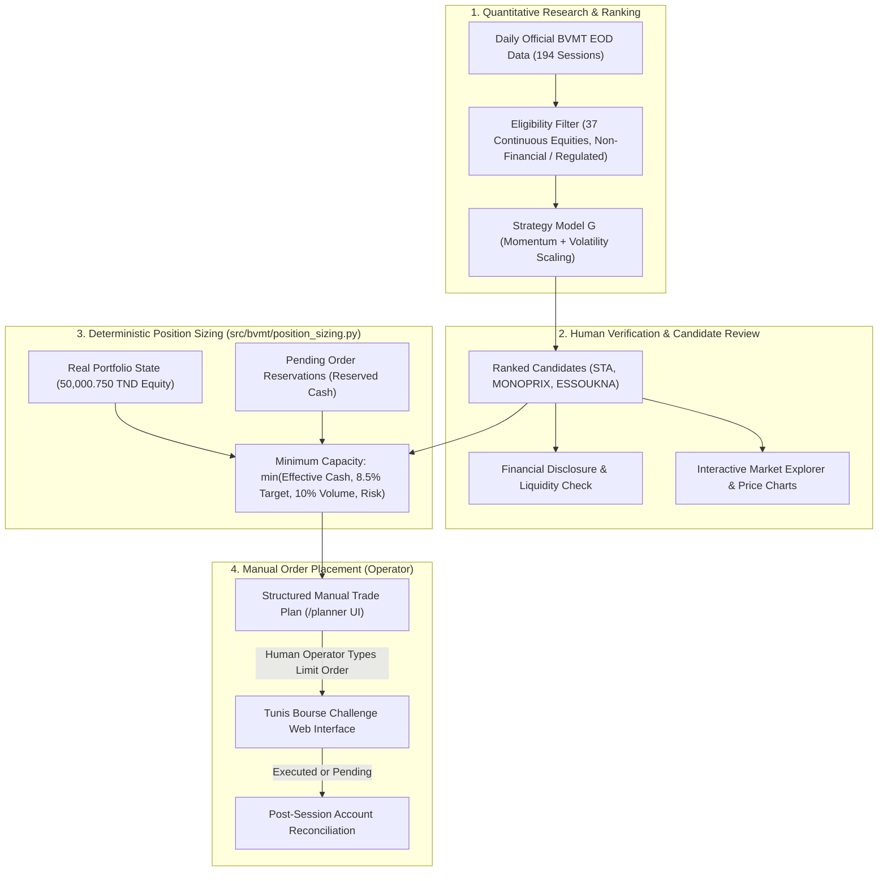
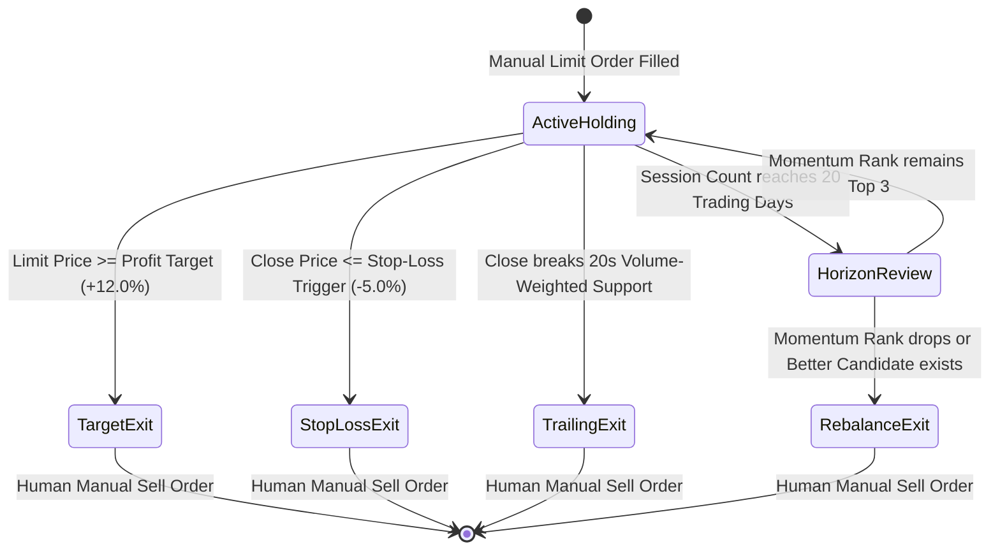

# BVMT Trading Intelligence — Trade Planning Guide

## 1. System Philosophy: Decision Support, Not Automated Execution

The BVMT Trading Intelligence platform operates strictly as a **100% manual decision-support system**. Under the rules of the Tunis Bourse Virtual Challenge (`https://www.tunisbourse-challenge.com`), automated bot execution, web-form automation, or unsolicited API submission is disallowed.

Every trade recommendation generated by the quantitative research models (Strategy Lab models A through I) is classified as an **exploratory research candidate** until verified by a human analyst and structured through the **Trade Planning Engine** (`src/bvmt/trade_planner.py`).

---

## 2. Trade Planning Workflow

---

## 3. Order Plan Classification & Lifecycles

In the Trade Planner (`/planner`), every instrument is assigned to one of three categories:

1. **`MANUAL_ORDER_PLAN`**:
   - Meets all eligibility gates: continuous trading segment, traded $\ge 15$ of last 20 sessions, positive 20-session momentum, valid recent price.
   - Suggested quantity $\ge 1$ share and gross outlay $\ge 100\text{ TND}$.
   - Accompanied by exact limit price, fee breakdown, break-even threshold, and exit conditions.
2. **`PAPER_TRADE_CANDIDATE`**:
   - Strong research signal but binding portfolio constraint (e.g., maximum concentration reached in that stock, insufficient remaining cash, or low volume participation cap).
   - Logged into the forward paper-trading journal for out-of-sample forward tracking without capital risk.
3. **`RESEARCH_CANDIDATE`**:
   - Secondary momentum or fixing segment equities. Monitored for liquidity expansion or regime shifts.

---

## 4. Order Execution Rules for the BVMT Session

When manually placing orders on the competition platform, operators must adhere to exchange matching rules:

| Rule | Parameter | Application in Trade Planner |
| :--- | :--- | :--- |
| **Order Type** | **Limit Order Only** | Never use Market or At-the-Opening orders. Use the proposed $P_{\text{limit}}$ (last confirmed close or user-entered limit). |
| **Trading Mode** | **Continuous (09:00–14:15)** | Orders enter the central order book; continuous matching occurs between 10:00 and 14:00 Africa/Tunis. |
| **Order Validity** | **Good Till Cancelled / Session** | Orders remain in the book until filled or cancelled. Unfilled orders lock buying power as pending reservations. |
| **Static Threshold** | **$\pm 3.00\%$** | Maximum price move from previous session close before dynamic suspension halts trading. |
| **Round-Trip Fee** | **$0.50\%$ Buy + $0.50\%$ Sale** | Account for $1.00\%$ round-trip friction. Break-even requires $+1.01\%$ gain. |

---

## 5. Exit Management & Holding-Period Discipline

Every generated trade plan embeds pre-calculated exit criteria:

1. **Take-Profit Target ($+12.0\%$):** Limit sell placed when cumulative return reaches the expected target based on average historical multi-week swings.
2. **Stop-Loss Trigger ($-5.0\%$):** Capital preservation cutoff. If close price drops $5.0\%$ below execution price, the position is flagged for liquidation next session.
3. **Trailing Technical Exit:** Triggered if price closes below the 20-session rolling support level.
4. **Planned Holding Horizon (20 Trading Sessions):** Positions are held for approximately 4 calendar weeks (20 trading days). Day trading (1 session) is strictly prohibited as historical testing proves it incurs $16.8\%$ capital drag in transaction fees.

---

## 6. Real-Time Interactive Sizing in the Next.js UI

The `/planner` route provides an interactive calculator:
- **Instant Recalculation:** Adjust the Limit Price, Target Allocation %, or Max Risk Budget.
- **Pending Order Warnings:** If active pending buy orders exist, effective purchasing cash is automatically reduced to prevent order rejection by the exchange.
- **Copy-to-Clipboard:** Quick action buttons allow human traders to copy the exact Ticker, Quantity, and Limit Price into the Tunis Bourse Challenge order ticket without manual transcription errors.

