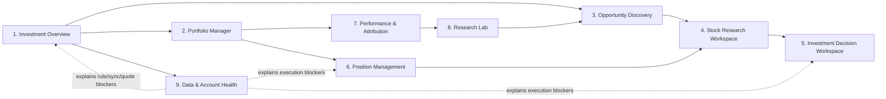

# BVMT Trading Intelligence V2 — Information Architecture

**Status**: Gate 1 UX Specification (`V2-UX1`)  
**Aligned Contracts**: `ADR-001..ADR-005` (`ARCHITECTURE_DECISIONS.md`)

---

## 1. Navigation Taxonomy Across the 9 V2 Destinations

The terminal organizes all 9 destinations into **three stable domain clusters** in the persistent left rail (desktop `1440px`) and collapsible top menu drawer + quick switcher (mobile `390px`).

| Cluster | # | Destination | Route | Primary `/api/v2/*` Endpoint | Core Focus |
|---|---|---|---|---|---|
| **Portfolio & Supervision** | **1** | **Investment Overview** | `/` | `GET /api/v2/overview?mode=...` | Account truth comparison, cash drag, review priorities, holdings pulse |
| | **2** | **Portfolio Manager** | `/portfolio` | `GET /api/v2/portfolio?mode=...` | Holdings table, sector/issuer weights, account conflict banner, thesis/horizon columns, orders & transactions |
| | **6** | **Position Management** | `/positions/[instrument_id]` | `GET /api/v2/positions/{id}?mode=...` `POST /api/v2/positions/sell-scenario` `POST /api/v2/positions/protection-scenario` | Monitoring state (`HOLD`/`REVIEW`/`CONSIDER_TRIM`/`CONSIDER_EXIT`/`INSUFFICIENT_DATA`) vs `EXECUTION_BLOCKED`, protection scenario, manual partial sale calculator |
| **Research & Decisions** | **3** | **Opportunity Discovery** | `/discovery` | `GET /api/v2/discovery?mode=...&universe=...&horizon=...` | Track-isolated screener (`TUNIS_BOURSE_CHALLENGE` 42 vs `FULL_BVMT_RESEARCH` 76), 5 horizons, coverage & liquidity gates |
| | **4** | **Stock Research Workspace** | `/stocks/[instrument_id]` | `GET /api/v2/stocks/{id}?mode=...&horizon=...` | Persistent issuer identity, EOD chart, L1–L9 evidence panels, contradictions, 10-field provenance register |
| | **5** | **Investment Decision Workspace** | `/decisions` | `POST /api/v2/decisions/buy-scenario` | Structured `InvestmentThesis`, L1–L10 pre-trade review, manual BUY impact simulator (`is_executed=False`) |
| **Evaluation & Integrity** | **7** | **Performance & Attribution** | `/attribution` | `GET /api/v2/attribution?mode=...` | Nov 7–18 trajectory, cash drag, per-stock attribution, realized vs unrealized + unexplained residual (`+235.680 TND`), benchmark comparison |
| | **8** | **Research Lab** | `/research-lab` | `GET /api/v2/research-lab?mode=...` | Strategy families (`A–J`), walk-forward folds, `top1_excluded_return_pct`, `SignalJournal`, promotion gates |
| | **9** | **Data & Account Health** | `/health` | `GET /api/v2/health?mode=...` | Rule blockers (`72`), equity-only manifest (`76`/`496`), sync conflict audit, `BVMT_ALLOW_LIVE_LLM=0` |

> **Persistent Global Context Bar (Top Header)**: Carries `mode` (`REAL_COMPETITION` | `SYNTHETIC_DEMO`), `dataset_cutoff` (`2026-11-18 EOD`), `universe` indicator, and `account_truth_state` (`CONFLICTED` / `UNVERIFIED` / `VERIFIED`). Context is never silently inferred from free-text ticker search or URL fragments.

---

## 2. Cross-Destination Workflow Map

---

## 3. Progressive Disclosure Hierarchy (3-Tier Model)

Every dense workspace applies strict 3-tier progressive disclosure so first-time scanning stays calm while full institutional auditability remains one click away:

| Tier | Surface | What Is Shown Immediately | What Stays Deferred |
|---|---|---|---|
| **Tier 1: Decision Surface** | KPI strip, summary banner, table row | Headline value (`Decimal`), unit (`TND`/`%`), `ValueStatus` pill (`OBSERVED`/`CALCULATED`/`SIMULATED`/`UNVERIFIED`/`UNAVAILABLE`), plain-language state badge (`REVIEW`), primary blocker | Underlying formulas, raw timestamps, SHA-256 hashes |
| **Tier 2: Structured Evidence & Scenarios** | Expandable L1–L9 panels, Scenario Calculators, Attribution Breakdown | Supporting/contradicting/missing evidence items, 10% concentration math, 10% ADV exit days, fee breakdown (`0.50%`), post-trade weights | Raw ingestion rejection logs, per-session CSV provenance |
| **Tier 3: Audit & Provenance Register** | Collapsible drawer / `Provenance Register` tab / `/health` | 10-field `PriceProvenance` (`event_time`, `exchange_session`, `source_publication_time=None`, `first_observed_at`, `retrieved_at`, `ingested_at`, `validated_at`, `source_id`, `source_hash`, `data_quality_status`), snapshot IDs, `72` rule blockers | Non-interactive archive logs |

---

## 4. Operational States (Empty, Loading, Error, Blocked, Sandbox)

All 9 destinations must explicitly handle these 7 operational states without hiding gaps or faking zeros:

| Operational State | Trigger | UI Treatment | Data / Numeric Treatment |
|---|---|---|---|
| **1. Loading / Skeleton** | Initial `/api/v2/*` fetch | Calm `#F1F5F9` rectangular shimmer placeholders matching exact card/table heights; no layout shift | Never display `0.000 TND` during loading |
| **2. Empty Universe / Empty Search** | Filter yields 0 instruments or 0 transactions | Dedicated bordered empty panel explaining *why* (`0 equities match filter` or `0 verified transactions imported`) + single reset/import-guidance action | No synthetic rows or placeholder tickers |
| **3. API / Local Source Error** | Backend `500` / unreachable `127.0.0.1` | Inline `#FEF2F2` border alert with exact error code and retry button; retains last timestamp only if explicitly labeled `CACHED STALE` | Never silently fall back to `SYNTHETIC_DEMO` |
| **4. Stale / EOD-Only Market Data** | `current_executable_quote_tnd` is `UNAVAILABLE` | Explicit `2026-11-18 EOD · NOT LIVE` pill in header and price panels; zero pulsing indicators | `current_executable_quote_tnd` renders `UNAVAILABLE` (`missing_reason`) |
| **5. Account Reconciliation Conflict** | Out-of-order ledger vs newer capture (`2026-11-10` vs `2026-11-12` `ext_1794476128406`) or unverified screenshot | Persistent amber conflict banner on Overview, Portfolio, and Position Management comparing snapshots side-by-side (read-only) | Never auto-merge snapshots; `Pending Orders` = `UNVERIFIED` |
| **6. Execution Blocked (`EXECUTION_BLOCKED`)** | Any rule blocker (`72`), missing quote, or snapshot conflict | Decoupled `EXECUTION_BLOCKED` badge next to monitoring state; calculator remains usable for **dry-run scenario inspection** with `is_executed=False` | Zero order-submission buttons; clear ordered list of blocking reasons |
| **7. `SYNTHETIC_DEMO` Sandbox Mode** | `mode=SYNTHETIC_DEMO` selected | Persistent top ribbon (`SYNTHETIC DEMO MODE — ILLUSTRATIVE FIXTURES ONLY`); teal/slate badge isolation | Fixtures carry `SIMULATED` provenance; zero overlap with real ledger |
